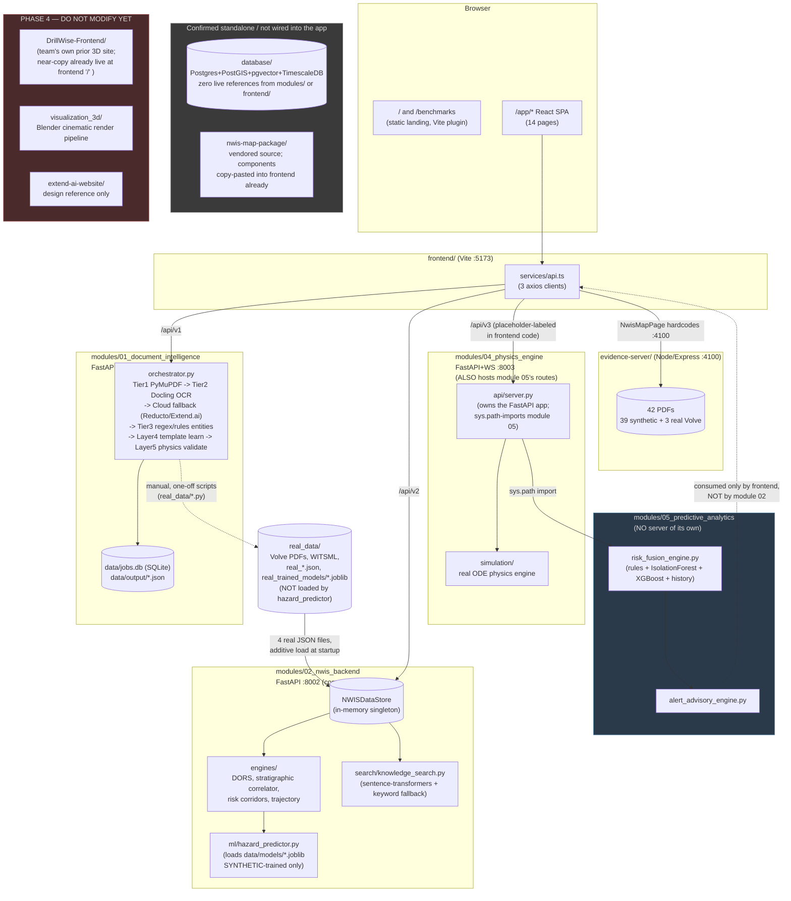

# Codebase Map — Forensic, Read-Only Audit

**Date:** 2026-10-03
**Method:** Built from direct source inspection, import/dependency tracing, file-existence checks, hash comparisons, and (for one claim) actually executing a documented command to verify it. Not derived from README/comment claims taken at face value — every claim below is cited `file:line` or marked `UNVERIFIED` with what would resolve it. Nothing in the repository was modified to produce this report.

**Scope note:** This is a snapshot of what exists and how it connects, not a judgment of quality. Phase-4 items (the independent 3D work) are inventoried but explicitly **not** evaluated for integration — see §10.

---

## 1. Repository Structure

```
PS121/
├── frontend/                   # REAL — React/TS SPA + static landing page (the actual dashboard)
├── modules/
│   ├── 01_document_intelligence/   # REAL — OCR/NLP extraction, FastAPI :8001
│   ├── 02_nwis_backend/            # REAL — DORS/correlation/search/risk/alerts, FastAPI :8012 (default 8002)
│   ├── 04_physics_engine/          # REAL — physics digital twin + ML data pipeline, FastAPI+WS :8003
│   └── 05_predictive_analytics/    # REAL — risk fusion/ML/alerts; NO standalone server (imported by 04)
├── database/                   # REAL, STANDALONE/UNWIRED — Postgres/PostGIS/pgvector/TimescaleDB schema
├── real_data/                  # REAL — Equinor Volve source PDFs/WITSML + extraction scripts + JSON outputs
├── nwis-map-package/            # STANDALONE-BUT-RUNNABLE-PROTOTYPE — vendored source, superseded as a live dependency
├── evidence-server/             # LIVE-INTEGRATED — auxiliary Node/Express PDF server for the real app
├── logger/                      # REFERENCE — the project's own running build log + prior audits (00–11)
├── research/                    # REFERENCE ONLY — domain research corpus; competitor_repos/ is empty
├── DrillWise-Frontend/          # PHASE 4 — standalone 3D/web marketing site (team's own prior site, being adapted later)
├── visualization_3d/            # PHASE 4 — Blender-based cinematic render assets, unrelated tooling
├── extend-ai-website/           # PHASE 4 / REFERENCE — design-reference site, unwired
├── _pdf_tmp/, *.pdf, *.log, generate_*.py  # Generated documentation + scratch output + stale dev logs (root clutter, not app code)
└── AUDIT/                       # This report
```

Full 837-path tree captured during this audit; only directories with runtime significance are expanded below.

---

## 2. Application Candidates

| Candidate | Verdict | Basis |
|---|---|---|
| `frontend/` | **THE real frontend** | Only frontend wired to all three real backends; has routing, 14 pages, build output |
| `modules/01,02,04` | **Real backends, independently runnable** | Each has its own `run_server.py`, confirmed routes, confirmed data flow |
| `modules/05` | **Real code, no server of its own** | Imported into module 04's process (see §4, §9) |
| `nwis-map-package/` | Standalone prototype, vendored-then-superseded | Own README calls itself "the file to copy from"; 1 git commit; nothing in `frontend/` calls its dev server |
| `evidence-server/` | Real auxiliary service, actually used | `NwisMapPage.tsx` hardcodes its URL; root `evidence_server.log` proves it was run and consumed |
| `database/` | Real, fully built, **not consumed by anything** | Confirmed zero imports from modules/frontend (§6) |
| `DrillWise-Frontend/` | Phase 4 — the team's own prior site | Confirmed out of scope per user; do not modify |
| `visualization_3d/` | Phase 4 — Blender pitch-deck assets | Self-documented as not touching `modules/`/`frontend/` |
| `extend-ai-website/` | Reference only | No code anywhere imports or serves it |

---

## 3. Actual Frontend(s)

**`frontend/`** — Vite + React 18 + TypeScript + React Router + Tailwind.

- Entry: `frontend/src/main.tsx` → `App.tsx` → `AppProvider` → `BrowserRouter` → `Sidebar`+`Header`+`RoutedContent`.
- **Route table** (`frontend/src/App.tsx:30-46`), all under `/app` (root `/` is intercepted before React Router ever sees it — see §9):

| Path | Component |
|---|---|
| `/app` | DashboardPage |
| `/app/command-center` | CommandCenterPage |
| `/app/drilling` | LiveDrillingPage |
| `/app/wells` | NearbyWellsPage |
| `/app/offset-map` | NwisMapPage |
| `/app/correlation` | GeologicalCorrelationPage |
| `/app/risk` | RiskPredictionPage |
| `/app/alerts` | AlertsAdvisoryPage |
| `/app/knowledge` | HistoricalIntelligencePage |
| `/app/copilot` | CopilotPage |
| `/app/documents` | DocumentIngestionPage |
| `/app/simulator` | SimulatorPage |
| `/app/reports` | ReportsAnalyticsPage |
| `/app/status` | SystemStatusPage |
| `*` | → redirect to `/app` |

- **Known bug**: `DashboardPage.tsx:155,174,228,274,335` links to `/alerts`, `/correlation`, `/wells`, `/drilling`, `/risk` — missing the `/app` prefix — so clicking them falls through the catch-all and redirects to `/app` instead of the intended page. UNVERIFIED as intentional; nothing explains it. Confirm by clicking in a running browser.
- Secondary "landing" static site mounted separately — see §9.
- Build output `frontend/dist/` exists, looks like a genuine Vite/Rollup build (hashed chunk names, correct lazy-split chunks matching source `lazy()` calls), but is **stale relative to current `src/`** (src files ~4 min newer than dist at inspection time — low-impact gap, re-run `npm run build` before relying on it).
- No test files exist anywhere under `frontend/` (`*.test.ts*`/`*.spec.ts*` — zero matches repo-wide for the frontend).

---

## 4. Actual Backend(s)

| Module | Port (default) | Entry point | Status |
|---|---|---|---|
| `modules/01_document_intelligence` | 8001 | `run_server.py` → `api.server:app` | Real, runnable, verified against real PDFs |
| `modules/02_nwis_backend` | 8002 (commonly run on 8012 — orphaned-socket issue, see logger) | `run_server.py` → `server:app` | Real, runnable, the system's core engine |
| `modules/04_physics_engine` | 8003 | `run_server.py` → `api.server:app` | Real, runnable — **and this is also where module 05's API actually lives** |
| `modules/05_predictive_analytics` | — (no server) | n/a | Real code, imported into module 04's process via `sys.path` manipulation |

**README correction (verified, not assumed):** the root README and module 04's own README describe module 04 as having "no standalone server; imported by module 05's API." This is backwards. A subagent in this audit **actually ran** the exact documented launch command:

```
cd modules/04_physics_engine/api && python -m modules.04_physics_engine.run_server
```

Result: `ModuleNotFoundError: No module named 'modules'` — **confirmed broken as documented**. The same command run from the **repository root** does work (Python's namespace-package resolution needs `modules` reachable from `sys.path[0]`, i.e. cwd = repo root). Separately, `modules/04_physics_engine/api/server.py` is the file that actually constructs the single `FastAPI()` app, defines every `/api/v3/...` route and the WebSocket, and does a `sys.path` insert to import `predictive.realtime_inference` **from module 05 into itself** (`api/server.py:62-70`) — i.e., module 04 imports module 05, not the reverse. Module 05 has no `api/`, no `run_server.py`, no FastAPI `app` anywhere in its tree — confirmed by directory listing.

### 4.1 Module 01 — Document Intelligence (port 8001)
- CORS defaults: `localhost:5173/3000`, `127.0.0.1:5173`.
- Routers under `/api/v1`: `ingest`, `status` (jobs), `results`, `review`; `/`, `/health`, `/templates` are public.
- Job persistence: **real SQLite** (`data/jobs.db`, confirmed 65,536 bytes / 84 real historical job rows on this checkout, not a placeholder).
- Pipeline (`pipeline/orchestrator.py`): Tier 1 native (PyMuPDF) → scanned-page check → Tier 2 OCR (Docling, confirmed via import, not Tesseract) → cloud fallback (Reducto/Extend.ai, real HTTP calls via `httpx`, but inert unless API keys are set) → Tier 3 entity extraction (**confirmed regex/keyword-based, zero ML/NER** — directly verified from imports; the prior audit's correction stands) → Layer 4 template learning → Layer 5 physics validation → manual-review escalation → JSON saved to `data/output/`.
- Auth: shared `X-API-Key`, off by default if `NWIS_API_KEY` unset, auto-generated by `run_server.py` on first run.
- **This checkout's `.env` currently holds live-looking values** for `NWIS_API_KEY`, `NWIS_REDUCTO_API_KEY`, `NWIS_EXTEND_API_KEY` — meaning auth and cloud fallback are **actually enabled/configured** here, not just inert documented defaults. (Not tested against live services in this audit — observation only.)

### 4.2 Module 02 — NWIS Backend (port 8002/8012)
- CORS: same defaults as module 01, extendable via `NWIS_CORS_ORIGINS`.
- Startup pre-warms the sentence-transformer embedding model in the background (recent uncommitted change, `server.py`) to avoid a 60–120s stall on the first live search.
- 20 routes under `/api/v2` (wells, trajectory, formations, casing, events/search, telemetry, stratigraphic depth track, offset rank, analyze, corridors, ahead-of-bit, map/wells, live/replay-SSE) — full inventory in §7.
- In-memory `NWISDataStore` loads **both** the synthetic Assam-Arakan testbed (12 wells, 39 events, 3,600 telemetry records for one well) **and**, additively, real Volve data from `real_data/*.json` (2 real wells, real casing/formations/events/trajectories) — **confirmed live-wired**, not aspirational (see §12).
- ML: `hazard_predictor.py` loads `.joblib` models from `modules/02_nwis_backend/data/models/` **only** — never from `real_data/real_trained_models/`. Falls back to a heuristic scorer per-hazard when no model file exists for that hazard type (4 of 7 hazard types have no trained model at all, by design — too few real positive samples).
- Knowledge search: real sentence-transformer semantic search with automatic keyword fallback if the model fails to load; the API always discloses which mode ran (`search_mode`).
- Auth: same shared-API-key + rate-limit pattern as module 01.

### 4.3 Module 04 — Physics Engine (port 8003)
- Genuinely equation-driven simulation (confirmed via direct code inspection, not docstring claims): real ODE integration (Euler depth stepping, 2nd-order spring-damper torsional dynamics sub-stepped at 20ms), Darcy-like influx/loss physics, Fanning-type hydraulic friction, Jordan-Shirley d-exponent — not decorative.
- **A second, fully-built control path exists (`PhysicsController`/`LiveTelemetryStreamer`) that the live server does not use** — only exercised by `tests/test_physics_and_pipeline.py`. Dead in production, alive in tests.
- `data_pipeline/synthetic_generator.py` is used for module 04's own dataset-report/testing — **not** wired as module 05's live training-data source (no training invocation found anywhere).
- 13 substantive physics-behavior tests exist and pass real assertions (not trivial).

### 4.4 Module 05 — Predictive Analytics (no server)
- `risk_fusion_engine.py` fuses 4 pillars (rules 0.35, anomaly 0.20, ML 0.30, historical 0.15) with deliberate weight-redistribution when the ML pillar is unfitted.
- Isolation Forest (`anomaly_detector.py`) and XGBoost (`xgboost_classifier.py`) are real library usage, but **no trained model files exist on disk** in this checkout (`predictive/data/models/` doesn't even exist) — both run in unfitted/fallback mode, **honestly self-reported** via `/api/v3/predictive/models` → `"UNFITTED_FALLBACK"`.
- `alert_advisory_engine.py` output is consumed **only by the frontend** (`AlertsAdvisoryPage.tsx` via the module-03 axios client) — **module 02 has zero awareness of it**, despite the README's outcome-mapping table implying a connection.
- 2 substantive test files (19 test functions total), real assertions, no trivial boilerplate.

---

## 5. Actual Data/ML Pipeline

- **Document extraction** (module 01): real 6-layer pipeline, verified against 14 real Equinor Volve PDFs + synthetic fixtures. Confirmed regex/rules, not ML/NER.
- **Trajectory/stratigraphic math** (module 02 `engines/`): real minimum-curvature survey math (ported, documented), real TVD/formation-depth normalization.
- **Hazard ML** (module 02 `ml/`): `LogisticRegression` per hazard type, trained only where ≥8 positive samples exist (3 of 7 hazard types qualify on synthetic data; 2 have a real-Volve-trained counterpart that is **not loaded at runtime** — see §12).
- **Physics-based synthetic data** (module 04 `data_pipeline/`): real feature engineering, multi-horizon causality-preserving labeling, well-level train/val/test splitting (leakage-safe) — built and tested, but not wired into a live training loop for module 05's models in this checkout.
- **Risk fusion** (module 05): real multi-pillar fusion logic; running on 2 of 4 pillars effectively disabled (no trained ML artifacts) with transparent fallback.

---

## 6. Database/Storage Layer

**`database/`** — PostgreSQL 16 + PostGIS + pgvector (built from source, v0.7.4) + TimescaleDB, via Docker (`docker-compose.yml`, host port 5433). Schema (`schema.sql`, 504 lines) is a genuine 3-tier PPDM/WITSML/OSDU-aligned design (master/reference → work-product → derived/own-IP), including a `pgvector` HNSW index sized for `all-MiniLM-L6-v2` (384-dim) embeddings.

`migrate_seed.py` is a real, working one-way loader — connects to a real Postgres instance, loads the synthetic testbed, generates real embeddings — **verified working end-to-end once** (2026-09-28, per `database/README.md`), not an ongoing pipeline.

**Confirmed via exhaustive grep (not assumed): zero references to `psycopg`/`sqlalchemy`/`asyncpg`/`migrate_seed`/`database/schema.sql` anywhere in `modules/` or `frontend/`.** The handful of "postgres" hits in module code are comments about *future* work, never a live import. **The root README's claim that this layer is "not yet wired into modules 01/02's live storage" is directly confirmed, not just repeated.**

`database/_archived_prior_design/` is correctly named and inert — an earlier, different-schema design explicitly superseded, confirmed unreferenced by any current code.

In-memory storage actually used at runtime: module 01's SQLite job store; module 02's singleton `NWISDataStore` (Python objects in process memory, loaded from JSON at startup).

---

## 7. API Inventory

### Module 01 (`/api/v1`, port 8001)
`POST /ingest` · `GET /jobs/{id}` · `GET /jobs` · `GET /results/{doc_id}` (+`/events`,`/formations`,`/npt`,`/benchmark`) · `GET /results` · `GET /documents/{doc_id}/file` · `GET /review/queue` · `GET /review/{doc_id}` · `POST /review/{doc_id}/decision` · `POST /review/{doc_id}/annotate` · `GET /templates` (public) · `GET /health` (public) · `GET /` (public)

### Module 02 (`/api/v2`, port 8002/8012)
`GET /health` (public) · `GET /` (public) · `GET /wells` · `GET /wells/{id}` · `GET /trajectory/{id}` · `GET /formations/{id}` · `GET /formations` · `GET /casing/{id}` · `GET /casing` · `GET /events/search` · `GET /events/{id}` · `GET /events` · `GET /telemetry/{id}` · `GET /stratigraphic_depth_track/{id}` · `GET /offset_rank/{id}` · `GET /analyze/{id}` · `GET /corridors/{id}` · `GET /ahead_of_bit/{id}` · `GET /map/wells` · `GET /live/replay/{id}` (SSE)

### Module 04 (hosts module 05 too) (`/api/v3`, port 8003)
`GET /physics/status` · `POST /start,/pause,/step,/reset,/speed,/scenario` · `DELETE /scenario` · `POST /operator-inputs` · `GET /historian` · `WS /physics/stream` (no auth — browser `EventSource`/WS header limitation) · `POST /predictive/evaluate` · `GET /predictive/alerts/{id}` · `POST /predictive/alerts/mitigate` · `GET /predictive/models` · `GET /health`, `/api/v3/health` (public)

All three backends use the same pattern: shared `X-API-Key` header auth (off by default if unset, auto-generated on first `run_server.py` run), sliding-window in-process rate limiting, sanitized global exception handler.

---

## 8. Frontend → Backend Connection Map

`frontend/src/services/api.ts` — three axios clients:

| Client | Env var (default) | Actual `.env` on this checkout | API prefix |
|---|---|---|---|
| `m01` | `VITE_M01_API_BASE` (`:8001`) | **`:8011`** ⚠️ | `/api/v1` |
| `m02` | `VITE_M02_API_BASE` (`:8002` per `.env.example`, `:8012` per code default) | `:8012` | `/api/v2` |
| `m03` | `VITE_M03_API_BASE` (`:8003`) | `:8003` | `/api/v3` |

**⚠️ Flagged discrepancy (real, not cosmetic):** the live `frontend/.env` sets `VITE_M01_API_BASE=http://localhost:8011`, while module 01's own default port, its `.env.example`, and every in-code comment assume **8001**. If module 01 is actually started on 8001 (its documented default), every module-01 call from the frontend as currently configured will fail. Resolve by checking which port module 01 is actually bound to in practice, then aligning one side.

Each page's data source was traced individually (not assumed from its name):

- **Fully real, live-fetched**: CommandCenterPage, NearbyWellsPage, NwisMapPage, GeologicalCorrelationPage, HistoricalIntelligencePage, CopilotPage, DocumentIngestionPage, ReportsAnalyticsPage, SystemStatusPage.
- **Partially real / partially placeholder**: DashboardPage (real DORS/correlation calls; module 01/02 health dots are **hardcoded green**, not actually checked — contrast with `BackendStatusStrip.tsx` which does check); LiveDrillingPage (real trajectory/formations; telemetry/sim bound to module 03, which is a documented placeholder).
- **Entirely dependent on the non-existent module-03 live backend** (will show static fallback data until a real module-03/05 server is reachable at `:8003`, which it is not in a typical checkout — no trained models, but the server itself does run): SimulatorPage, AlertsAdvisoryPage, parts of DashboardPage.
- **Explicitly hardcoded/illustrative and labeled as such in the UI**: RiskPredictionPage's `featureImportances` array and ROC-AUC/latency figures — header comment states a prior benchmark report with similar numbers was found to contain **fabricated metrics** and was deliberately not reused.

Evidence PDFs: `NwisMapPage.tsx` hardcodes `http://localhost:4100/evidence` → served by the standalone **`evidence-server/`** Node process (not part of `frontend/`, must be started separately; confirmed actually run via root `evidence_server.log`).

---

## 9. Runtime/Deployment Map

Each service is started independently, no orchestration/docker-compose ties them together except `database/` (which is isolated anyway):

```
frontend (vite dev :5173)         → modules/01 (:8001 documented / :8011 per .env ⚠️)
                                   → modules/02 (:8002 documented / :8012 actual)
                                   → modules/04 (:8003, also serves module 05's routes)
                                   → evidence-server (:4100, manual Node process)
database (docker compose :5433)   → isolated, nothing connects to it
nwis-map-package (:5180 vite / :4000 express)  → standalone, not started by anything above
```

`frontend/vite.config.ts` has a custom plugin (`landingPageAtRoot`) that intercepts exactly two literal paths before Vite's normal handling: `"/"` → serves `public/landing/index.html`, `"/benchmarks"` → serves `public/landing/benchmarks.html`. Everything else, including all of `/app/*`, falls through to the React SPA. This is why the React Router table in §3 has no `"/"` entry.

---

## 10. 3D Frontend Inventory — PHASE 4, DO NOT MODIFY YET

Three distinct 3D/visual items exist; they are **not the same thing** and have different provenance:

1. **`DrillWise-Frontend/`** (repo root) — standalone static site (`python -m http.server`, no backend), containing a GLB 3D model (`assets/3d-models/well-digital-twin.glb`), fonts, and a full marketing page. This is the **team's own previously-built site** (per the user, built earlier and intended for adaptation into this project later) — not a third-party clone requiring attribution action. A near-identical copy of this package is already live as the static splash at `/` (`frontend/public/landing/`), wired via the Vite plugin in §9, lightly text-edited (e.g. "Physics + Agentic AI" → "Physics + Applied ML"). **PHASE 4 — do not touch, per explicit user instruction.**
2. **`visualization_3d/`** — Blender-based cinematic render pipeline (3-scene Earth → Assam terrain → underground wellbore sequence), driven by `scripts/blender_client.py` talking to a local `blender-mcp` TCP socket. Self-documented in its own `IMPLEMENTATION_PLAN.md` as "a standalone visual asset for presentation/demo purposes — it does not modify any of the actual NWIS application code." **Unbuilt-into-app by design; genuinely separate from item 1.**
3. **`extend-ai-website/`** — another cloned/reference web template (has both `index.html` and `index-original.html`), used as design reference only; not served or imported by any live code.
4. **Frontend's own in-app 3D components** (`frontend/src/components/{LiveDrillingScene3D,WellTrajectory3D,WellInspector3DModal,WellCutawayCockpit}.tsx`) are a **separate, fourth thing** — react-three-fiber components **already wired into live routes** (`/app/drilling`, `/app/wells`). These are part of the real application, not Phase-4 material, and were not touched or flagged for removal.

---

## 11. Asset Inventory

- **3D/GLB**: one GLB file (`DrillWise-Frontend/assets/3d-models/well-digital-twin.glb`, duplicated into `frontend/public/landing/assets/3d-models/`); Blender scene files (`visualization_3d/scripts/scene1_earth.blend[1]`) and their rendered PNG/MP4 outputs.
- **Fonts/images/CSS**: `DrillWise-Frontend/assets/` and its near-duplicate `frontend/public/landing/assets/` (fonts, editorial CSS, hero images) — same source, two locations (one vendored original, one live-served copy).
- **Brand assets actually used by the real app**: `frontend/public/brand/` (DrillWise logo marks) and `frontend/public/icons.svg` — genuinely referenced by the React app's own UI chrome.
- **PDF evidence sets**: `evidence-server/pdfs/` (42 files: 39 synthetic DDRs + 3 real Volve) is the one actually served to the live app; `nwis-map-package/server/pdfs/` (39 files, synthetic only) is the vendored original, not served to the live app.
- **Generated documentation assets**: `_pdf_tmp/*.png` (diagrams for the root-level PDF generator scripts), not application assets.

---

## 12. Dataset Inventory

| Dataset | Location | Real or synthetic | Consumed by |
|---|---|---|---|
| Assam-Arakan synthetic testbed | `modules/02_nwis_backend/data/synthetic/` | Synthetic (seeded, deterministic) | Module 02's live default data (12 wells, 39 events, 3,600 telemetry records — module docstring's "15 wells" claim is stale; actual generator produces 12) |
| Equinor Volve real documents | `real_data/volve/*.pdf` (14 files) | **Real** (public Equinor dataset) | Source input to module 01's pipeline (manually run, not live-triggered) |
| Volve WITSML XML | `real_data/witsml/` (23 well/wellbore folders) | **Real** | `parse_witsml_trajectories.py` → `real_trajectories_witsml.json` → **live-loaded** by module 02's `data_store.py` |
| Real extraction outputs | `real_data/real_casing_records_all.json`, `real_formations_fresh.json`, `real_events_depth_tagged_fresh.json` | **Real**, but static/committed | **Live-loaded** by module 02 at every startup — additively merged with synthetic data (2 real wells queryable through the live API). Caveat: the scripts that originally generated these three specific files are not present in the current repo (only `real_trajectories_witsml.json` has a present-day regenerating script) — consumption is live, refresh is not a repeatable pipeline today. |
| "REAL"-trained hazard models | `real_data/real_trained_models/*.joblib` | **Real-data-trained** | **Not loaded by any live code** — confirmed by hash comparison; the live server always uses the synthetic-trained models in `modules/02_nwis_backend/data/models/` |
| Evidence PDFs | `evidence-server/pdfs/`, `nwis-map-package/server/pdfs/` | Mixed (mostly synthetic DDRs + a few real Volve) | Served over HTTP to the live NWIS map page (evidence-server only) |

---

## 13. Competitor/Reference Inventory

- **`research/competitor_repos/`** — confirmed **genuinely empty** (directory exists, zero contents). Planned but never populated; not a cleanup target, just unused.
- **`research/research/`** — a 70-file domain research corpus (competitor platform audits: SLB, Halliburton, Baker Hughes, Cognite, Weatherford, NOV, Peloton, Corva; standards; drilling physics; gap analyses). Pure reference material — confirmed not imported or served by any application code. No action needed; correctly segregated already.
- **`logger/`** — not a competitor repo, but worth noting here as the project's own authoritative running log and two prior audits (`10_PS26121_IMPLEMENTATION_AUDIT.md`, `11_NWIS_BACKEND_VISUALIZATION_READINESS_AUDIT.md`) that this report's findings are consistent with and build on, not duplicate.

---

## 14. Suspected Dead/Duplicate Code

| Item | Classification | Evidence |
|---|---|---|
| `modules/04_physics_engine`'s `PhysicsController`/`LiveTelemetryStreamer` | **Dead in production, alive in tests** | Live `api/server.py` instantiates `DrillingPhysicsEngine` directly and runs its own `_sim_loop()`; the controller/streamer classes are referenced only from `tests/test_physics_and_pipeline.py` |
| `nwis-map-package/` (the whole standalone package) | **Superseded as a dependency, kept as vendored source** | Its own README calls itself the "file to copy from"; its three core components were copy-pasted verbatim into `frontend/src/components/nwis-map/`; nothing in the live app points at its dev server (port 5180) or its own Express server (port 4000 default) |
| `recharts` (frontend dependency) | **Unused** | Declared in `package.json`; zero `import ... from 'recharts'` anywhere in `frontend/src` — `StripChart.tsx` is a hand-rolled SVG chart instead |
| `trajectory_engine.py`'s `calculate_minimum_curvature_trajectory`/`interpolate_trajectory_at_md` | **Unused at the higher-level-function granularity** (own docstring admits it) | Only the low-level math primitives (`compute_dogleg_angle`, `compute_ratio_factor`) are actually called by `stratigraphic_correlator.py`; the two higher-level functions are currently unused because test/synthetic data already arrives pre-computed |
| `real_data/real_trained_models/*.joblib` | **On-disk but never loaded** | See §12 — confirmed by hash comparison against the live-loaded models |
| `data/models/stuck_pipe_model_SYNTHETIC_BACKUP.joblib` | **Backup copy, byte-identical to the live model** | MD5-identical to `stuck_pipe_model.joblib` — a deliberate backup, not dead by accident, but worth knowing it's not a second distinct model |
| `DrillWise-Frontend/` vs `frontend/public/landing/` | **Duplicate asset trees** (not dead — one is served) | Near-identical content; the `frontend/public/landing/` copy is the one actually wired at `/` |

---

## 15. Hardcoded/Mock/Simulated Behavior

This codebase is unusually self-disclosing about this category — nearly every hit found was an explicit, accurate label rather than a concealment. Notable genuine instances, all independently verified:

- **DashboardPage.tsx** module 01/02 status dots — hardcoded green regardless of actual backend health (contrasted explicitly, in-code, with `BackendStatusStrip.tsx`'s real health check).
- **RiskPredictionPage.tsx** — `featureImportances` array and ROC-AUC/PR-AUC/lead-time/latency figures are hand-written constants, explicitly labeled "Illustrative — not measured" in the page's own header comment, which also states a prior report containing similar numbers was found to be **fabricated** and deliberately excluded.
- **SimulatorPage.tsx** — hardcoded numeric fallbacks (e.g. `|| 1.29`, `|| 2435`, `|| 242`) used only when live module-03 telemetry is null; a static label `"1st-Order Lag (α=0.7)"` presented without a confirmed live source.
- **Module 01's `/results/{doc_id}/benchmark` endpoint and `benchmarks/run_benchmark.py`** — both embed static, literature-sourced competitor accuracy/cost figures ("Reducto/LandingAI 98%", "Tesseract 80–88%") in the same table as genuinely computed metrics for the actual pipeline — not fabricated, but presented alongside real numbers in a way that could mislead a reader into thinking all columns are equally measured.
- **Module 02's synthetic testbed** — all telemetry/events/wells default data is openly, consistently self-labeled `SIMULATED_REPLAY`/synthetic throughout (JSON field values, module docstrings) — not disguised.
- **Module 04/05's unfitted ML models** — self-reported via a `"UNFITTED_FALLBACK"` API status, not silently degraded.
- **Live Replay (module 02 SSE endpoint)** — genuinely simulates bit-depth progression through real stored trajectory/event data via the real orchestrator; explicitly documented as not live rig telemetry.

No instance was found anywhere in modules 01, 02, 04, or 05 of mock/fake data standing in for missing production logic without a clear label — the one category that comes closest is the two documentation/presentation items above (Dashboard's hardcoded status dots, and the mixed-table benchmark comparisons), both now listed explicitly rather than left implicit.

---

## 16. Broken or Incomplete Integration Points

| Point | Status | Evidence |
|---|---|---|
| Module 04's documented launch command | **Verified broken** | Actually executed; raises `ModuleNotFoundError` exactly as documented, works only from repo root (undocumented) |
| README's module 04/05 server ownership claim | **Verified backwards** | Module 04's `api/server.py` owns the FastAPI app and imports module 05, not the reverse |
| `frontend/.env`'s `VITE_M01_API_BASE=:8011` vs. module 01's actual default `:8001` | **Unresolved discrepancy** | Would break every module-01 call from the frontend in this configuration unless module 01 is deliberately run on 8011 |
| Module 02 ↔ Module 05 | **Never integrated** | Module 02's `risk_corridor_engine.py` has its own independent risk logic; zero references to module 05's `alert_advisory_engine` anywhere in module 02 |
| `database/` ↔ modules 01/02 | **Never integrated** | Confirmed zero live references; a one-time-verified, disconnected layer |
| Browser `EventSource`/WebSocket vs. `X-API-Key` auth | **Documented, unresolved gap** | Module 02's SSE live-replay and module 04's WebSocket stream can't carry the custom auth header from a plain browser client; module 02's SSE caller in `api.ts` works around it with a manual fetch+stream reader, module 04's WS endpoint is simply unauthenticated |
| `real_data/real_trained_models/*.joblib` ↔ `hazard_predictor.py` | **Never integrated** | Confirmed by path-resolution logic and hash comparison |

---

## 17. Unknowns Requiring Runtime Verification

These are marked `UNVERIFIED` because static inspection cannot settle them — each needs the services actually running:

1. **Does module 01 actually run on 8001 or 8011 in practice?** Resolves the §8 discrepancy. (Check: start module 01, check its own startup log line for the bound port, compare to `frontend/.env`.)
2. **`DashboardPage.tsx`'s un-prefixed internal links** — does clicking them actually misroute to `/app`, or is there routing middleware not seen in `App.tsx` that handles it? (Check: click each link in a running browser.)
3. **`cloud_fallback.py`'s internal contradiction** — module docstring says "never tested against a live account," several inline comments say "confirmed against a live key." Which is current? (Check: git blame/history on those specific comments, or a live smoke test with a real Reducto/Extend.ai key.)
4. **`frontend/dist/`'s actual staleness** — the ~4-minute gap found may be an artifact of this investigation's own file-touch timestamps rather than real source drift. (Check: rebuild and diff output hashes against the committed/deployed dist, if one exists.)
5. **Provenance of `real_formations_fresh.json`/`real_events_depth_tagged_fresh.json`/`real_casing_records_all.json`** — the scripts that generated these three specific files are not present in the current repo. (Check: logger Steps 20-23/25, referenced in `data_store.py` comments, for the missing script or a description of how they were produced.)
6. **`realtime_inference.py`'s claimed "~15-25ms" latency** — no benchmark artifact found backing this docstring claim. (Check: run `test_realtime_inference_stream_latency` and inspect its actual measured numbers.)
7. **Whether `NWIS_PORT`/module 02's actual run port (8002 vs 8012) is consistently set via environment** in every launch script, or manually overridden each time. (Check: how the dev team actually starts module 02 day-to-day.)

---

## 18. Recommended Execution Order (for later phases — no changes made in this pass)

This section only sequences *investigation/verification/fix* priority; it does not propose redesigns.

1. **Resolve the module-01 port discrepancy** (`8001` vs `8011`) — cheapest fix, blocks a core data-flow path if wrong.
2. **Runtime-verify the full stack together** (all 3 backends + frontend + evidence-server) in a browser, confirming §16's integration points behave as this static audit predicts, before any functional change is made.
3. **Fix or re-document module 04's launch command** — currently broken exactly as written; either fix `README.md`'s instructions or add the missing `modules/__init__.py`/document the repo-root-only invocation.
4. **Decide the fate of the two parallel physics control paths** (live `_sim_loop()` vs. tested-but-unused `PhysicsController`) — a design decision, not urgent, but worth a conscious choice rather than accidental drift.
5. Everything else in this report (database wiring, real-model integration, module 02↔05 connection) is **pre-existing, known-scope work**, not a newly discovered emergency — prioritize per the hackathon's actual demo needs, not this audit's ordering.

Phase 4 (3D frontend adaptation) explicitly stays out of this sequence per current instructions.

---

## Architecture Diagram (from repository contents only)



---

*This report reflects the repository state at the time of investigation (2026-10-03). No files were modified, moved, or deleted to produce it.*
