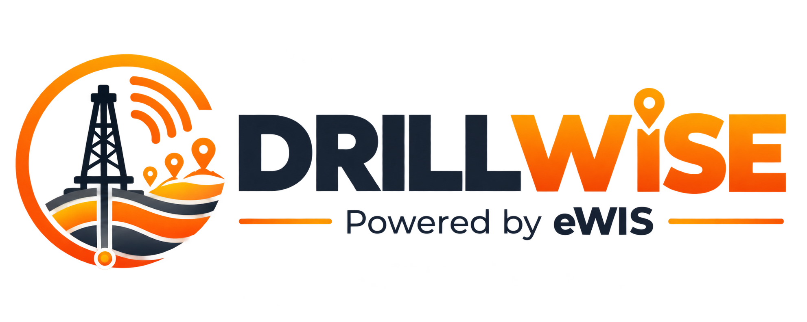
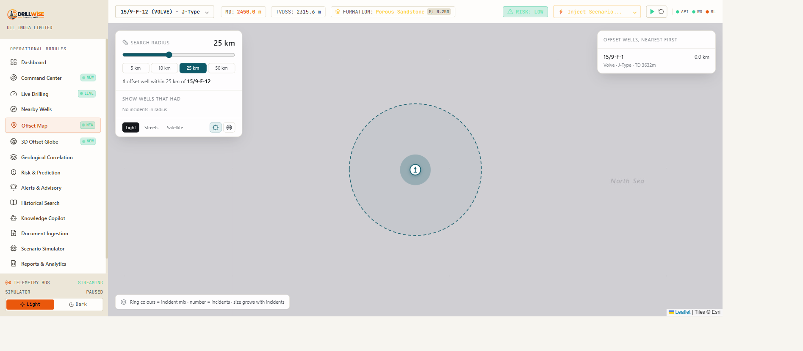
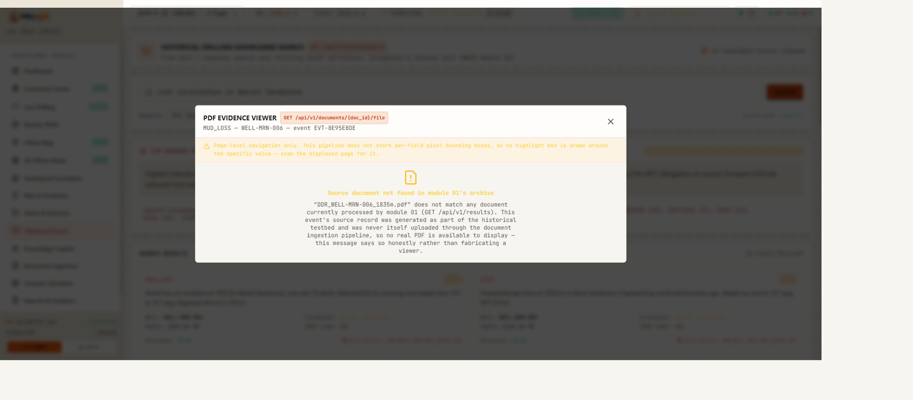
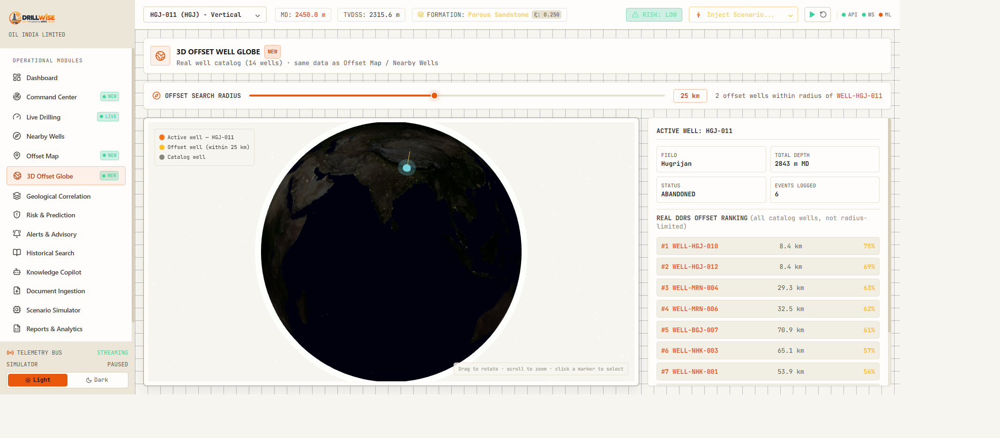
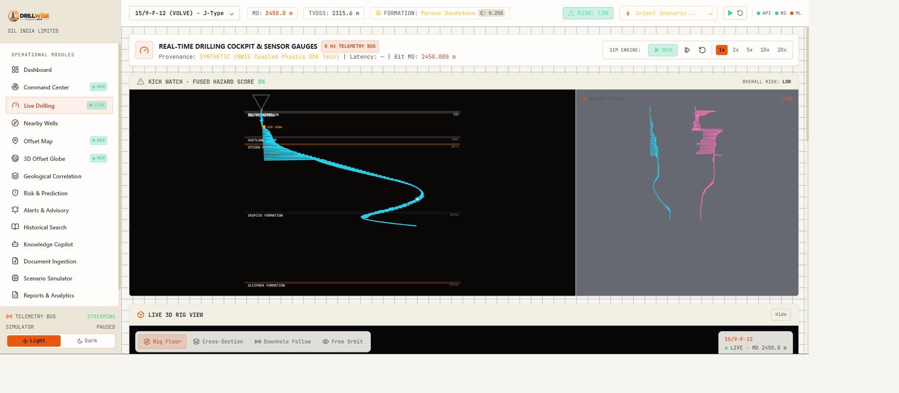
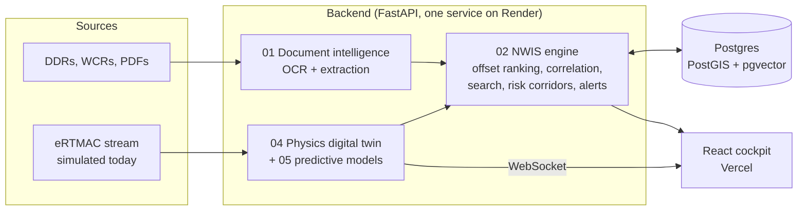

<div align="center">



### Nearby Wells Intelligence for drilling teams

**eRTMAC-NWIS · Smart India Hackathon 2026 · Problem Statement 26121 · Oil India Limited**

[**Live site**](https://drillwise-three.vercel.app) ·
[**Product story**](https://drillwise-three.vercel.app/story) ·
[**Open the app**](https://drillwise-three.vercel.app/app) ·
[**Docs**](https://drillwise-three.vercel.app/docs)


</div>

---

## Why this exists

Oil India's eRTMAC shows what is happening on the active well right now. What it can't show is what already happened in the wells around it: the mud losses, kicks and stuck pipe recorded in thousands of pages of daily drilling reports and well completion reports. Finding that history today means searching by hand, and depends on who remembers what.

**DrillWise** is a decision-support platform that sits next to eRTMAC and gives the field an institutional memory. It reads the historical reports, finds the offset wells that matter for the active well, lines them up by depth and formation, and warns the driller before the bit reaches a depth where trouble was seen before. Every alert links back to the report page it came from.

<div align="center">

<br/><sub>Command Center: the active well, ahead-of-bit risk and the offset evidence behind it.</sub>
</div>

## What it does, mapped to PS 26121

| # | The problem statement asks for | What DrillWise provides |
|---|---|---|
| i | AI, NLP and OCR extraction from historical reports | Document ingestion pipeline: native-text or OCR parsing, drilling-domain entity extraction, physics checks on every value, each event linked to its source page |
| ii | Map of nearby wells within a user-defined radius | 2D offset map and a 3D Cesium globe with a radius filter |
| iii | Searchable repository of events, lessons and mitigations | Historical search and an evidence-grounded Copilot |
| iv | Correlation by depth and formation | Stratigraphic correlation across offset wells |
| v | Predictive risk analytics | Risk-corridor engine, physics digital twin, rule engine and ML hazard models |
| vi | Real-time alerts and recommendations | Ahead-of-bit alerts with a recommendation, the evidence and a four-pillar confidence score |
| vii | A dashboard for field and office users | One React cockpit: dashboard, command center, live drilling, reports |

<table>
<tr>
<td width="50%"><br/><sub><b>Offset map</b>: wells within a chosen radius.</sub></td>
<td width="50%"><br/><sub><b>Nearby wells</b>: offset ranking with every component score shown.</sub></td>
</tr>
<tr>
<td width="50%"><br/><sub><b>Correlation</b>: wells aligned by formation and depth.</sub></td>
<td width="50%"><br/><sub><b>Knowledge search</b>: answers that cite their source documents.</sub></td>
</tr>
<tr>
<td width="50%"><br/><sub><b>3D globe</b>: the Upper Assam field on real terrain.</sub></td>
<td width="50%"><br/><sub><b>Live drilling</b>: the physics-simulated well in 3D.</sub></td>
</tr>
</table>

## The product story (`/story`)

A 74-second, eight-phase walkthrough that runs as the product's landing story: **problem** (the well, the buried history), **solution** (extract, map, rank, correlate, look ahead) and **outcome** (the alert the engineer acts on). It is rendered live in the browser with three.js over real data:

- **Terrain:** SRTM-based elevation and Sentinel-2 imagery of the Upper Assam basin, with the Himalaya and the Naga-Patkai ranges around it.
- **Wells and numbers:** the wells, formation tops, ranking and risk scores come from the NWIS backend's output for the demo scenario (well NHK-002 at 2,850 m).
- **Downhole:** the camera descends through NHK-002's real formation tops to the project's own bottom-hole-assembly model (PDC bit, steering unit, MWD).
- **Behaviour:** it adapts resolution to the device, has a Lite mode, and pauses itself and its music when the page isn't being watched.

`/film` is a separate, more dramatic cut of the same story.

## Architecture



| Layer | Stack | Hosted on |
|---|---|---|
| Frontend | React 18, Vite, TypeScript, Tailwind, three.js and React Three Fiber, Cesium, Leaflet | Vercel, `frontend/` |
| Backend | Python, FastAPI, scikit-learn and XGBoost, one process mounting modules 01, 02 and 04 | Render (Docker), `Backend/` + `modules/`, see `render.yaml` |
| Data | PostgreSQL with PostGIS and pgvector | Supabase, `database/schema.sql` |
| LLM | Gemini Flash-Lite, with a deterministic keyword-search fallback | Google AI |

## Repository guide

| Path | What's in it |
|---|---|
| `frontend/` | The React app (`/app`), the docs (`/docs`), the static landing page (`/`), `/story` and `/film` |
| `Backend/` | The unified FastAPI service that mounts the modules, plus its tests |
| `modules/01_document_intelligence/` | OCR and extraction pipeline |
| `modules/02_nwis_backend/` | Offset ranking (DORS), stratigraphic correlation, knowledge search, risk corridors and alerts |
| `modules/04_physics_engine/` | Drilling-physics digital twin and the `/api/v3` WebSocket |
| `modules/05_predictive_analytics/` | Rule engine and ML hazard fusion, served by module 04 |
| `database/` | Postgres schema and seed/migration scripts |
| `real_data/` | Public Equinor Volve documents and trajectories used for validation |
| `AUDIT/` | Audits, deployment guide and screenshot evidence |
| `docs/` | Project documentation |

The numbering under `modules/` follows deployable services, not the PS outcome numbers. The table above shows where each outcome lives.

## Run it locally

```bash
# Backend (unified service on :8000)
cd Backend
pip install -r requirements.txt
python run.py

# Frontend (:5173; /api and /ws are proxied to the backend)
cd frontend
npm ci
npm run dev
```

Then open <http://localhost:5173/app>, or <http://localhost:5173/story> for the product story. The full deployment walkthrough is in `AUDIT/16_DEPLOYMENT_GUIDE.md`.

Frontend environment variables (`frontend/.env`):

| Variable | Purpose |
|---|---|
| `VITE_API_BASE` | Backend origin, for example `https://<your-backend>.onrender.com` |
| `VITE_API_KEY` | API key sent to the backend. It ships in the browser bundle, so treat it as public. |

## What is real, and what is simulated

We keep this explicit so that every claim can be checked:

- **Real code, real output:** the offset ranking, correlation, search, risk engine and alerts. The pipeline has also been run on 14 real Equinor Volve field documents.
- **Synthetic:** the demo field's drilling events and daily drilling reports are a synthetic test set, labelled as such.
- **Simulated:** live rig telemetry is a physics simulation, not an eRTMAC feed.
- **Story visuals:** terrain height and depth are exaggerated 3× in `/story` so the relief reads. The rig is a representative model, not the actual NHK-002 site.

## Credits and licences

- Satellite imagery: [Sentinel-2 cloudless](https://s2maps.eu) by EOX IT Services GmbH (contains modified Copernicus Sentinel data 2016 and 2017), CC BY 4.0
- Elevation: AWS Terrain Tiles (Mapzen; sources include SRTM, NASA/USGS)
- Rig equipment models: 3dassets.dev, CC0. Rock textures: Poly Haven, CC0.
- Music in `/story`: 'Aphelion' by Scott Buckley ([www.scottbuckley.com.au](https://www.scottbuckley.com.au)), released under [CC BY 4.0](https://creativecommons.org/licenses/by/4.0/), edited for length
- Validation data: Equinor Volve field data set

---

<div align="center">


**Built by Laukik Rathod and team**
for Smart India Hackathon 2026 · PS 26121 · Oil India Limited

</div>
