<div align="center">


<h3>The offset-well memory that drills alongside you.</h3>

<p>
<b>eRTMAC-NWIS</b> · Nearby Wells Intelligence System<br/>
Smart India Hackathon 2026 · Problem Statement <b>26121</b> · Oil India Limited · Smart Automation
</p>

<p>
<a href="https://drillwise-three.vercel.app"><b>Watch the story</b></a> &nbsp;·&nbsp;
<a href="https://drillwise-three.vercel.app/app"><b>Open the app</b></a> &nbsp;·&nbsp;
<a href="https://drillwise-three.vercel.app/docs"><b>Read the docs</b></a> &nbsp;·&nbsp;
<a href="https://drillwise-three.vercel.app/film"><b>The film</b></a>
</p>

<p>


</p>

<a href="https://drillwise-three.vercel.app">
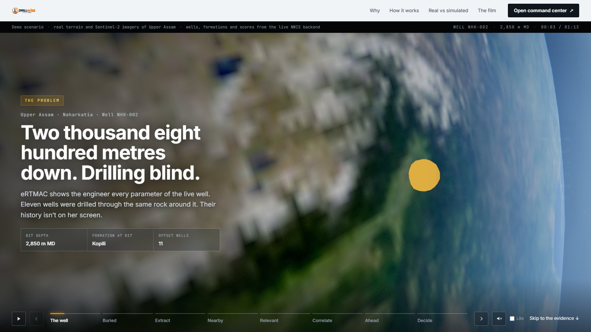
</a>
<sub>The landing page is a 74-second real-time 3D story. It opens on the Earth, falls through the atmosphere into the real Upper Assam basin, and follows one alert from the buried reports to the driller's screen.</sub>

</div>

---

## Contents

- [The problem](#the-problem)
- [What DrillWise does](#what-drillwise-does)
- [Mapped to PS 26121](#mapped-to-ps-26121)
- [The product story](#the-product-story)
- [Inside the app](#inside-the-app)
- [How it works](#how-it-works)
- [Architecture](#architecture)
- [API surface](#api-surface)
- [Run it locally](#run-it-locally)
- [Deploy](#deploy)
- [Repository map](#repository-map)
- [What is real, and what is simulated](#what-is-real-and-what-is-simulated)
- [Credits and licences](#credits-and-licences)
- [Team](#team)

---

## The problem

Oil India's **eRTMAC** shows the drilling engineer everything about the well being drilled right now. It doesn't show what happened in the wells drilled around it.

That history exists: kicks, mud losses, stuck pipe, casing and cementing problems, formation-by-formation. It is spread across **well completion reports, daily drilling reports, scanned PDFs and people's memory**. Finding the one relevant page takes hours, and it depends on who remembers what. Meanwhile the bit keeps going down.

> **2,850 m down, in the Kopili, eleven offset wells around her, and the warning she needs is on page two of one report out of thirty-nine.**

## What DrillWise does

DrillWise is a decision-support platform that runs **alongside eRTMAC** and gives the field an institutional memory.

<table>
<tr>
<td width="33%" valign="top">

### 📄 Reads the archive
Drilling reports become structured events: depth, formation, severity, mitigation, outcome. Each value is physics-checked and linked back to its source page.

</td>
<td width="33%" valign="top">

### 🗺️ Finds the wells that matter
Every offset well within your radius, on a 2D map and a 3D globe, ranked on five factors. Nearby isn't always relevant.

</td>
<td width="33%" valign="top">

### ⚠️ Warns ahead of the bit
Offset-well history is projected onto the path ahead, with a recommendation, the evidence behind it and confidence broken into four pillars.

</td>
</tr>
</table>

## Mapped to PS 26121

| # | The problem statement asks for | DrillWise | Where |
|:-:|---|---|---|
| i | AI, NLP and OCR extraction from historical reports | Six-layer ingestion: native text, Docling OCR for scans, drilling-domain extraction, templates, physics validation, structured JSON with page provenance | `modules/01_document_intelligence` · **Document Ingestion** |
| ii | Map of nearby wells within a user-defined radius | Haversine radius search; 2D Leaflet map and 3D Cesium globe | `NwisMapPage` · `GlobeMapPage` |
| iii | Searchable repository of events, lessons and mitigations | Hybrid semantic + keyword search over events, with source citations; an evidence-grounded Copilot | `modules/02_nwis_backend/search` · **Historical Search**, **Copilot** |
| iv | Correlation by depth and formation | Minimum-curvature trajectories (TVD/TVDSS) and a stratigraphic index that aligns wells by formation, not raw depth | `stratigraphic_correlator.py` · **Geological Correlation** |
| v | Predictive risk analytics | Physics digital twin, rule engine, anomaly detection, supervised models and offset-well priors, fused per hazard | `modules/04_physics_engine` · `modules/05_predictive_analytics` |
| vi | Real-time alerts and recommendations | Ahead-of-bit risk corridors from the top-ranked offset wells; alerts carry an action, evidence and four-pillar confidence | `risk_corridor_engine.py` · **Command Center**, **Alerts** |
| vii | A dashboard for field and office users | One React cockpit with 15 operational pages, in dark theme by default | `frontend/` |

The full requirement-by-requirement matrix is in the docs: [Requirements traceability](https://drillwise-three.vercel.app/docs).

## The product story

The landing page (`/`) is a 74-second, eight-phase story rendered live in the browser with three.js. Every number on screen comes from the NWIS backend's output for the demo scenario (well NHK-002 at 2,850 m).

<table>
<tr>
<td width="50%">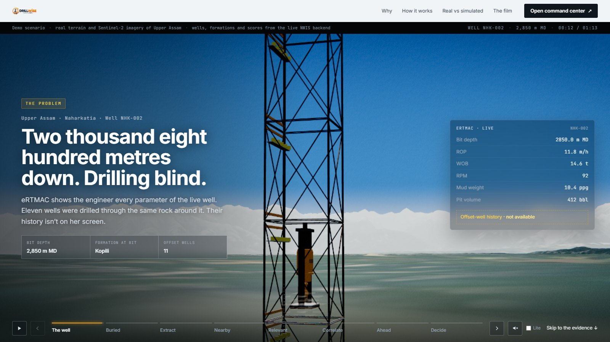</td>
<td width="50%">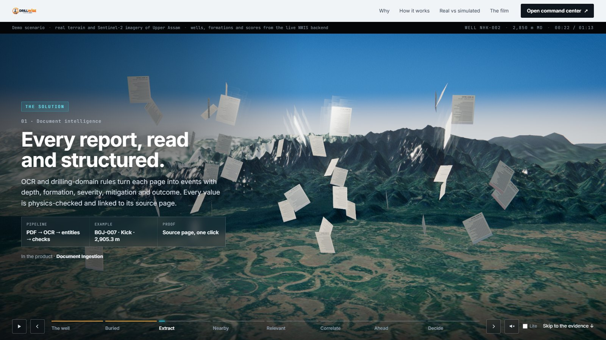</td>
</tr>
<tr>
<td><sub><b>01 · The well.</b> From orbit down to the rig at NHK-002, drilling blind at 2,850 m.</sub></td>
<td><sub><b>02–03 · Buried, then extracted.</b> Thirty-nine drilling reports become structured events. The key one lifts out.</sub></td>
</tr>
<tr>
<td width="50%">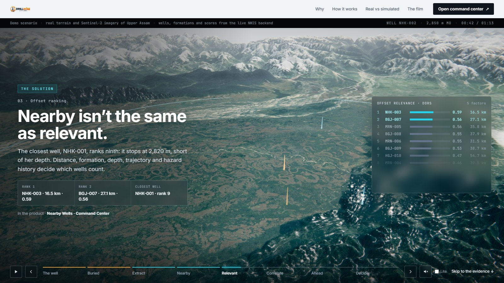</td>
<td width="50%">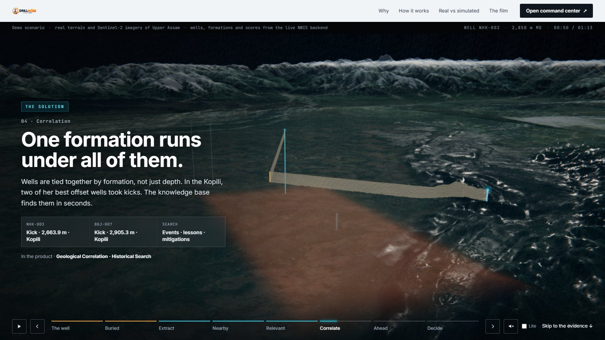</td>
</tr>
<tr>
<td><sub><b>04–05 · Nearby, then relevant.</b> The closest well ranks ninth. Five factors decide which wells count.</sub></td>
<td><sub><b>06 · Correlate.</b> The camera sinks under the basin. One formation, the Kopili, runs under all of them.</sub></td>
</tr>
</table>

<div align="center">
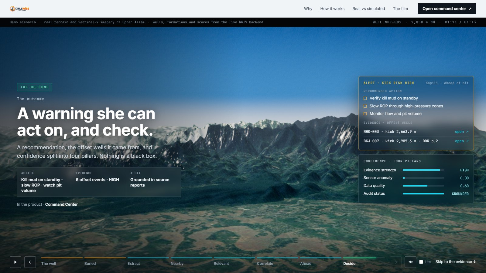
<sub><b>07–08 · Ahead, then decide.</b> Down the borehole to the bit, then back up to an alert she can act on, with the evidence and confidence behind it.</sub>
</div>

<br/>

| | |
|---|---|
| **Built on real data** | SRTM-based elevation and Sentinel-2 imagery of the basin and the Himalaya and Naga-Patkai ranges; NHK-002's real formation tops; the project's own bottom-hole-assembly model |
| **Score** | 'Aphelion' by Scott Buckley, cut to the story. It is muted during the problem, opens up for the solution, and pauses whenever the page isn't being watched. |
| **Performance** | Adaptive resolution (up to 2× on high-DPI screens, stepped down on slower ones), a Lite mode, and only one world drawn at a time: the Earth, the basin or the borehole |

`/film` is a separate, more dramatic cut of the same story.

## Inside the app

<table>
<tr>
<td width="50%">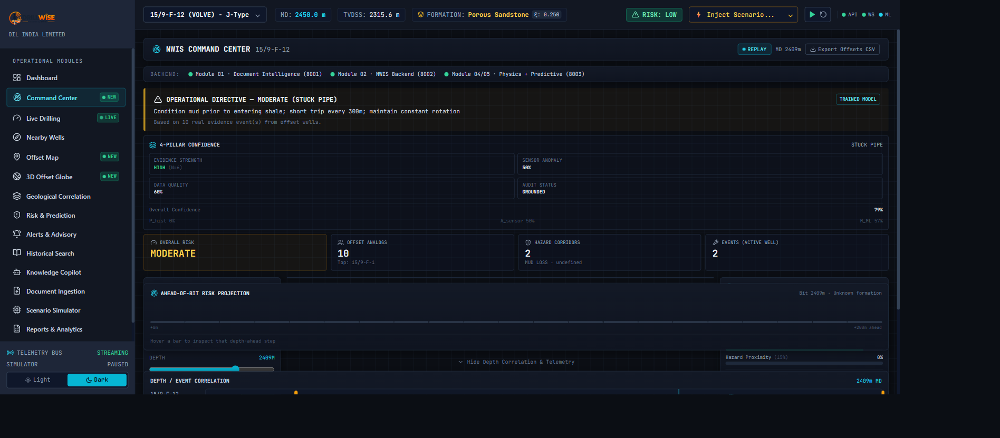<br/><sub><b>Command Center.</b> The active well, ahead-of-bit risk and the offset evidence behind each alert.</sub></td>
<td width="50%">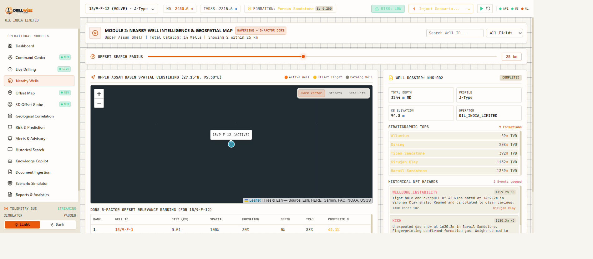<br/><sub><b>Nearby Wells.</b> The offset ranking, with every component score shown.</sub></td>
</tr>
<tr>
<td width="50%"><br/><sub><b>Offset Map.</b> Every well within a chosen radius.</sub></td>
<td width="50%"><br/><sub><b>3D Globe.</b> The Upper Assam field on real terrain, with trajectories.</sub></td>
</tr>
<tr>
<td width="50%">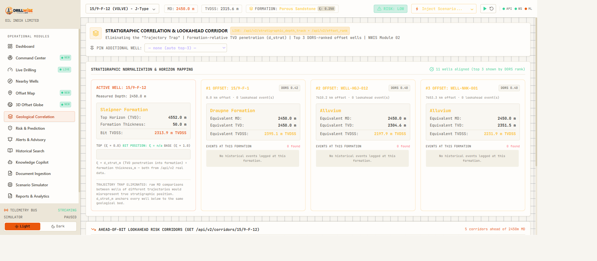<br/><sub><b>Geological Correlation.</b> Wells aligned by formation and depth.</sub></td>
<td width="50%"><br/><sub><b>Historical Search.</b> Answers that cite the report and page they came from.</sub></td>
</tr>
<tr>
<td width="50%"><br/><sub><b>Live Drilling.</b> The physics-simulated well, streamed over WebSocket.</sub></td>
<td width="50%">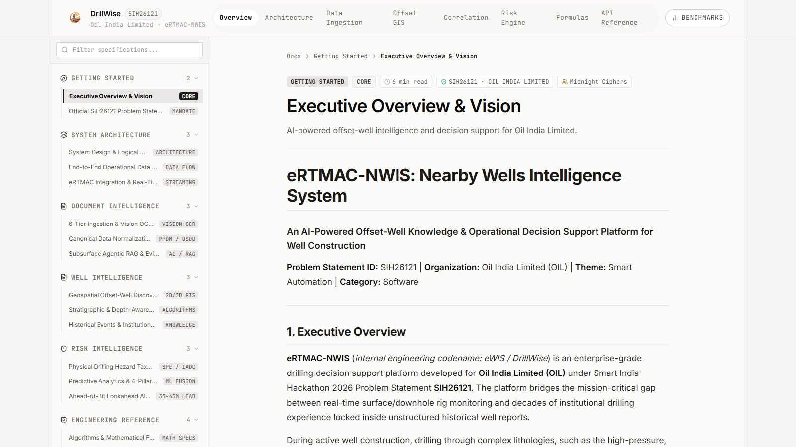<br/><sub><b>Docs.</b> 23 pages built into the app: architecture, algorithms, API and the PS traceability matrix.</sub></td>
</tr>
</table>

**All 15 pages:** Dashboard · Command Center · Live Drilling · Nearby Wells · Offset Map · 3D Globe · Geological Correlation · Risk Prediction · Alerts & Advisory · Historical Search · Copilot · Document Ingestion · Simulator · Reports & Analytics · System Status.

## How it works

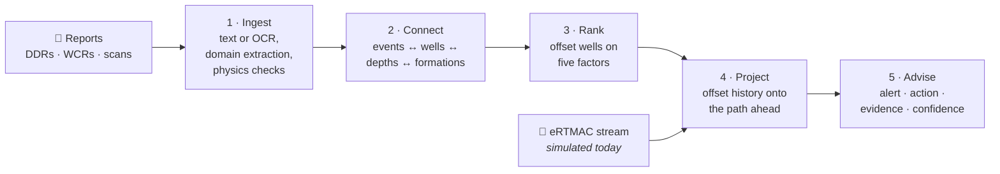

**Offset relevance (DORS).** Each offset well gets a score from five weighted factors:

$$\text{DORS} = 0.20\,S_{\text{spatial}} + 0.30\,S_{\text{formation}} + 0.20\,S_{\text{depth}} + 0.15\,S_{\text{trajectory}} + 0.15\,S_{\text{hazard}}$$

That is why, in the demo, the closest well (NHK-001, 12.3 km) ranks ninth. It stops at 2,820 m, short of the active well's depth.

**Stratigraphic alignment.** Wells are compared by position within a formation, not by raw depth:

$$\xi = \frac{d - d_{\text{top}}}{d_{\text{base}} - d_{\text{top}}}$$

The derivations, worked examples and the drilling-physics formulas (d-exponent, ECD and others) are in [Algorithms and formulas](https://drillwise-three.vercel.app/docs).

## Architecture

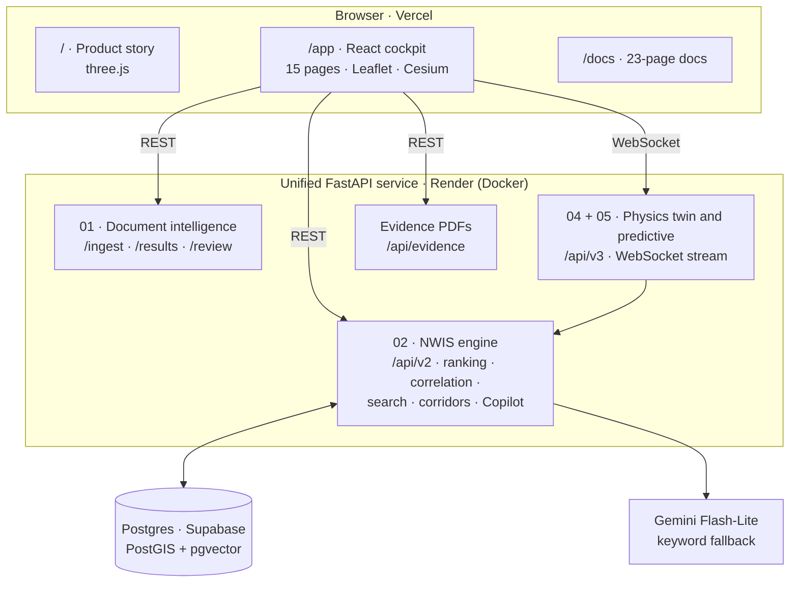

| Layer | Technology |
|---|---|
| **Frontend** | React 18, TypeScript, Vite 5, Tailwind, three.js with React Three Fiber, Cesium, Leaflet, Recharts, pdf.js, Mermaid and KaTeX for the docs |
| **Backend** | Python, FastAPI and Uvicorn. One process mounts every module. |
| **Documents** | PyMuPDF for native text and Docling for OCR (optional), with drilling-domain rules and physics validation |
| **Search** | Sentence-transformer embeddings with keyword fusion (optional); deterministic keyword search when absent |
| **ML** | scikit-learn and XGBoost, plus a rule engine and physics models |
| **Data** | PostgreSQL with PostGIS and pgvector (`database/schema.sql`) |
| **LLM** | Gemini Flash-Lite, with key rotation and a keyword-search fallback |
| **Hosting** | Vercel for the frontend, Render (Docker) for the backend, Supabase for the database |

## API surface

One service, three API generations, all behind an optional API key (`NWIS_API_KEY`).

| Area | Endpoints |
|---|---|
| **Wells and map** | `GET /api/v2/wells` · `/wells/{id}` · `/map/wells` · `/trajectory/{id}` · `/casing/{id}` |
| **Ranking and correlation** | `GET /api/v2/offset_rank/{id}` · `/formations/{id}` · `/stratigraphic_depth_track/{id}` |
| **Events and knowledge** | `GET /api/v2/events` · `/events/search` · `/events/{id}` · `POST /api/v2/agent/chat` |
| **Risk** | `GET /api/v2/analyze/{id}` · `/ahead_of_bit/{id}` · `/corridors/{id}` |
| **Document intelligence** | `POST /ingest` · `GET /jobs/{id}` · `/results/{doc}` · `/results/{doc}/events` · `/review/queue` · `POST /review/{doc}/decision` |
| **Physics twin** | `POST /api/v3/physics/start` · `/pause` · `/step` · `/scenario` · `WS /api/v3/physics/stream` |
| **Predictive** | `POST /api/v3/predictive/evaluate` · `GET /api/v3/predictive/alerts/{id}` · `/predictive/models` |
| **Evidence and health** | `GET /api/evidence/...` · `/health` · `/ready` · `/api/v2/health` · `/api/v3/health` |

The full reference is in the docs, under [API reference](https://drillwise-three.vercel.app/docs).

## Run it locally

**Requirements:** Python 3.11+, Node 20+.

```bash
# 1 · Backend: one process on :8000
cd Backend
pip install -r requirements.txt          # add requirements-optional.txt for Docling OCR and semantic search
python run.py

# 2 · Frontend on :5173 (/api and /ws are proxied to :8000)
cd frontend
npm ci
npm run dev
```

Then open:

| URL | What |
|---|---|
| <http://localhost:5173/> | The product story |
| <http://localhost:5173/app> | The cockpit |
| <http://localhost:5173/docs> | The documentation |

<details>
<summary><b>Environment variables</b></summary>

**Frontend** (`frontend/.env`)

| Variable | Purpose |
|---|---|
| `VITE_API_BASE` | Backend origin in production, for example `https://<service>.onrender.com`. Not needed in dev, which uses the proxy. |
| `VITE_API_KEY` | Sent to the backend. It ships in the browser bundle, so treat it as public. |

**Backend** (`Backend/.env`, see `Backend/.env.example`)

| Variable | Purpose |
|---|---|
| `NWIS_API_KEY` | Protects every route. Unset means open, which is fine only on localhost. |
| `NWIS_CORS_ORIGINS` | Allowed frontend origins, for example `https://drillwise-three.vercel.app` |
| `NWIS_DATABASE_URL` | Postgres connection string. When unset, the service runs on its bundled data. |
| `GEMINIKEY1` … `GEMINIKEY3` | Copilot LLM keys, rotated on failure. Without them, the Copilot uses keyword search. |

</details>

<details>
<summary><b>Tests</b></summary>

```bash
cd Backend
pip install -r requirements-dev.txt
pytest -m "unit or contract"        # fast suite: routes, auth, lifecycle, WebSocket, evidence
pytest -m integration               # needs the server running
```

</details>

## Deploy

| Part | Where | How |
|---|---|---|
| Frontend | **Vercel** | Root directory `frontend`, production branch `main`. `vercel.json` routes `/`, `/app/*`, `/docs/*`, `/story` and `/film` to the React app, and `/benchmarks` to a static page. |
| Backend | **Render** | Blueprint from `render.yaml` (Docker, `Backend/Dockerfile`) |
| Database | **Supabase** | Postgres with PostGIS and pgvector; apply `database/schema.sql`, then seed with `database/migrate_seed.py` |

Step-by-step: `AUDIT/16_DEPLOYMENT_GUIDE.md`.

## Repository map

```
.
├── frontend/                 React app: story (/), cockpit (/app), docs (/docs), film (/film)
│   ├── src/story/            the landing story: scene/ (Earth, basin, rig, borehole), HUD, score
│   ├── src/pages/            the 15 cockpit pages
│   ├── src/docs/             the in-app documentation (23 pages)
│   └── public/story/         terrain, imagery, rig models, rock textures, video, music
├── Backend/                  unified FastAPI service (mounts every module) + tests
├── modules/
│   ├── 01_document_intelligence/   OCR and extraction pipeline
│   ├── 02_nwis_backend/            ranking, correlation, search, risk corridors, Copilot
│   ├── 04_physics_engine/          drilling-physics digital twin, /api/v3, WebSocket
│   └── 05_predictive_analytics/    rule engine and ML hazard fusion
├── database/                 Postgres schema, seed and migration
├── real_data/                Equinor Volve documents and WITSML, evidence PDFs, trained models
├── AUDIT/                    audits, deployment guide, screenshot evidence
└── docs/                     project documentation and README assets
```

Folder numbers under `modules/` follow the deployable services, not the PS outcome numbers. The table [above](#mapped-to-ps-26121) shows where each outcome lives.

## What is real, and what is simulated

We keep this explicit, so that every claim can be checked.

| | |
|---|---|
| ✅ **Real code, real output** | Offset ranking, correlation, knowledge search, the risk engine and alerts. The ingestion pipeline has also been run on 14 real Equinor Volve field documents. |
| ✅ **Real geography** | Basin elevation and imagery; wells placed in the Upper Assam fields |
| 🧪 **Synthetic** | The demo field's drilling events and daily drilling reports are a labelled synthetic test set. |
| 🧪 **Simulated** | Live rig telemetry is a physics simulation, not an eRTMAC feed. An eRTMAC adapter is the integration point for production. |
| 🎬 **Story visuals** | Terrain height and depth are drawn 3× so the relief reads. The rig is a representative model, not the NHK-002 site, and the rock textures are matched to each lithology, not core photographs. |

## Credits and licences

| Asset | Source | Licence |
|---|---|---|
| Satellite imagery | [Sentinel-2 cloudless](https://s2maps.eu) by EOX IT Services GmbH (contains modified Copernicus Sentinel data 2016 and 2017) | CC BY 4.0 |
| Elevation | AWS Terrain Tiles (Mapzen; sources include SRTM, NASA/USGS) | Open data |
| Rig and site equipment | 3dassets.dev | CC0 |
| Rock textures | Poly Haven | CC0 |
| Music in the story | 'Aphelion' by Scott Buckley ([www.scottbuckley.com.au](https://www.scottbuckley.com.au)), edited for length | [CC BY 4.0](https://creativecommons.org/licenses/by/4.0/) |
| Validation data | Equinor Volve field data set | Equinor open data licence |

All third-party assets are also credited on the page where they are used.

---

<div align="center">

## Team Midnight Ciphers

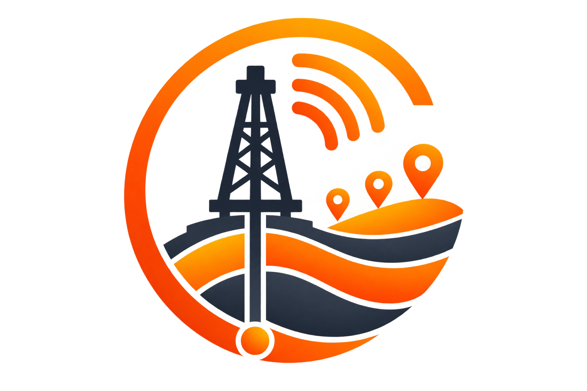

**Built by Laukik Rathod and team**

for **Smart India Hackathon 2026** · PS 26121 · Oil India Limited

<sub>DrillWise · eRTMAC-NWIS</sub>

</div>
