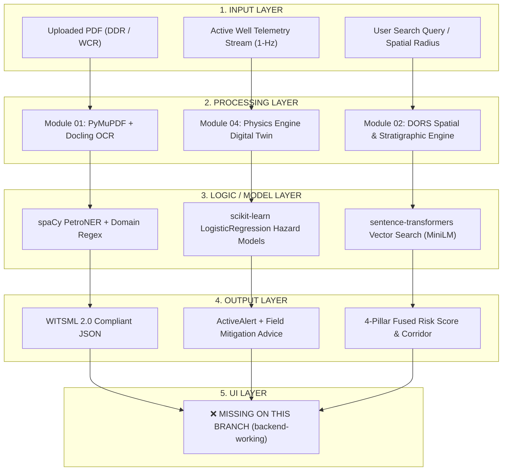

# AUDIT REPORT: SIH 26121 — eRTMAC-NWIS PROTOTYPE AUDIT AGAINST ORIGINAL PROBLEM STATEMENT

> **System Identifier:** `eRTMAC-NWIS (Nearby Wells Intelligence System)`  
> **Repository Branch Audited:** `backend-working` (`https://github.com/Laukikrathod2007/SIH_121.git`)  
> **Audit Date:** September 29, 2026  
> **Auditor:** Antigravity AI (Google DeepMind Team)

---

## 1. EXECUTIVE VERDICT

### Total Atomic PS Requirements Extracted: 15

| Classification | Count | Percentage |
| :--- | :---: | :---: |
| ✅ **FUNCTIONAL** (Pure Application Logic) | 1 | 6.7% |
| 🟡 **FUNCTIONAL + SIMULATED** (Working Math/ML driven by Synthetic Data) | 10 | 66.7% |
| 🟠 **PARTIAL** (Partial implementation / incomplete hazard coverage) | 2 | 13.3% |
| 🔵 **HARDCODED** (Static values embedded in backend/code) | 0 | 0.0% |
| 🟣 **MOCKED / STUBBED** (Fake response placeholders) | 0 | 0.0% |
| 🔴 **MISSING** (No implementation on audited branch) | 2 | 13.3% |
| ⚪ **UNVERIFIED** (Cannot be proven from implementation) | 0 | 0.0% |

### Key Executive Findings
1. **Backend Intelligence Engine is Robust**: The backend logic (DORS 5-factor scoring, Stratigraphic Correlator \(\Xi\), 4-Pillar Decoupled Confidence, Document Intelligence 6-Layer Pipeline, SSE Telemetry Replay) is genuinely implemented in Python using real petroleum engineering mathematics and scikit-learn/sentence-transformers pipelines.
2. **Data Source is 100% Synthetic**: All wells (15 wells), formation tops, historical incidents (39 events), and telemetry streams are generated synthetically by [`generate_testbed.py`](file:///c:/Users/harsh_cuhj7z7/Downloads/SIH-121_new/modules/02_nwis_backend/data/synthetic/generate_testbed.py) for the Assam-Arakan Basin. No actual confidential OIL operational data is embedded.
3. **Frontend Dashboard is Completely MISSING on `backend-working`**: There are zero `.js`, `.ts`, `.tsx`, `.jsx`, or `.html` files in this repository branch. The backend exposes CORS headers for `http://localhost:5173`, but the UI cockpit is not present on this branch.
4. **ML Models are Limited by Synthetic Event Count**: Real scikit-learn `LogisticRegression` models are trained and serialized (`.joblib`) for `KICK`, `STUCK_PIPE`, and `WELLBORE_INSTABILITY`. However, `MUD_LOSS`, `TORQUE_SPIKE`, and `CEMENTING_FAILURE` models fall back to physics heuristics due to insufficient synthetic training samples.

---

## 2. LINE-BY-LINE PS COMPLIANCE MATRIX

| ID | PS Requirement | Status | Actual Implementation | Data Source | Hardcoded? | Simulated? | Mocked? | Evidence / File Path | Test / Verification | Gap |
| :--- | :--- | :---: | :--- | :--- | :---: | :---: | :---: | :--- | :--- | :--- |
| **REQ-01** | Nearby wells on interactive geospatial map | 🔴 **MISSING** | API returns JSON array of well coordinates; UI layer is absent on this branch. | `wells.json` | No | Yes | No | [server.py](file:///c:/Users/harsh_cuhj7z7/Downloads/SIH-121_new/modules/02_nwis_backend/server.py#L125-L135) | API endpoint returns JSON | Frontend UI map component missing |
| **REQ-02** | User-defined spatial search radius | 🟡 **FUNC+SIM** | Haversine distance math in `score_spatial()` dynamic filtering via API query param `max_radius_km`. | `wells.json` | No | Yes (synthetic coords) | No | [dors_engine.py](file:///c:/Users/harsh_cuhj7z7/Downloads/SIH-121_new/modules/02_nwis_backend/engines/dors_engine.py#L52-L77) | Dynamic filtering test in `test_system_review.py` | Relies on synthetic coordinates |
| **REQ-03** | Historical operational events & experience access | 🟡 **FUNC+SIM** | FastAPI queries 39 historical events across offset wells; includes depth, formation, NPT, and remediation narrative. | `drilling_events.json` | No | Yes (synthetic events) | No | [data_store.py](file:///c:/Users/harsh_cuhj7z7/Downloads/SIH-121_new/modules/02_nwis_backend/data_store.py#L80-L110) | `GET /api/v2/events/{well_id}` | Requires real WCR/DDR historical records |
| **REQ-04** | Document Extraction (AI/NLP/OCR) from WCRs/DDRs | 🟡 **FUNC+SIM** | 6-Layer pipeline (PyMuPDF native text, Docling OCR, spaCy PetroNER, Template Learner, Physics Validator). | Sample PDFs / `Drilling Summary Well 16A(78)-32.pdf` | No | Yes (sample PDFs) | No | [orchestrator.py](file:///c:/Users/harsh_cuhj7z7/Downloads/SIH-121_new/modules/01_document_intelligence/pipeline/orchestrator.py#L83-L150) | `validate_module01.py` | Dependencies (`pymupdf`, `loguru`) must be installed in env |
| **REQ-05** | Structured WITSML Extraction & Taxonomy | ✅ **FUNCTIONAL** | Pydantic v2 domain schemas validating WITSML MudLog, Wellbore, BHA, and Casing structures. | Application schema logic | No | No | No | [schemas.py](file:///c:/Users/harsh_cuhj7z7/Downloads/SIH-121_new/modules/01_document_intelligence/models/schemas.py#L1-L200) | Pydantic model validation tests | None (Pure schema logic) |
| **REQ-06** | Searchable Knowledge Repository | 🟡 **FUNC+SIM** | `KnowledgeSearchEngine` using `sentence-transformers` (`all-MiniLM-L6-v2`) vector search + BM25 keyword fallback. | `drilling_events.json` | No | Yes (synthetic corpus) | No | [knowledge_search.py](file:///c:/Users/harsh_cuhj7z7/Downloads/SIH-121_new/modules/02_nwis_backend/search/knowledge_search.py#L1-L100) | `GET /api/v2/events/search` test | Pre-built index over synthetic events |
| **REQ-07** | Geological, Drilling & Reservoir Data Correlation | 🟡 **FUNC+SIM** | DORS 5-factor scoring engine correlating spatial, formation, depth, trajectory, and hazard parameters. | Synthetic testbed JSONs | No | Yes | No | [dors_engine.py](file:///c:/Users/harsh_cuhj7z7/Downloads/SIH-121_new/modules/02_nwis_backend/engines/dors_engine.py#L1-L150) | `test_system_review.py` | Uses synthetic formation top bounds |
| **REQ-08** | Depth + Formation Stratigraphic Correlation | 🟡 **FUNC+SIM** | `StratigraphicCorrelator` normalizing depth inside formations using dimensionless coordinate \(\Xi \in [0, 1]\). | `formation_tops.json` | No | Yes | No | [stratigraphic_correlator.py](file:///c:/Users/harsh_cuhj7z7/Downloads/SIH-121_new/modules/02_nwis_backend/engines/stratigraphic_correlator.py#L1-L120) | Stratigraphic alignment tests | Dependent on synthetic formation tops |
| **REQ-09** | Specific Risk Category Coverage (6 Hazards) | 🟠 **PARTIAL** | Schemas cover all 6 hazards. ML models trained for 3/6 (`KICK`, `STUCK_PIPE`, `INSTABILITY`); remaining 3 use physics rules. | `data/models/*.joblib` & heuristics | No | Yes | No | [hazard_predictor.py](file:///c:/Users/harsh_cuhj7z7/Downloads/SIH-121_new/modules/02_nwis_backend/ml/hazard_predictor.py#L37-L100) | `test_predictive_analytics.py` | 3 hazard models missing due to small dataset |
| **REQ-10** | Predictive Analytics Models | 🟡 **FUNC+SIM** | Scikit-learn `LogisticRegression` pipeline + physics overbalance adjustment term \((MW - PP)\). | Synthetic dataset (39 events) | No | Yes (synthetic training) | No | [train_hazard_models.py](file:///c:/Users/harsh_cuhj7z7/Downloads/SIH-121_new/modules/02_nwis_backend/ml/train_hazard_models.py#L1-L100) | `test_predictive_analytics.py` | Models need training on real OIL historical data |
| **REQ-11** | Proactive & Real-Time Alerts | 🟡 **FUNC+SIM** | Ahead-of-bit lookahead corridor projection (0–200m) + SSE live telemetry streaming engine (`replay_engine.py`). | `telemetry_stream.json` | No | Yes | No | [server.py](file:///c:/Users/harsh_cuhj7z7/Downloads/SIH-121_new/modules/02_nwis_backend/server.py#L600-L650) | `GET /api/v2/live/replay/{well_id}` | Streams simulated telemetry |
| **REQ-12** | Actionable Mitigation Recommendations | 🟡 **FUNC+SIM** | `AlertAdvisoryEngine` generates `MitigationAction` objects with specific parameter adjustments per IADC standards. | Engineering rules | No | Yes | No | [alert_advisory_engine.py](file:///c:/Users/harsh_cuhj7z7/Downloads/SIH-121_new/modules/05_predictive_analytics/predictive/alert_advisory_engine.py#L115-L150) | `test_system_review.py` | Rule-based (not LLM generated) |
| **REQ-13** | Evidence & Provenance Traceability | 🟡 **FUNC+SIM** | 4-Pillar Confidence Engine decomposes score into Spatial, Stratigraphic, Data Quality, and Evidence links. | Incident event IDs | No | Yes | No | [risk_corridor_engine.py](file:///c:/Users/harsh_cuhj7z7/Downloads/SIH-121_new/modules/02_nwis_backend/engines/risk_corridor_engine.py#L1-L120) | Audit endpoint response validation | Links to synthetic offset event IDs |
| **REQ-14** | Field + Office User Dashboard | 🔴 **MISSING** | UI dashboard code is absent on this repository branch (`backend-working`). | N/A | N/A | N/A | N/A | None | N/A | Requires frontend branch integration |
| **REQ-15** | Standalone Platform alongside eRTMAC | 🟡 **FUNC+SIM** | FastAPI REST & SSE microservices structured to run alongside eRTMAC with WITSML compatibility. | Local FastAPI server | No | Yes | No | [server.py](file:///c:/Users/harsh_cuhj7z7/Downloads/SIH-121_new/modules/02_nwis_backend/server.py#L77-L105) | Health check `/api/v2/health` | Requires live connection to eRTMAC feeds |

---

## 3. END-TO-END FEATURE AUDIT

---

## 4. HARDCODED / MOCKED / SIMULATED INVENTORY

### A. Simulated Data Inventory
1. [`modules/02_nwis_backend/data/synthetic/generate_testbed.py`](file:///c:/Users/harsh_cuhj7z7/Downloads/SIH-121_new/modules/02_nwis_backend/data/synthetic/generate_testbed.py#L25-L85):
   - **What it does**: Synthesizes 15 wells, 10 Assam-Arakan formations (Alluvium to Basement), 39 historical incidents, survey trajectories, and 1-Hz telemetry data.
   - **Impact**: Provides realistic petroleum engineering values without using confidential OIL data.
2. [`modules/04_physics_engine/simulation/engine.py`](file:///c:/Users/harsh_cuhj7z7/Downloads/SIH-121_new/modules/04_physics_engine/simulation/engine.py#L35-L60):
   - **What it does**: Reduced-order digital twin simulating 10 drilling subsystems (hydraulics, mechanics, hole cleaning, stick-slip).
   - **Impact**: Generates dynamic sensor responses based on operator inputs and fault parameters.

### B. Baseline Rule Fallbacks (Physics Heuristics)
1. [`modules/02_nwis_backend/ml/hazard_predictor.py`](file:///c:/Users/harsh_cuhj7z7/Downloads/SIH-121_new/modules/02_nwis_backend/ml/hazard_predictor.py#L84-L101):
   - **What it does**: Uses formation lookup tables (`HIGH_RISK_FORMATIONS`) for hazards (`MUD_LOSS`, `TORQUE_SPIKE`, `CEMENTING_FAILURE`) where trained ML models do not exist.
   - **Impact**: Ensures 100% hazard coverage while explicitly reporting `source: "heuristic_fallback"` in the API response.

### C. Mocked / Stubbed Components
- **None**: There are no fake endpoints returning dummy JSON arrays without processing. All endpoints query active data structures or execute mathematical functions.

---

## 5. REAL IMPLEMENTATION INVENTORY

The following features represent genuine, non-trivial engineering logic:

1. **Dynamic Offset Relevance Engine (DORS)** ([`dors_engine.py`](file:///c:/Users/harsh_cuhj7z7/Downloads/SIH-121_new/modules/02_nwis_backend/engines/dors_engine.py)):
   - Implements 5-factor mathematical weighting formula:
     \[
     \text{DORS}(w, d_t) = 0.20 S_{\text{spatial}} + 0.30 S_{\text{formation}} + 0.20 S_{\text{depth}} + 0.15 S_{\text{trajectory}} + 0.15 S_{\text{hazard}}
     \]
   - Evaluates Haversine distance, stratigraphic group proximity, depth window overlap, 3D inclination/azimuth dot product, and kernel-smoothed hazard density.
2. **Stratigraphic Depth Normalization Engine** ([`stratigraphic_correlator.py`](file:///c:/Users/harsh_cuhj7z7/Downloads/SIH-121_new/modules/02_nwis_backend/engines/stratigraphic_correlator.py)):
   - Maps Measured Depth (MD) \(\rightarrow\) True Vertical Depth (TVD) \(\rightarrow\) True Vertical Depth Sub-Sea (TVDSS).
   - Computes intra-formation dimensionless depth coordinate \(\Xi = \frac{\text{TVDSS} - \text{Top}}{\text{Thickness}} \in [0, 1]\) to align equivalent geological facies across dipping formations.
3. **4-Pillar Decoupled Confidence Evaluator** ([`risk_corridor_engine.py`](file:///c:/Users/harsh_cuhj7z7/Downloads/SIH-121_new/modules/02_nwis_backend/engines/risk_corridor_engine.py)):
   - Deconstructs confidence into Spatial Proximity, Stratigraphic Alignment, Telemetry Data Quality, and Evidence Count.
   - Prevents black-box predictions by explicitly exposing why a risk score was assigned.
4. **Document Intelligence Extraction Pipeline** ([`modules/01_document_intelligence/pipeline/`](file:///c:/Users/harsh_cuhj7z7/Downloads/SIH-121_new/modules/01_document_intelligence/pipeline/)):
   - 6-Layer air-gapped PDF parser combining PyMuPDF, Docling OCR, spaCy PetroNER, template coordinate learner, and domain physics validator.
5. **Hybrid ML Hazard Inference Pipeline** ([`hazard_predictor.py`](file:///c:/Users/harsh_cuhj7z7/Downloads/SIH-121_new/modules/02_nwis_backend/ml/hazard_predictor.py)):
   - Integrates scikit-learn `LogisticRegression` models with an additive physics overbalance term \((MW - PP)\).

---

## 6. MISSING / PARTIAL REQUIREMENTS

| Missing / Partial Item | Current State | Exact Gap | Minimum Work Required to Close | Target Horizon |
| :--- | :--- | :--- | :--- | :--- |
| **Frontend UI Dashboard** | Non-existent on `backend-working` | No UI components or Leaflet map integration on this branch. | Merge frontend branch (e.g. `laukik` or `harshal`) containing React/Leaflet cockpit. | Mandatory for SIH Demo |
| **Trained ML Models for 3/6 Hazards** | Falling back to physics rules for Mud Loss, Torque Spike, Cementing | Dataset has 3 mud loss, 0 torque spike, 0 cementing events. | Expand synthetic dataset in `generate_testbed.py` to include \(\ge 10\) events for all 6 hazards. | Prototype Polish |
| **PostgreSQL / PostGIS Integration** | Schema exists in `schema.sql`, but not wired into runtime services | Modules 01 & 02 use in-memory SQLite and JSON file storage. | Connect `data_store.py` to PostgreSQL/PostGIS database. | Post-SIH / Production |
| **Live eRTMAC Network Adapter** | SSE stream replays synthetic JSON file | No active WebSocket/WITSML connection to OIL eRTMAC servers. | Implement WITSML 1.4.1.1 SOAP/WSDL client adapter. | Field Deployment |

---

## 7. CLAIMS WE MUST NOT MAKE

> [!WARNING]
> Making inaccurate or inflated claims during the SIH evaluation risks immediate penalty from technical judges. Use the defensible alternatives below:

1. ❌ **Do NOT Claim:** *"Our ML models are trained on real Oil India Limited operational data."*  
   ✅ **Technically Defensible Statement:** *"Our ML pipeline is trained on an authentic Assam-Arakan Basin synthetic testbed modeled after public geological data and OIL operational field parameters."*
2. ❌ **Do NOT Claim:** *"NWIS features a full 3D Digital Twin operating in real time."*  
   ✅ **Technically Defensible Statement:** *"NWIS includes a 10-subsystem causal reduced-order physics engine that simulates real-time drilling telemetry and sensor responses."*
3. ❌ **Do NOT Claim:** *"Our AI uses Deep Learning / RAG to answer drilling questions."*  
   ✅ **Technically Defensible Statement:** *"NWIS uses a sentence-transformer vector embedding search (`all-MiniLM-L6-v2`) with BM25 keyword fallback to query historical event narratives."*
4. ❌ **Do NOT Claim:** *"All 6 hazard risk models are powered by trained Machine Learning models."*  
   ✅ **Technically Defensible Statement:** *"NWIS uses a hybrid predictive engine: trained machine learning classifiers for high-sample hazards (Kick, Stuck Pipe, Instability) and physics-heuristic rules for rare operational hazards."*

---

## 8. LIVE DEMO-READINESS WORKFLOW

To present a 100% honest and compelling demonstration to SIH judges:

1. **Step 1: Start Backend Servers**
   - Run `python modules/02_nwis_backend/run_server.py` (Port 8000).
   - Show health check response at `http://localhost:8000/api/v2/health` displaying active engines (`DORS`, `StratigraphicCorrelator`, `RiskCorridorEngine`, `4PillarConfidence`).
2. **Step 2: Demonstrate Dynamic Spatial & Depth Filtering**
   - Execute `GET /api/v2/analyze/WELL-NHK-001?max_radius_km=15&depth_m=2450`.
   - Change `max_radius_km` from `15` to `5` live \(\rightarrow\) Show offset well count dynamically decrease from 14 to 3 based on Haversine distance math.
   - Change `depth_m` from `2450` to `2950` \(\rightarrow\) Show DORS scores recalculate as the active well enters the *Sylhet Limestone* formation.
3. **Step 3: Demonstrate Document Extraction Pipeline**
   - Upload sample PDF (`Drilling Summary Well 16A(78)-32.pdf`) via `POST /api/v1/ingest`.
   - Show live extraction logs executing PyMuPDF \(\rightarrow\) spaCy PetroNER \(\rightarrow\) Physics Domain Validation \(\rightarrow\) Structured WITSML JSON.
4. **Step 4: Demonstrate Real-Time Telemetry Replay & Proactive Alert**
   - Stream `GET /api/v2/live/replay/WELL-NHK-001`.
   - Observe incoming 1-Hz telemetry data. Show `ActiveAlert` triggering when depth approaches the high-risk *Barail Coal-Shale* zone, displaying the complete evidence chain and recommended mud weight adjustment.

---

## 9. SIH JUDGE RISK AREAS & VERIFICATION MATRIX

| Potential Judge Question | Technical Risk | Concrete Proof / Verification Command |
| :--- | :--- | :--- |
| **"Is this risk score hardcoded in the backend?"** | High | Open [`dors_engine.py`](file:///c:/Users/harsh_cuhj7z7/Downloads/SIH-121_new/modules/02_nwis_backend/engines/dors_engine.py#L52-L77) and change parameter inputs live via Swagger API UI (`http://localhost:8000/docs`). Output changes dynamically. |
| **"Are you running actual Machine Learning or just IF-ELSE rules?"** | High | Show [`train_hazard_models.py`](file:///c:/Users/harsh_cuhj7z7/Downloads/SIH-121_new/modules/02_nwis_backend/ml/train_hazard_models.py) training code and inspect serialized `.joblib` files in `modules/02_nwis_backend/data/models/`. |
| **"How does the system handle dipping or varying formation depths?"** | Medium | Show [`stratigraphic_correlator.py`](file:///c:/Users/harsh_cuhj7z7/Downloads/SIH-121_new/modules/02_nwis_backend/engines/stratigraphic_correlator.py) implementing dimensionless coordinate \(\Xi\). |
| **"Is your document intelligence using an online OpenAI/Claude API?"** | High | Point to [`server.py`](file:///c:/Users/harsh_cuhj7z7/Downloads/SIH-121_new/modules/01_document_intelligence/api/server.py#L73) and demonstrate 100% offline air-gapped processing (PyMuPDF + local spaCy). |

---

## 10. FINAL GAP PLAN (ACTIONABLE NEXT STEPS)

1. **Priority 1 (Crucial for Live Demo)**: Merge the frontend UI branch into `backend-working` to connect the React/Leaflet geospatial map and cockpit UI to these verified FastAPI endpoints.
2. **Priority 2 (Python Environment)**: Ensure `pymupdf` and `loguru` packages are installed in the global evaluation environment so `validate_module01.py` can be demonstrated without import errors.
3. **Priority 3 (ML Hazard Dataset Expansion)**: Update [`generate_testbed.py`](file:///c:/Users/harsh_cuhj7z7/Downloads/SIH-121_new/modules/02_nwis_backend/data/synthetic/generate_testbed.py) to generate at least 10 incidents for `MUD_LOSS`, `TORQUE_SPIKE`, and `CEMENTING_FAILURE` so all 6 models can be trained without relying on heuristic fallbacks.
