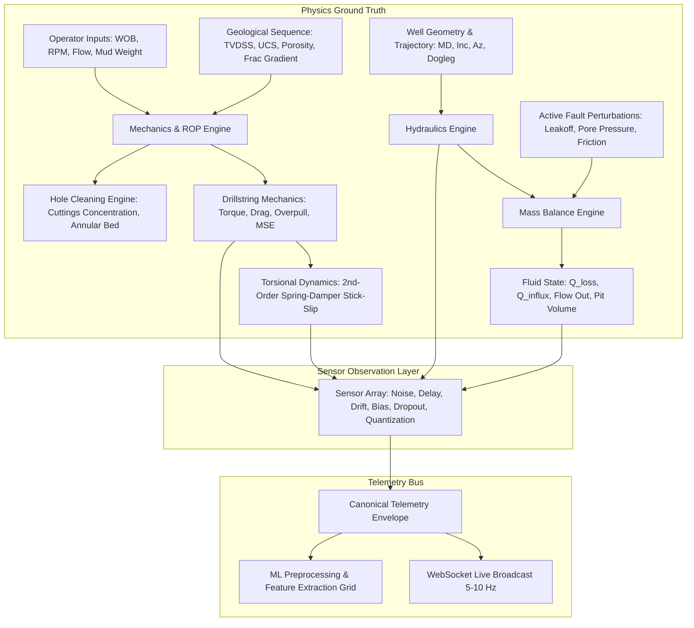

# eRTMAC-NWIS Module 5 -- Reduced-Order Drilling Physics Engine Implementation

**System:** eRTMAC-NWIS (Nearby Wells Intelligence System)  
**Module:** 5 -- Predictive Drilling Risk Analytics & Live Digital Twin Core  
**Companion:** Module 4 -- Geological, Drilling & Reservoir Correlation  
**Verification Status:** 100% Automated Unit & Integration Test Pass (105/105 Tests Passing)  

---

## 1. Executive Summary & Architectural Philosophy

The eRTMAC-NWIS digital twin is an internal, causal **reduced-order physics engine**. It strictly adheres to the core engineering principle:

$$\text{Operator Controls} + \text{Formation Properties} + \text{Well Trajectory} + \text{Mud Properties} + \text{Drillstring Mechanics} = \text{Internal Physical State}$$

$$\text{Internal State} \longrightarrow \text{Sensor Observation Model} \longrightarrow \text{Canonical Live Telemetry}$$

Under no circumstances is random noise or decorative animations presented as telemetry. The frontend dashboard is never the source of truth.

---

## 2. Implemented Subsystems & Mathematical Formulations

### 2.1 Formation Model (`services/formation.py`)
Provides continuous depth resolution of geological parameters from TVDSS:
- Rock density $\rho_{rock}$ (g/cc), Unconfined Compressive Strength (UCS in MPa), Young's Modulus $E$ (GPa), Poisson's Ratio $\nu$.
- Porosity $\phi$, permeability $k$ (mD), pore pressure gradient $g_{pp}$ (g/cc), fracture gradient $g_{fg}$ (g/cc).
- Friction coefficient $\mu$, leakoff coefficient $C_l$, drillability coefficient $K_d$.

Depth queries automatically identify the containing formation, thickness, and stratigraphic coordinate $\xi = \frac{TVDSS - top}{base - top} \in [0.0, 1.0]$.

### 2.2 Drilling Mechanics & ROP (`services/mechanics.py`)
Computes penetration rate with physical asymptotic saturation (preventing infinite growth with WOB/RPM):

$$ROP_{raw} = \alpha \cdot RPM \cdot \left(\frac{WOB}{D_b}\right)^b \cdot \frac{K_d}{UCS / UCS_{ref}} \cdot f_{wear} \cdot f_{cleaning} \cdot f_{dysfunction}$$

$$ROP = ROP_{max} \cdot \tanh\left(\frac{ROP_{raw}}{ROP_{max}}\right)$$

- $ROP_{max} = \frac{60.0}{UCS / UCS_{ref}}$ enforces physical rock failure limits.
- Depth evolves dynamically via $\frac{dMD}{dt} = ROP$, continuously updating $MD$, $TVD$, $TVDSS$, and the active geological formation.

### 2.3 Hydraulics Subsystem (`services/hydraulics.py`)
Maintains dynamic annular and downhole pressures:
- **Annular flow velocity:** $v_a = \frac{Q}{A_{annulus}}$ where $A_{annulus} = \frac{\pi}{4}(D_h^2 - D_p^2)$.
- **Hydrostatic pressure:** $P_h = \rho_{mud} \cdot g \cdot TVD$ (strictly TVD-referenced, not MD).
- **Frictional losses:**
  - Pipe friction: $\Delta P_{pipe} = f_{pipe} \frac{MD}{D_p} \frac{\rho v_p^2}{2}$
  - Annular friction: $\Delta P_{annulus} = f_{annulus}(1 + 2 C_c) \frac{MD}{D_h - D_p} \frac{\rho v_a^2}{2}$
  - Bit nozzle drop: $\Delta P_{bit} = \frac{\rho Q^2}{2 C_d^2 TFA^2}$
- **Standpipe Pressure (SPP):** $SPP = \Delta P_{pipe} + \Delta P_{BHA} + \Delta P_{bit} + \Delta P_{annulus}$.
- **Bottomhole Pressure (BHP):** $BHP = P_h + \Delta P_{annulus} + P_{choke}$.
- **Equivalent Circulating Density (ECD):** $ECD = \frac{BHP}{g \cdot TVD}$.
- **Pressure margins:**
  - Pore Pressure margin: $PP\_margin = BHP - P_{pore}$
  - Fracture Gradient margin: $FG\_margin = P_{fracture} - BHP$

### 2.4 Mass Balance & Fluid Conservation (`services/mass_balance.py`)
Fluid balance emerges organically without manual manipulation of flow rates:
- **Lost Circulation ($BHP > P_{fracture}$):**
  $$Q_{loss} = C_{loss} \cdot (BHP - P_{fracture})^n$$
- **Formation Influx / Kick ($P_{pore} > BHP$):**
  $$Q_{influx} = PI \cdot (P_{pore} - BHP)$$
- **Return Flow:** $Q_{out} = \max(0, Q_{in} - Q_{loss} + Q_{influx})$.
- **Active Pit Volume Conservation:**
  $$\frac{dV_{pit}}{dt} = Q_{out} - Q_{in} = Q_{influx} - Q_{loss}$$

### 2.5 Drillstring Mechanics, Torque & Drag (`services/mechanics.py`)
- Buoyed weight: $W_{buoyed} = W_{air} \left(1 - \frac{\rho_{mud}}{\rho_{steel}}\right)$.
- Normal contact force: $N = W_{buoyed} \sin(\theta) + 0.05 W_{buoyed} \cos(\theta)$.
- Friction force: $F_{drag} = \mu \cdot N \cdot (1 + 3 C_c^{1.5})$.
- Wall friction torque: $T_{friction} = F_{drag} \cdot \frac{D_p}{2}$.
- Bit torque: $T_{bit} = \frac{1}{3} \mu_{bit} WOB \cdot D_b$.
- Surface torque: $T_{surface} = T_{bit} + T_{friction}$.
- Hookload: $HL = W_{buoyed} - WOB + Overpull$.

### 2.6 Mechanical Specific Energy (MSE) & d-exponent
- **MSE (Mechanical Specific Energy):**
  $$MSE = \frac{WOB}{A_b} + \frac{2\pi \cdot RPM \cdot Torque}{A_b \cdot ROP}$$
- **Corrected d-exponent ($d_c$):**
  $$d = \frac{\log_{10}(ROP / (60 \cdot RPM))}{\log_{10}(12 \cdot WOB / (10^6 \cdot D_b))}, \quad d_c = d \cdot \left(\frac{g_{pp, normal}}{\rho_{mud}}\right)$$

### 2.7 2nd-Order Torsional Dynamics & Stick-Slip (`services/torsional_dynamics.py`)
Sub-stepped at $\Delta t \le 0.02$s to guarantee numerical stability:

$$I \ddot{\theta} + c \dot{\theta} + k \theta = T_{surface} - T_{bit}$$

- Nonlinear Stribeck friction:
  $$T_{bit}(\omega_{bit}) = T_{dyn} + (T_{stat} - T_{dyn}) e^{-(\omega_{bit}/\omega_s)^2}$$
- **Stick phase:** If $\omega_{bit} < \omega_{thresh}$ and $k\theta < T_{stat}$, bit locks ($\omega_{bit} = 0$), accumulating strain energy.
- **Slip phase:** Once $k\theta \ge T_{stat}$, bit accelerates violently to $2\times–3\times$ surface RPM.
- Evaluates Stick-Slip Severity Index:
  $$SSI = \frac{\omega_{max} - \omega_{min}}{2 \bar{\omega}}$$

### 2.8 Hole Cleaning & Annular Cuttings Transport (`services/hole_cleaning.py`)
- Cuttings generation rate: $Q_{gen} = A_b \cdot ROP \cdot (1 - \phi)$.
- Particle slip velocity: $v_{slip} = 0.22 \sqrt{\frac{\rho_{rock} - \rho_{mud}}{1400}}$.
- Net transport velocity: $v_{transport} = v_{annulus} - v_{slip}$.
- Dynamic annular concentration:
  $$\frac{dC_c}{dt} = \frac{Q_{gen} - v_{transport} A_{annulus} C_c}{V_{annulus}}$$
- Cuttings bed formation increases annular friction and drillstring drag.

---

## 3. Sensor Observation Model (`services/sensors.py`)

Every physical channel is observed through an independent sensor model:

$$y(t) = S \cdot x(t - \tau) + b + \sigma_{noise} \cdot \mathcal{N}(0, 1) + r_{drift} \cdot t$$

- **Latency buffer $\tau$:** Real-world delay (e.g. 2-5 sec mud-pulse transmission for downhole MWD).
- **Quantization:** Rounding to gauge step resolution.
- **Saturation:** Hard limits with quality degradation.
- **Dropout:** Probability of signal loss (assigns `ChannelQuality.BAD`).
- **Quality Score:** Continuous $[0.0 .. 1.0]$ confidence index per channel and overall.

---

## 4. Verification & Automated Test Coverage

The engine is verified across 13 dedicated integration tests in [`tests/test_physics_and_pipeline.py`](file:///d:/Programming/Project%203.0/PS121/backend/tests/test_physics_and_pipeline.py):
1. `TestNormalDrilling`: Proves continuous depth progression ($dMD/dt = ROP > 0$) and formation transitions.
2. `TestLostCirculation`: Proves loss develops, flow-out drops, and pit volume declines.
3. `TestKickOverpressure`: Proves formation influx develops, flow-out surges, and pit volume gains.
4. `TestStuckPipe`: Proves overpull, drag, and torque surge while ROP drops.
5. `TestStickSlip`: Proves true mechanical limit cycle oscillation of RPM and torque.
6. `TestSensorDecoupling`: Proves sensor noise and dropouts leave internal physical state untouched.
