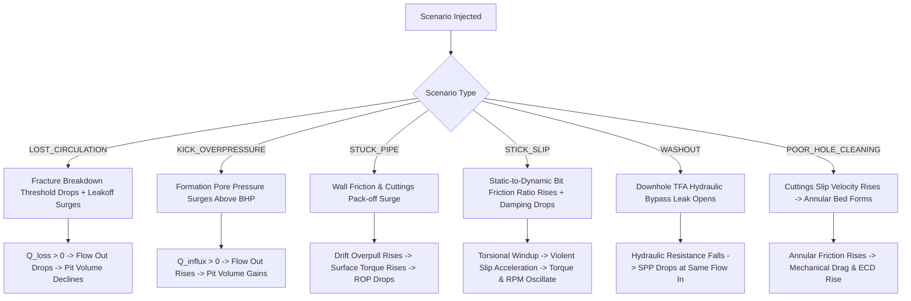

# eRTMAC-NWIS Digital Twin Fault Scenarios & Physical Signatures

**Document ID:** `docs/SIMULATION_SCENARIOS.md`  
**System:** eRTMAC-NWIS Module 5 Predictive Drilling Risk Analytics  
**Verification:** All Scenarios Verified Against Automated Quality Gates  

---

## 1. Overview of Scenario Philosophy

In eRTMAC-NWIS, fault scenarios do **not** directly overwrite sensor values. Instead, scenarios inject **physical parameter perturbations** into the geology, mechanics, or hydraulics solvers. The characteristic telemetry signatures emerge organically through coupled conservation laws.

---

## 2. Catalog of Supported Scenarios



---

### Scenario 1: `NORMAL` (Baseline Rotary Drilling)
- **Physical Mechanism:** Nominal formation rock strength, stable wellbore pressure window ($P_{pore} < BHP < P_{fracture}$), clean annular hole cleaning.
- **Physical Multipliers:** All multipliers set to $1.0\times$.
- **Telemetry Signature:**
  - $Q_{out} \approx Q_{in}$ within sensor noise ($\pm 10$ L/min).
  - Pit volume conserved ($|\Delta V_{pit}| \le 0.5$ m³).
  - Stable ROP ($10–25$ m/hr depending on rock UCS).
  - Stable SPP ($140–170$ bar).
  - Stick-slip index $SSI < 0.15$.

---

### Scenario 2: `LOST_CIRCULATION` (Fracture Breakdown / Thief Zone)
- **Physical Mechanism:** Penetration into naturally fractured or depleted formation with reduced fracture resistance ($P_{fracture}$ drops by $20–35\%$) and heightened leakoff coefficient ($C_{loss}$ multiplied by $4.0\times$).
- **Causal Physics Chain:**
  $$BHP > P_{fracture} \implies Q_{loss} = C_{loss} (BHP - P_{fracture})^{0.85} \implies Q_{out} = Q_{in} - Q_{loss} \implies \frac{dV_{pit}}{dt} < 0$$
- **Telemetry Signature:**
  - Return flow $Q_{out}$ drops immediately below injection flow $Q_{in}$ ($\Delta Q < -100$ L/min).
  - Persistent active pit volume loss ($\frac{dV_{pit}}{dt} < 0$).
  - Negative fracture margin ($FG\_margin < 0$).
  - ECD drops slightly if hydrostatic column level declines.

---

### Scenario 3: `KICK_OVERPRESSURE` (Formation Fluid Influx)
- **Physical Mechanism:** Entering abnormally geopressured shale, gas cap, or undercompacted sand where pore pressure gradient spikes ($P_{pore} > BHP$) and influx productivity index multiplies by $3.0\times$.
- **Causal Physics Chain:**
  $$P_{pore} > BHP \implies Q_{influx} = PI (P_{pore} - BHP) \implies Q_{out} = Q_{in} + Q_{influx} \implies \frac{dV_{pit}}{dt} > 0$$
- **Telemetry Signature:**
  - Return flow $Q_{out}$ surges above injection flow $Q_{in}$ ($\Delta Q > +100$ L/min).
  - Active pit volume gain ($\frac{dV_{pit}}{dt} > 0$).
  - Negative pore pressure margin ($PP\_margin < 0$).
  - Drilling break: ROP jumps due to reduced chip hold-down differential pressure.

---

### Scenario 4: `STUCK_PIPE` (Mechanical Differential / Pack-Off)
- **Physical Mechanism:** Wall contact friction coefficient multiplied by $2.8\times$, cuttings bed pack-off drag multiplied by $2.2\times$, mechanical dysfunction factor drops to $0.2\times$.
- **Causal Physics Chain:**
  $$\mu \uparrow + C_c \uparrow \implies F_{drag} = \mu N (1 + 3 C_c^{1.5}) \uparrow \implies Overpull \uparrow \implies Torque \uparrow \implies ROP \downarrow$$
- **Telemetry Signature:**
  - Axial overpull and drag surge by $30–80$ kN.
  - Surface torque climbs sharply ($> 25$ kN·m).
  - ROP drops drastically toward zero despite applied WOB.
  - Mechanical Specific Energy (MSE) spikes by $2\times–4\times$ indicating severe mechanical inefficiency.

---

### Scenario 5: `STICK_SLIP` (Torsional Resonant Limit Cycle)
- **Physical Mechanism:** Static-to-dynamic bit friction ratio multiplied by $1.8\times$, torsional damping ratio $c$ halved ($0.5\times$).
- **Causal Physics Chain:**
  $$I \ddot{\theta} + c \dot{\theta} + k \theta = T_{surface} - T_{bit}(\omega_{bit})$$
  Nonlinear Stribeck friction locks the bit until $k\theta \ge T_{static}$, releasing with explosive acceleration.
- **Telemetry Signature:**
  - Violent downhole bit RPM oscillations ($0$ to $> 200$ rpm while surface top drive rotates at steady $60$ rpm).
  - Torque oscillation amplitude $> 5$ kN·m.
  - Stick-slip index $SSI > 0.50$ (severe torsional dysfunction).

---

### Scenario 6: `WASHOUT` (Drillstring Fluid Bypass / Breach)
- **Physical Mechanism:** Pipe wall erosion or nozzle loss creates a secondary bypass flow area between drillpipe ID and annulus ($TFA$ increases by $100\%$).
- **Causal Physics Chain:**
  $$TFA \uparrow \implies \Delta P_{bit} = \frac{\rho Q^2}{2 C_d^2 TFA^2} \downarrow \implies SPP = \sum \Delta P \downarrow$$
- **Telemetry Signature:**
  - Sharp, unexpected drop in Standpipe Pressure ($SPP$ falls by $15–35$ bar) while pump flow $Q_{in}$ remains constant.
  - Surface return flow and pit volume remain unchanged (differentiating washout from lost circulation).

---

### Scenario 7: `POOR_HOLE_CLEANING` (Annular Solids Loading)
- **Physical Mechanism:** Particle slip velocity $v_{slip}$ increases by $2.0\times$ due to insufficient mud yield stress or low pump rate, dropping net transport velocity.
- **Causal Physics Chain:**
  $$v_{transport} = v_{annulus} - v_{slip} \downarrow \implies \frac{dC_c}{dt} > 0 \implies C_c \uparrow \implies \Delta P_{annulus} \uparrow \implies Drag \uparrow$$
- **Telemetry Signature:**
  - Annular cuttings concentration $C_c$ climbs progressively ($> 0.08$).
  - Annular pressure and ECD climb gradually over time.
  - Background drag and torque show steady upward drift.

---

## 3. Scenario Control API Usage

### Injecting a Scenario via REST:
```bash
# Inject Lost Circulation with 1.8x severity
curl -X POST "http://localhost:8000/api/v1/physics/scenario" \
  -H "Content-Type: application/json" \
  -d '{"scenario_type": "LOST_CIRCULATION", "severity": 1.8}'
```

### Resetting to Normal:
```bash
curl -X DELETE "http://localhost:8000/api/v1/physics/scenario"
```
