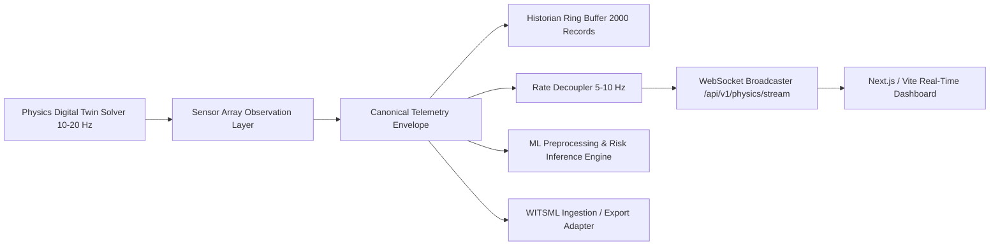

# eRTMAC-NWIS Live Telemetry Architecture & Streaming Implementation

**Document ID:** `docs/TELEMETRY_IMPLEMENTATION.md`  
**System:** eRTMAC-NWIS Module 5 Predictive Drilling Risk Analytics  
**Verification:** Live WebSocket Stream, REST Controller & Review Suite Tested (105/105 Passing)  

---

## 1. Overview & Streaming Architecture

The eRTMAC-NWIS telemetry system streams high-frequency, physics-grounded drilling measurements to the real-time operational dashboard and downstream predictive risk models.



### Key Architectural Tenets:
1. **Frequency Decoupling:** The internal physics integrator runs at **10–20 Hz** ($\Delta t = 50–100$ ms) to maintain stiff numerical stability. The telemetry broadcaster resamples at **5–10 Hz** to avoid saturating network sockets or client browser threads.
2. **Deterministic Time Indexing:** Every telemetry record binds simulation time, UTC timestamp, measured depth ($MD$), true vertical depth ($TVD$), subsea depth ($TVDSS$), and stratigraphic coordinate ($\xi$).
3. **Data Quality Awareness:** Every channel conveys its individual sensor health score $[0.0 .. 1.0]$ and status (`GOOD`, `SUSPECT`, `BAD`, `IMPUTED`).

---

## 2. Canonical Telemetry Schema

The telemetry schema matches the official Module 5 Section 46 specifications:

| Channel | Unit | Category | Description |
| :--- | :--- | :--- | :--- |
| `md_m` | m | Trajectory | Measured depth along borehole |
| `tvd_m` | m | Trajectory | True vertical depth from surface |
| `tvdss_m` | m | Trajectory | True vertical depth subsea (MSL) |
| `rop_m_hr` | m/hr | Mechanics | Rate of penetration |
| `rpm` | rpm | Mechanics | Surface rotary table / top drive speed |
| `bit_rpm` | rpm | Mechanics | Downhole bit rotary speed (MWD) |
| `wob_kn` | kN | Mechanics | Weight on bit |
| `torque_kn_m` | kN·m | Mechanics | Surface drilling torque |
| `hookload_kn` | kN | Mechanics | Tension at traveling block / hook |
| `overpull_kn` | kN | Mechanics | Axial friction / tripping drag |
| `mse_mpa` | MPa | Derived | Mechanical Specific Energy |
| `d_exponent` | dimensionless | Derived | Corrected d-exponent ($d_c$) |
| `stick_slip_index` | dimensionless | Mechanics | Torsional vibration severity ($SSI$) |
| `flow_in_lpm` | L/min | Hydraulics | Mud pump injection rate |
| `flow_out_lpm` | L/min | Hydraulics | Mud return flow at bell nipple |
| `standpipe_pressure_bar` | bar | Hydraulics | Surface standpipe pressure (SPP) |
| `annular_pressure_bar` | bar | Hydraulics | Downhole equivalent circulating pressure |
| `bhp_bar` | bar | Hydraulics | Bottomhole pressure |
| `pit_volume_m3` | m³ | Fluids | Active surface pit mud volume |
| `mud_weight_gcc` | g/cc | Fluids | Circulating mud density |
| `ecd_gcc` | g/cc | Hydraulics | Equivalent Circulating Density at bit |
| `pp_margin_bar` | bar | Pressure Window | Pore pressure margin ($BHP - P_{pore}$) |
| `fg_margin_bar` | bar | Pressure Window | Fracture gradient margin ($P_{frac} - BHP$) |
| `q_loss_lpm` | L/min | Fluids | Formation fluid loss rate |
| `q_influx_lpm` | L/min | Fluids | Formation fluid influx (kick) rate |
| `cuttings_concentration`| fraction | Hole Cleaning | Annular solids concentration $[0..1]$ |
| `inclination_deg` | deg | Trajectory | Borehole inclination |
| `azimuth_deg` | deg | Trajectory | Borehole azimuth |
| `temperature_c` | °C | Environment | Circulating bottomhole temperature |

---

## 3. Canonical Telemetry JSON Envelope

Matches Module 5 Section 47:

```json
{
  "well_id": "NHK-SIM-001",
  "wellbore_id": "DEFAULT",
  "sequence": 1420,
  "timestamp": "2026-09-28T02:00:00.100Z",
  "simulation_time_s": 142.0,
  "depth": {
    "md_m": 2503.45,
    "tvd_m": 2448.74,
    "tvdss_m": 2428.74
  },
  "formation": {
    "name": "Barail Sandstone",
    "xi": 0.668,
    "top_tvdss_m": 1400.0,
    "base_tvdss_m": 2940.0
  },
  "channels": {
    "rop_m_hr": 14.82,
    "rpm": 110.0,
    "bit_rpm": 108.4,
    "wob_kn": 85.0,
    "torque_kn_m": 18.25,
    "hookload_kn": 420.5,
    "overpull_kn": 8.4,
    "mse_mpa": 164.2,
    "d_exponent": 1.18,
    "stick_slip_index": 0.05,
    "flow_in_lpm": 2200.0,
    "flow_out_lpm": 2200.0,
    "standpipe_pressure_bar": 158.4,
    "annular_pressure_bar": 46.8,
    "bhp_bar": 312.4,
    "pit_volume_m3": 80.0,
    "mud_weight_gcc": 1.28,
    "ecd_gcc": 1.34,
    "pp_margin_bar": 64.2,
    "fg_margin_bar": 68.5,
    "q_loss_lpm": 0.0,
    "q_influx_lpm": 0.0,
    "cuttings_concentration": 0.041,
    "inclination_deg": 12.0,
    "azimuth_deg": 45.0,
    "temperature_c": 82.5
  },
  "quality": {
    "overall": 0.985,
    "channel_qualities": {
      "rop_m_hr": 1.0,
      "flow_out_lpm": 1.0,
      "standpipe_pressure_bar": 1.0
    },
    "flagged_channels": {
      "flow_out_lpm": "GOOD"
    }
  },
  "provenance": {
    "source": "NWIS_PHYSICS_ENGINE",
    "tier": "SYNTHETIC",
    "version": "1.0.0"
  }
}
```

---

## 4. API Endpoints & Simulation Control

Available under `/api/v1/physics/`:

| Method | Endpoint | Description |
| :--- | :--- | :--- |
| `POST` | `/api/v1/physics/start` | Starts continuous background physics simulation loop. |
| `POST` | `/api/v1/physics/pause` | Pauses simulation. |
| `POST` | `/api/v1/physics/step` | Advances the simulation by a single discrete step. |
| `POST` | `/api/v1/physics/reset` | Resets the digital twin to specified initial depth. |
| `POST` | `/api/v1/physics/speed` | Sets playback speed multiplier ($1\times, 2\times, 5\times, 10\times$). |
| `POST` | `/api/v1/physics/operator-inputs` | Dynamically updates surface controls (WOB, RPM, Flow Rate, Mud Weight). |
| `POST` | `/api/v1/physics/scenario` | Injects fault scenarios (`LOST_CIRCULATION`, `KICK_OVERPRESSURE`, `STUCK_PIPE`, etc.). |
| `DELETE`| `/api/v1/physics/scenario` | Clears active scenarios back to `NORMAL` baseline. |
| `GET` | `/api/v1/physics/status` | Returns simulator state, active connections, and latest telemetry record. |
| `GET` | `/api/v1/physics/historian` | Returns trailing buffer of telemetry records for chart seeding. |
| `WS` | `/api/v1/physics/stream` | WebSocket endpoint publishing live 5-10 Hz telemetry envelopes. |

---

## 5. WITSML Interoperability Boundary

The telemetry envelope maps directly to standard Energistics WITSML Log objects:
- `witsml:logCurveInfo` channels map 1:1 with `TelemetryChannels`.
- Time-indexed logs (`indexType="dateTime"`) and depth-indexed logs (`indexType="measured depth"`) are generated from the same envelope.
- Facilitates plugging into real oilfield rig telemetry feeds (eRTMAC/Drillwatch) without altering the downstream Module 5 risk analytics engines.
