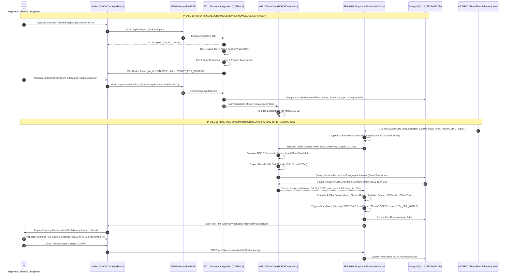

# End-to-End Operational Data Flow
### Telemetry Streams, Historical Ingestion, Subsurface Correlation, and Real-Time Hazard Advisory
**System:** eRTMAC-NWIS | **Traceability:** SIH26121 Core Operational Processing

---

## 1. Complete End-to-End Data Processing Chain

The fundamental mission of eRTMAC-NWIS is to transform fragmented historical records and high-speed rig sensor feeds into continuous, actionable ahead-of-bit decision intelligence. This section traces the exact data flow across all system boundaries.

---

## 2. Granular Data Flow Transformations

### Step 1: Raw Unstructured Ingestion to Structured Schema
1. **Raw Ingestion:** A 42-page historical PDF (*e.g., Well Completion Report for WELL-15/9-F-1A*) is received by `modules/01_document_intelligence`.
2. **Text Stream Extraction:** PyMuPDF parses digital text layers. If page image density $> 60\%$, the page is automatically classified as scanned.
3. **Vision OCR Pipeline:** Scanned pages are passed to Docling OCR, executing layout bounding-box segmentation to separate headers, footers, narrative paragraphs, and complex multi-row mud weight tables.
4. **Domain Entity Extraction:** Regex parsers identify key parameters (*e.g., `(?i)(lost\s+circulation|mud\s+loss)\s*[:=-]?\s*(\d+(?:\.\d+)?)\s*(bbl|m3|lpm)`*).
5. **Physical Sanity Filtering:** Layer 5 verifies that extracted values conform to physical realities (*e.g., Mud Weight must not exceed 25 ppg; Top Depth must precede Base Depth*). Any typographical character anomalies (*e.g., "1O.5 ppg" where letter 'O' replaces number '0'*) are repaired.

### Step 2: Spatial & Directional Survey Interpolation
1. **Surface Distance:** For the active well coordinates $(\phi_a, \lambda_a)$ and offset well $(\phi_w, \lambda_w)$, Haversine distance is calculated:
   $$d = 2R \arcsin\left(\sqrt{\sin^2\left(\frac{\Delta\phi}{2}\right) + \cos\phi_a\cos\phi_w\sin^2\left(\frac{\Delta\lambda}{2}\right)}\right)$$
2. **3D Wellbore Spline Generation:** Trajectory stations containing Measured Depth ($MD$), Inclination ($I$), and Azimuth ($A$) are processed through the Minimum Curvature Method, calculating exact 3D Cartesian coordinates $(N, E, TVD)$ at 5-meter depth intervals.
3. **Trajectory Type Classification:** Based on inclination profile, the well is automatically classified as `VERTICAL`, `J_TYPE`, `S_TYPE`, or `HORIZONTAL`.

### Step 3: Stratigraphic Depth Normalization & Horizon Alignment
1. **Formation Top Lookup:** Given current drill bit measured depth $d_t$, the system identifies the active formation $F_k$ penetrated by the active well.
2. **True Stratigraphic Depth Calculation:** To eliminate errors caused by regional structural dip ($\alpha$) and fault throws, the penetration depth is normalized relative to the formation top:
   $$d_{\text{strat}}(w, d) = \text{TVD}(w, d) - \text{Top}_{\text{TVD}}(F_k, w)$$
3. **Dimensionless Coordinate ($\xi$):** The fractional position within the formation interval is computed:
   $$\xi(w, d) = \frac{\text{TVD}(w, d) - \text{Top}_{\text{TVD}}(F_k, w)}{\text{Base}_{\text{TVD}}(F_k, w) - \text{Top}_{\text{TVD}}(F_k, w)}$$
   This guarantees that an event that occurred 30% into the Barail Sandstone in an offset well will correctly map to the 30% penetration depth of the active well, regardless of differences in total formation thickness.

### Step 4: Ahead-of-Bit Risk Corridor Generation
1. **Corridor Forward Projection:** The lookahead engine projects a forward depth window $\Delta D$ (typically 50 meters) ahead of current bit depth $d_{current}$:
   $$\mathcal{W}_{\text{lookahead}} = [d_{\text{current}}, d_{\text{current}} + 50\text{ m}]$$
2. **Offset Hazard Clustering:** The system queries all historical events occurring in top-ranked DORS offset wells within this stratigraphic window:
   $$\mathcal{C}_k = \left[ \min_{e \in \mathcal{E}} d_{\text{start}}(e) - 10\text{ m}, \; \max_{e \in \mathcal{E}} d_{\text{end}}(e) + 10\text{ m} \right]$$
3. **Operational Lead Time Calculation:** Assuming current rate of penetration ($ROP$), the system computes the exact time window before bit entry:
   $$T_{\text{lead}} = \frac{D_{\text{start}}(\mathcal{C}_k) - d_{\text{current}}}{ROP_{\text{current}}} \times 60 \text{ minutes}$$
   At a standard penetration rate of $30\text{ m/hr}$, an alert triggered 20 meters before the loss zone provides **40 minutes of operational lead time**, giving the mud engineer ample time to mix and spot a high-fluid-loss squeeze pill.

### Step 5: 4-Pillar Risk Aggregation & Cockpit Dispatch
1. **Pillar 1 (Deterministic Rules):** Evaluates sensor discrepancies (*e.g., $\Delta Flow = Flow_{out} - Flow_{in} < -80\text{ LPM}$*).
2. **Pillar 2 (Isolation Forest):** Identifies anomalous multi-parameter drift across Standpipe Pressure, Torque, and ROP.
3. **Pillar 3 (Supervised ML):** Computes calibrated probability from trained hazard classifiers.
4. **Pillar 4 (Offset Prior):** Evaluates the historical event density in top DORS offset wells.
5. **Weighted Synthesis:**
   $$R_H(t) = 0.35 \cdot S_{\text{rules}} + 0.20 \cdot S_{\text{anomaly}} + 0.30 \cdot S_{\text{ML}} + 0.15 \cdot S_{\text{offset}}$$
6. **Dispatch:** If $R_H(t) \ge 0.70$, a `CRITICAL` advisory payload is broadcast via WebSocket to all connected SCADA cockpit sessions.
