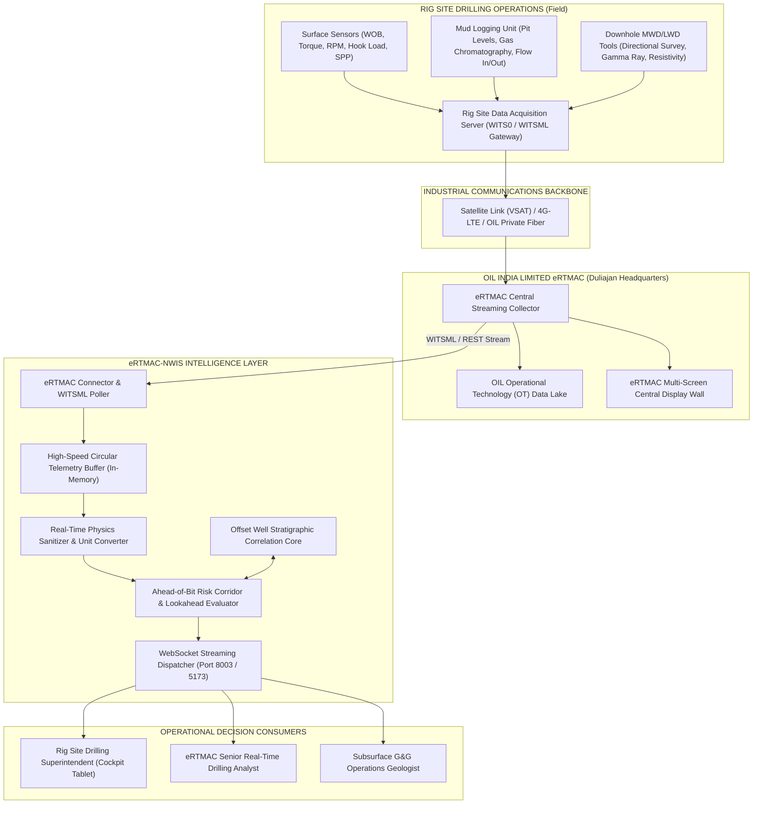
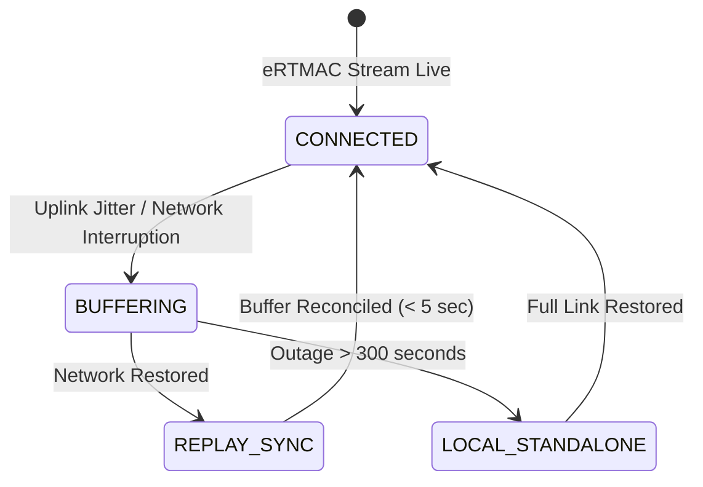

# eRTMAC Integration & Real-Time Operational Data Flow
### Architecture, Industrial Protocols, Security Perimeters, and Fault-Tolerant Edge Buffering
**Client Organization:** Oil India Limited (Duliajan, Assam) | **System:** eRTMAC-NWIS

---

## 1. The Industrial Operational Context: Oil India Limited eRTMAC

**eRTMAC** (*Real Time Data Monitoring and Analysis Centre*), situated at Oil India Limited’s Field Headquarters in **Duliajan, Assam**, serves as the central operational nerve center for all exploratory and developmental drilling activities across OIL’s operational concessions.



---

## 2. Integration Protocols & Transport Mechanisms

eRTMAC-NWIS is engineered to interface with industrial drilling feeds through standardized petroleum data exchange protocols:

### 2.1 Supported Industrial Telemetry Protocols

| Protocol | Version | Transport | Data Frequency | Primary Use Case |
|---|---|---|---|---|
| **WITSML** | 1.4.1.1 / 2.0 | HTTP/SOAP & REST | 1 Hz to 0.1 Hz | Master trajectory surveys, BHA logs, daily mud properties, casing shoe depths. |
| **WITS Level 0** | Pre-WITSML Legacy | TCP Socket / RS-232 | 1 Hz (Continuous) | High-frequency surface drilling channels (Records 01, 02, 05, 08). |
| **OPC-UA** | 1.04 | TCP / Binary | 10 Hz to 1 Hz | Direct connection to modern cyber rig programmable logic controllers (PLCs). |
| **MQTT / Kafka** | 3.1.1 / 2.8+ | TLS Encrypted TCP | Event-Driven | Enterprise OT data lake integration for real-time historical event streaming. |

### 2.2 WITS Level 0 Channel Mapping to NWIS Canonical Telemetry Schema

When consuming continuous surface feeds via WITS Level 0, NWIS maps standard Record 01 (General Drilling) and Record 02 (Drilling - High Frequency) directly into its Pydantic schema:

```json
{
  "timestamp": "2026-10-05T14:32:00.000Z",
  "well_id": "WELL-NHK-001",
  "bit_depth_md_m": 3215.4,
  "hole_depth_md_m": 3215.4,
  "rate_of_penetration_m_hr": 28.5,
  "weight_on_bit_klbs": 24.2,
  "rotary_rpm": 120.0,
  "surface_torque_kft_lb": 14.8,
  "standpipe_pressure_psi": 2850.0,
  "flow_rate_in_lpm": 2450.0,
  "flow_rate_out_percent": 100.0,
  "active_pit_volume_m3": 124.5,
  "mud_density_in_ppg": 11.2,
  "mud_density_out_ppg": 11.2,
  "equivalent_circulating_density_ppg": 11.85,
  "total_gas_units": 45.0
}
```

---

## 3. Strict Safety Perimeters & Read-Only Operational Isolation

> [!IMPORTANT]
> **NWIS IS A DECISION-SUPPORT SYSTEM, NOT AN AUTONOMOUS DRILLING CONTROL SYSTEM.**  
> Under no circumstances does NWIS transmit control commands to rig drawworks, top drives, mud pumps, or Blowout Preventers (BOPs).

### 3.1 The Unidirectional Read-Only Data Boundary
To satisfy strict industrial functional safety standards (IEC 61508 / IEC 61511):
1. **Network Demilitarized Zone (DMZ):** NWIS connects to eRTMAC across a strictly enforced unidirectional network diode or read-only reverse proxy.
2. **Read-Only Credentials:** The service account configured in `NWIS_ERTMAC_CONNECTION_STRING` is granted `SELECT`-only privileges on eRTMAC database views, with zero `INSERT`, `UPDATE`, or `EXECUTE` rights on rig control tables.
3. **Deterministic Separation of Roles:**
   * **Rig Control System (Cyber Rig):** Executes driller joystick inputs, anti-collision interlocks, and emergency automatic shut-in sequences.
   * **eRTMAC Core:** Monitors continuous operational telemetry and maintains regulatory rig records.
   * **eRTMAC-NWIS:** Computes subsurface offset correlation, projects ahead-of-bit risk corridors, and delivers contextual recommendations to authorized human drilling engineers.

---

## 4. Network Resilience, Latency SLAs & Edge Disruption Buffering

Field drilling rigs in remote locations (*e.g., Brahmaputra river islands, Upper Assam jungles*) occasionally experience satellite uplink latency jitter or brief communication dropouts. NWIS implements resilient edge-buffering architecture:



1. **Local Ring Buffer:** The eRTMAC connector maintains a 10,000-record circular memory buffer holding the preceding 2.7 hours of continuous 1 Hz telemetry.
2. **Automatic Time-Series Replay Synchronization:** Upon link restoration following an outage, NWIS transmits a `GET /witsml/query?since={last_received_timestamp}` request, rapidly backfilling missing intervals without creating duplicate database rows (`ON CONFLICT DO NOTHING`).
3. **Dead-Band Telemetry Filtering:** To conserve satellite bandwidth while maintaining micro-scale anomaly resolution, the edge connector suppresses duplicate sensor updates if parameters vary by less than $0.1\%$ within a 1-second interval, transmitting periodic heartbeats every 10 seconds.
4. **Latency Budget:**
   * Satellite Transmission (Rig $\rightarrow$ eRTMAC Duliajan): $\approx 450\text{ ms}$.
   * eRTMAC Ingestion $\rightarrow$ NWIS Connector: $\approx 50\text{ ms}$.
   * NWIS Correlation & Risk Evaluation: $\approx 120\text{ ms}$.
   * WebSocket Broadcast to Cockpit: $\approx 60\text{ ms}$.
   * **Total Glass-to-Glass Latency:** $< 700\text{ ms}$, comfortably within the required 2-second real-time drilling decision threshold.
