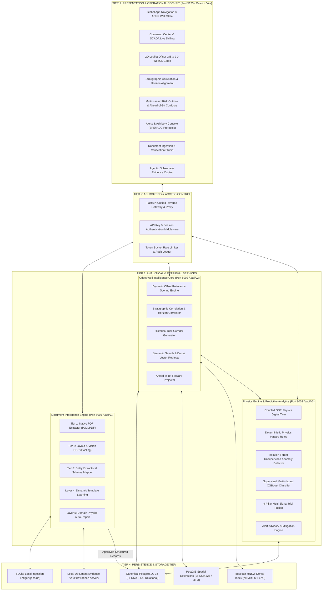

# System Design & Logical Architecture
### End-to-End Component Decomposition, Service Boundaries, and Runtime Contracts
**System:** eRTMAC-NWIS | **Standard Alignment:** PPDM 3.9, WITSML 1.4.1.1, OSDU Data Platform

---

## 1. High-Level Logical Architecture

eRTMAC-NWIS is engineered as a decoupled, multi-tiered enterprise architecture designed to operate with sub-second responsiveness while executing complex subsurface mathematical simulations and processing multi-gigabyte document corpora.

---

## 2. Component Responsibilities & Service Contracts

### 2.1 Tier 1: Presentation & Operational Cockpit (`frontend/`)
* **Technology:** React 18, TypeScript 5.6, Vite 5.4, Tailwind CSS, Leaflet, Three.js / React Three Fiber, Lucide Icons.
* **Core Responsibilities:**
  * Global state management via `AppContext`: Tracks `active_well_id`, current measured depth (`current_md_m`), search radius (`search_radius_km`), and live telemetry stream.
  * Real-time telemetry consumption: Establishes a persistent WebSocket connection to `/ws/telemetry` or `/api/v3/physics/stream` for live parameter updates at 1 Hz.
  * Dynamic spatial rendering: Re-renders candidate offset wells on both 2D SCADA maps and 3D subsurface trajectory views instantly upon slider adjustments.
  * Human-in-the-loop review: Provides interactive document validation screens allowing drilling engineers to review, correct, and approve extracted formation tops and hazard events before writing to the canonical database.

### 2.2 Tier 2: Unified API Gateway & Security Perimeter
* **Technology:** FastAPI, Starlette, Uvicorn, Nginx/Reverse Proxy architecture.
* **Core Responsibilities:**
  * Request routing: Directs incoming requests to the appropriate service module (`/api/v1` $\rightarrow$ Document Intelligence, `/api/v2` $\rightarrow$ Offset Core, `/api/v3` $\rightarrow$ Physics & Risk Fusion).
  * CORS enforcement: Strictly regulates cross-origin resource sharing between development endpoints and production domain perimeters.
  * Cryptographic API key validation: Inspects `X-API-Key` headers against hashed environment keys, enforcing role-based access for field personnel vs. administrators.

### 2.3 Tier 3: Analytical & Machine Learning Services

#### Module 01: Document Intelligence Service (`/api/v1`, Default Port: 8001)
* **Inputs:** Raw binary PDF documents (scanned or native), job configuration parameters, review decisions.
* **Outputs:** Validated JSON schemas conforming to `DocumentExtractionResult`, including well headers, formation tops, mud logging intervals, drilling events, and NPT summaries.
* **Internal Processing:**
  1. *Tier 1 Native Parsing:* High-speed stream extraction via PyMuPDF for digitally created PDF reports.
  2. *Tier 2 Layout Vision OCR:* Deep visual layout analysis using Docling and Vision Transformers, isolating complex multi-column tables, headers, and callouts.
  3. *Tier 3 Domain Entity Extraction:* Rule-based and regular-expression extraction mapping domain terminology to PPDM-compliant entities.
  4. *Layer 4 Template Learner:* Dynamic caching of recurring operator report formats (*e.g., Oil India standard DDR format vs. Equinor Volve format*).
  5. *Layer 5 Physics-Based Auto-Repair:* Validates extracted parameters against hard petroleum physical laws (*e.g., verifying that $Top\_MD < Base\_MD$, Mud Density $\in [8.0, 20.0]\text{ ppg}$, and Standpipe Pressure $< 6,000\text{ psi}$*), automatically repairing minor OCR character dropouts.

#### Module 02: Offset Well Intelligence Core (`/api/v2`, Default Port: 8002)
* **Inputs:** Active well identifier, target measured depth, search radius, natural language queries.
* **Outputs:** DORS offset rankings, stratigraphic depth tracks, historical risk corridors, semantic search results with source citations.
* **Internal Processing:**
  1. *Haversine & Spatial Calculator:* Computes real surface distances and initial proximity filters.
  2. *Minimum Curvature Engine:* Solves directional survey math converting MD, Inclination, and Azimuth into 3D TVD, North, and East coordinates.
  3. *Stratigraphic Horizon Correlator:* Aligns geological formation tops across divergent wells using the dimensionless penetration coordinate ($\xi$).
  4. *DORS Scoring Engine:* Computes the 5-factor composite offset relevance score across all candidate wells.
  5. *Dense Semantic Index:* Executes in-memory and pgvector dot-product similarity searches using 384-dimensional dense vectors generated by `all-MiniLM-L6-v2`.

#### Modules 04 & 05: Physics Digital Twin & Predictive Analytics (`/api/v3`, Port: 8003)
* **Inputs:** Real-time surface and downhole sensor telemetry streams, formation boundary context from Module 02.
* **Outputs:** Physics-simulated parameters, multi-pillar hazard probabilities, real-time alert advisories, SPE/IADC mitigation protocols.
* **Internal Processing:**
  1. *Physics Digital Twin:* Coupled numerical integration of differential equations modeling drillstring torsional vibration, swab/surge pressures, Fanning hydraulic friction, and annular cuttings transport.
  2. *Deterministic Rule Engine:* Evaluates sharp physical threshold boundaries (delta flow rate, pit volume trend, d-exponent drilling break).
  3. *Unsupervised Anomaly Detector:* Isolation Forest computing multi-dimensional parameter divergence over rolling telemetry windows.
  4. *Supervised Hazard Classifier:* Multi-class XGBoost model estimating conditional probabilities for Stuck Pipe, Wellbore Instability, and Fluid Influx.
  5. *Multi-Signal Fusion Core:* Aggregates the 4 analytical pillars into a single calibrated risk score $R_H(t) \in [0, 1]$ per hazard.

### 2.4 Tier 4: Canonical Persistence Layer (`database/`)
* **Technology:** PostgreSQL 16, PostGIS 3.4, pgvector 0.7.4, SQLite 3.
* **Core Responsibilities:**
  * PPDM 3.9 Master Data: Authority tables for operators, fields, basins, wells, and reference stratigraphy.
  * WITSML 1.4.1.1 Work Product Data: Wellbore trajectories, directional survey stations, casing shoe records, and raw drilling runs.
  * Institutional Memory: Centralized `drilling_events` table linking historical incidents to exact formation intervals, NPT durations, mitigation summaries, and original document references.
  * Auditability & Provenance: Strict `source_type` enumeration (`REAL`, `SYNTHETIC`, `SIMULATED`, `IMPORTED`, `DERIVED`) ensuring that simulated demo signals can never be misidentified as verified field observations.

---

## 3. Synchronous vs. Asynchronous Workflows

To prevent blocking the operational cockpit during compute-heavy operations, NWIS enforces a strict separation between synchronous and asynchronous operations:

| Workflow | Protocol | Latency SLA | Execution Mode | Failure Handling Strategy |
|---|---|---|---|---|
| **Live Telemetry Evaluation** | WebSocket / WSS | $< 100\text{ ms}$ | Synchronous Stream | Automatic fallback to last valid state; connection retry with exponential backoff. |
| **DORS Offset Re-Ranking** | HTTP GET / REST | $< 250\text{ ms}$ | Synchronous In-Memory | In-memory spatial-index query; cached fallback if trajectory points are missing. |
| **Stratigraphic Depth Track** | HTTP GET / REST | $< 300\text{ ms}$ | Synchronous | Linear interpolation over pre-parsed formation top arrays. |
| **Semantic Knowledge Query** | HTTP GET / REST | $< 400\text{ ms}$ | Synchronous | Vector cosine scan with automatic degradation to keyword search if vector model stalls. |
| **PDF Document Ingestion** | HTTP POST / REST | $5\text{ s} - 45\text{ s}$ | **Asynchronous Job** | Background task execution returning `job_id`; client polls `/jobs/{id}` or listens for completion; SQLite job state persistence. |
| **Database Sync / Resync** | HTTP POST / REST | $< 1.5\text{ s}$ | Asynchronous Worker | Idempotent UPSERT (`ON CONFLICT DO UPDATE`); retry queue with dead-letter logging. |

---

## 4. Resilience, Caching & Failover Design

1. **Embedding Model Pre-Warming:** During application bootstrap, Module 02 pre-warms the `all-MiniLM-L6-v2` transformer model in a background thread, eliminating the typical 60–120 second cold-start delay on first user search.
2. **Dual-Tier Knowledge Search Fallback:** If the PyTorch vector engine fails or exhausts GPU/CPU memory, the search engine automatically degrades to a deterministic BM25 / token-matching keyword scan, openly reporting `search_mode: "keyword_fallback"` in the API response.
3. **Database-Agnostic In-Memory Fallback:** If the external PostgreSQL container is offline or unreachable, Module 02 gracefully serves read requests from its in-memory `NWISDataStore`, ensuring that field operations are never interrupted by database maintenance.
4. **Transparent Model Degradation Disclosure:** When advanced machine learning classifiers are unfitted or lack sufficient historical training samples, the predictive engine automatically re-distributes pillar weights to deterministic physics rules, plainly signaling `UNFITTED_FALLBACK` to the user rather than fabricating artificial confidence scores.
