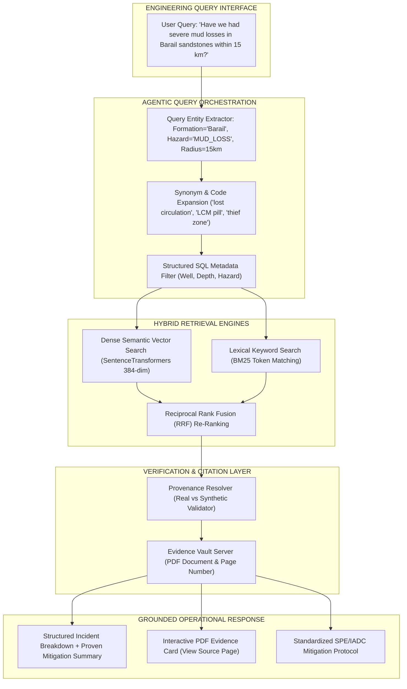

# Agentic RAG & Subsurface Evidence Retrieval
### Dense Vector Embeddings, Hybrid Lexical-Semantic Indexing, and Grounded Provenance Tracking
**Model:** `all-MiniLM-L6-v2` (384 Dimensions) | **Index:** In-Memory Cosine / pgvector HNSW | **Module:** `modules/02_nwis_backend/search`

---

## 1. The Challenge with Generic LLM RAG in Drilling Operations

Standard Retrieval-Augmented Generation (RAG) frameworks designed for consumer chat applications suffer from critical failure modes when applied to subsurface petroleum engineering:
1. **Hallucination Risk:** Generating plausible-sounding but physically catastrophic drilling parameters (*e.g., advising a mud weight higher than formation fracture gradient, inducing a fatal underground blowout*).
2. **Loss of Depth & Stratigraphic Context:** Generic vector search retrieves text chunks containing the keyword *"mud loss"*, but fails to recognize whether the loss occurred at $1,200\text{ m}$ in Alluvium or at $3,450\text{ m}$ in the high-pressure Barail Sandstone.
3. **Absence of Grounded Auditability:** Drilling superintendents will not execute multi-million dollar operational decisions (*e.g., spotting 50 bbl of coarse LCM or ordering casing strings*) based on unverified chatbot text without seeing the original signed Daily Drilling Report.

eRTMAC-NWIS implements **Domain-Constrained Subsurface Agentic RAG**, combining deep dense vector search with hard stratigraphic metadata filtering and strict page-level PDF evidence citations.



---

## 2. Mathematical Vector Indexing & Hybrid Search Architecture

### 2.1 Embedding Representation (`all-MiniLM-L6-v2`)
Historical drilling narratives, daily drilling remarks, and incident descriptions are vectorized into a continuous 384-dimensional dense semantic space:

$$\mathbf{v}_e = \text{TransformerEncoder}(\text{Text}(e)) \in \mathbb{R}^{384}, \quad \|\mathbf{v}_e\|_2 = 1$$

To maximize domain relevance, the text passed into the transformer combines multiple structured dimensions into a canonical passage format:
```text
Well: WELL-NHK-002 | Formation: Barail Sandstone | Depth: 3215.4m | Hazard: MUD_LOSS | Severity: CRITICAL
Narrative: Total lost returns encountered while drilling 8.5 inch hole at 3215m. Standpipe pressure dropped from 2800 psi to 1400 psi. Pumped 45 bbl medium-coarse LCM pill. Losses cured after 4 hours.
```

### 2.2 Dual-Mode Hybrid Retrieval
The system executes parallel retrieval branches, combining lexical precision for specific well names and technical acronyms with semantic flexibility for natural language queries:

```python
# Semantic Cosine Similarity:
score_semantic = np.dot(query_embedding, doc_embedding)

# Reciprocal Rank Fusion (RRF):
RRF_score(d) = sum(1.0 / (k + rank_i(d)) for rank_i in [rank_semantic, rank_lexical])
```

Where smoothing parameter $k = 60$. The combined score guarantees that documents matching both exact keywords and contextual semantics achieve the highest priority.

---

## 3. Strict Evidence Attribution & Provenance Badges

To maintain total transparency during Smart India Hackathon demonstrations and operational deployment, every retrieved knowledge record surfaces its exact provenance:

```text
┌─────────────────────────────────────────────────────────────────────────────────┐
│ EVENT RECORD: EVT-NHK002-LOSS-03                                                │
│ PROVENANCE: [REAL SOURCE DATA]   HAZARD: MUD LOSS   SEVERITY: CRITICAL          │
├─────────────────────────────────────────────────────────────────────────────────┤
│ Well: WELL-NHK-002 (Baghjan Field) | Depth: 3,215.4 m | Formation: Barail Sand │
│ Non-Productive Time: 14.5 Hours | IADC Code: 07 (Lost Circulation)              │
│                                                                                 │
│ Remedial Action Taken:                                                          │
│ Spotted 40 bbl high-fluid-loss squeeze pill containing 25 ppb calcium carbonate │
│ blend (fine/medium) + 15 ppb mica flakes. Squeeze pressure 450 psi. Returns     │
│ restored to 100%.                                                               │
│                                                                                 │
│ Source Reference:                                                               │
│ Document: WELL-NHK-002_DRILLING_SUMMARY.pdf (Page 18, Paragraph 3)              │
│ [ VIEW ORIGINAL PDF SOURCE ]                                                    │
└─────────────────────────────────────────────────────────────────────────────────┘
```

### Provenance Classification Standards:
* **`REAL` Badge (Emerald Green):** Extracted directly from genuine physical field documents (*e.g., Equinor Volve WCRs/DDRs*). Clicking *"View Source"* opens the authentic PDF in the built-in PDF.js evidence viewer.
* **`SYNTHETIC` Badge (Amber Warning):** Procedurally generated testbed records designed to validate edge-case boundary conditions (*e.g., multi-well kick cascades*). Clearly indicated so evaluators and engineers know it is a simulated scenario.
* **`SIMULATED` Badge (Cyan Info):** Telemetry or alert events emitted live by the numerical physics twin or scenario injector during testing.
