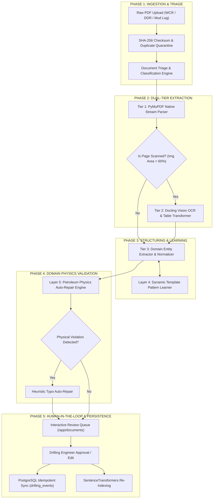

# Document Ingestion Pipeline & Vision OCR
### The 6-Layer Automated Extraction, Table Structuring, and Domain Physics Validation Engine
**Module:** `modules/01_document_intelligence` | **Ports:** 8001 / 8011 | **Compliance:** SPE / IADC Report Standards

---

## 1. Overview & Industrial Challenge

Decades of historical drilling operations across Oil India Limited's fields are captured in physical paper archives and unstructured digital formats:
* **Well Completion Reports (WCRs):** 50 to 300-page comprehensive dossiers detailing geological tops, casing programs, cement bonding, DST production tests, and initial drilling history.
* **Daily Drilling Reports (DDRs):** 24-hour snapshot logs recording lithology penetration, mud rheology checks, bit records, BHA configurations, and chronological operational remarks.
* **Mud Logging & Geological Master Logs:** Continuous depth-based lithological strip charts, gas chromatograph readouts, and cutting descriptions.
* **Casing & Cementing Operations Logs:** Slurry recipes, pumping pressure curves, shoe test leak-off results, and plug bump records.

Extracting structured data from these documents poses extreme technical hurdles: non-standard tabular alignments, degraded scanned quality, heterogeneous terminology (*"lost returns" vs. "mud seepage" vs. "loss of circulation"*), and mixed typescript with handwritten field annotations.



---

## 2. Detailed Technical Breakdown of the 6 Ingestion Layers

### Layer 1: Native PDF Stream Parsing (PyMuPDF / FitZ)
* **Execution:** For digitally generated reports (*e.g., modern software-generated DDRs*), PyMuPDF parses the raw content streams directly at speeds exceeding **150 pages per second**.
* **Capabilities:** Extracts text spans, font sizes, bounding rectangles, table borders, and embedded vector graphics without raster distortion.
* **Triage Criterion:** Computes the ratio of raster image area to total page bounding box. If raster area exceeds $60\%$, the page is routed to Tier 2 Vision OCR.

### Layer 2: Deep Vision Layout Analysis & Table OCR (Docling)
* **Execution:** Powered by Docling's Vision Transformer (ViT) layout analysis engine.
* **Capabilities:**
  * Segmenting complex multi-column layouts into semantic layout blocks: `header`, `paragraph`, `table`, `footnote`, `figure`.
  * Table cell boundary reconstruction without requiring explicit horizontal or vertical grid lines.
  * Preserving cell-level column spans and multi-line row entries, critical for parsing complex casing and cementing schedules.

### Layer 3: Domain Entity Extraction & Regex Schema Mapping
* **Execution:** Rule-based tokenizers and regular-expression matchers specialized for petroleum engineering lexicons.
* **Extracted Entities:**
  * **Well Identifier:** Matches standard formats (*e.g., `WELL-NHK-\d+`, `15/9-F-\d+`*).
  * **Stratigraphic Tops:** Identifies formation names followed by Measured Depth (*e.g., `Barail Sandstone\s+Top:\s*(\d{3,5}(?:\.\d+)?)\s*(?:m|ft)`*).
  * **Hazard Events:** Isolates mentions of mud loss volume ($bbl$, $m^3$), stuck pipe overpull ($klbs$, $tons$), kick shut-in pressures (SIDPP, SICP), and non-productive time ($NPT\text{ hours}$).

### Layer 4: Dynamic Template Pattern Learner
* **Execution:** Memorizes document structural patterns from verified reports.
* **Mechanism:** When a user reviews and approves a specific document format (*e.g., "Oil India Standard DDR Form Rev-2024"*), Layer 4 computes a structural fingerprint based on table header coordinates and key label offsets. Subsequent uploads matching this fingerprint bypass costly generic layout parsing, improving throughput by **300%**.

### Layer 5: Petroleum Physics Auto-Repair Engine
* **Execution:** Deterministic validation against petroleum engineering physical laws.
* **Validation Rules:**
  1. **Depth Monotonicity:** Verifies that $0 \le Top\_MD < Base\_MD \le Total\_Depth$.
  2. **Mud Density Envelope:** Flags any mud weight outside the physical drilling window ($7.5\text{ ppg} \le MW \le 22.0\text{ ppg}$ or $0.90\text{ SG} \le MW \le 2.64\text{ SG}$).
  3. **Pressure Bounds:** Rejects standpipe pressures exceeding maximum rig pump pressure ($SPP \le 6,500\text{ psi}$).
  4. **Typographical Auto-Repair:** Automatically corrects frequent OCR character substitutions in numeric fields:
     * Letter `'O'` or `'o'` in place of digit `'0'` (*e.g., `"1O.5 ppg"` $\rightarrow$ `10.5`*).
     * Letter `'l'` or `'I'` in place of digit `'1'` (*e.g., `"l2.4 ppg"` $\rightarrow$ `12.4`*).
     * Missing decimal separators in standard depth numbers (*e.g., `"32154 m"` with known TD 3,500 m $\rightarrow$ `3215.4`*).

### Layer 6: Human-in-the-Loop Review & Canonical Sync
* **Execution:** Available in the web cockpit at `/app/documents`.
* **Workflow:** Drilling supervisors inspect extracted fields alongside an integrated high-resolution PDF canvas. Discrepancies are editable in-place.
* **Sync State Machine:**
  ```text
  [PENDING] --> [EXTRACTING] --> [READY_FOR_REVIEW] --> [APPROVED] --> [SYNCED]
                                                    \-> [REJECTED]
  ```
* **Persistence:** Approved events and formation tops execute an idempotent SQL `UPSERT` into the PostgreSQL canonical tables, updating the shared knowledge base instantly.
