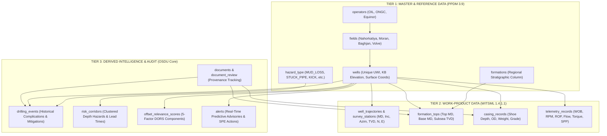

# Canonical Data Models, Normalization & Validation
### Petroleum Data Standards, Coordinate Harmonization, Depth References, and Relational Schema
**Standards:** PPDM 3.9 (Professional Petroleum Data Management), WITSML 1.4.1.1, OSDU Data Platform

---

## 1. Industry Standard Alignment (PPDM & OSDU)

Historical drilling records originate from multiple operators, contractors, and service companies, each using divergent data conventions. eRTMAC-NWIS enforces strict normalization by aligning with the two dominant global upstream petroleum data architectures:



---

## 2. Normalization & Harmonization Rules

### 2.1 Depth Reference Harmonization
Drilling depth measurements must be anchored to a certified surface reference elevation. NWIS dynamically translates all incoming records to True Vertical Depth Subsea (TVDSS):

$$\text{TVDSS} = \text{TVD} - \text{Elevation}_{\text{KB}}$$

| Reference Datum | Abbreviation | Definition | Conversion to Ground Level (GL) |
|---|---|---|---|
| **Kelly Bushing** | KB | Surface reference on rotary table floor (standard for rig MD). | $\text{Elevation}_{\text{GL}} = \text{Elevation}_{\text{KB}} - \Delta h_{\text{KB-GL}}$ |
| **Rotary Kelly Bushing** | RKB | Synonymous with Kelly Bushing in modern top-drive operations. | Identical to KB. |
| **Ground Level** | GL | True topographical surface elevation above mean sea level. | Baseline ($0.0\text{ m}$). |
| **Mean Sea Level** | MSL | Global gravitational geodetic reference ($0\text{ m TVDSS}$). | $\text{TVDSS} = \text{TVD}_{\text{GL}} - \text{Elevation}_{\text{MSL}}$. |

### 2.2 Coordinate Reference Systems (CRS)
* **Surface Reference:** All geographical coordinates are canonicalized to **WGS 84 (EPSG:4326)** in decimal degrees with 6 decimal places of precision ($\approx 0.11\text{ meter}$ ground resolution).
* **Projected Cartesian Grid:** For local well separation and anti-collision calculations, coordinates are projected to the relevant Universal Transverse Mercator (UTM) zone:
  * **Upper Assam Basin:** UTM Zone 46 North (EPSG:32646) or UTM Zone 47 North (EPSG:32647).
  * **North Sea (Volve Benchmark):** UTM Zone 31 North (EPSG:32631).

### 2.3 Unit Normalization Matrix
All calculations within analytical engines run strictly on standardized SI or canonical Oilfield units:

| Parameter Category | Raw Incoming Formats | Canonical Storage Unit | Conversion Formula |
|---|---|---|---|
| **Drilling Depth** | Feet (`ft`), Yards (`yd`) | Meters (`m`) | $d_{\text{m}} = d_{\text{ft}} \times 0.3048$ |
| **Mud Density** | Specific Gravity (`SG`), $\text{kg/m}^3$ | Pounds per Gallon (`ppg`) | $\rho_{\text{ppg}} = \rho_{\text{SG}} \times 8.3454$ |
| **Pressure** | Bar (`bar`), Kilopascals (`kPa`), MPa | Pounds per Square Inch (`psi`) | $P_{\text{psi}} = P_{\text{bar}} \times 14.5038$ |
| **Volumetric Flow** | Gallons per Minute (`gpm`), $\text{m}^3/\text{hr}$ | Liters per Minute (`LPM`) | $Q_{\text{LPM}} = Q_{\text{gpm}} \times 3.7854$ |
| **Rotary Torque** | Kilo-Newton Meters (`kN·m`) | Foot-Pounds (`ft-lb`) | $\tau_{\text{ft-lb}} = \tau_{\text{kN·m}} \times 737.562$ |
| **Volume (Pits/LCM)** | Barrels (`bbl`), Gallons (`gal`) | Cubic Meters ($\text{m}^3$) | $V_{\text{m}^3} = V_{\text{bbl}} \times 0.158987$ |

---

## 3. Relational Schema & Idempotent Upsert Design

### 3.1 Strict Provenance Tagging (`source_type` Enum)
To ensure that simulated data or synthetic demonstration fixtures can never be confused with audited physical well operations, every work-product table carries a non-nullable `source_type` column:

```sql
CREATE TYPE source_type AS ENUM (
    'REAL',       -- Parsed directly from genuine historical field documents (e.g. Volve PDFs)
    'SYNTHETIC',  -- Procedurally generated testbed data for algorithm verification
    'SIMULATED',  -- Generated by the live numerical physics digital twin
    'IMPORTED',   -- Received via external real-time feed (eRTMAC WITSML)
    'DERIVED'     -- Computed by NWIS analytical engines (DORS, Corridors, Risk Fusion)
);
```

### 3.2 Idempotent Handoff Contract
When an engineer approves extracted records in the document review console, the backend executes an idempotent SQL `UPSERT` transaction:

```sql
INSERT INTO drilling_events (
    event_id, well_id, hazard_type, severity, 
    start_depth_md_m, end_depth_md_m, formation_name,
    npt_hours, description, mitigation_summary, 
    source_document, source_page, source_type, created_at
) VALUES (
    $1, $2, $3, $4, $5, $6, $7, $8, $9, $10, $11, $12, 'REAL', NOW()
)
ON CONFLICT (event_id) DO UPDATE SET
    hazard_type        = EXCLUDED.hazard_type,
    severity           = EXCLUDED.severity,
    start_depth_md_m   = EXCLUDED.start_depth_md_m,
    end_depth_md_m     = EXCLUDED.end_depth_md_m,
    formation_name     = EXCLUDED.formation_name,
    npt_hours          = EXCLUDED.npt_hours,
    description        = EXCLUDED.description,
    mitigation_summary = EXCLUDED.mitigation_summary,
    source_document    = EXCLUDED.source_document,
    source_page        = EXCLUDED.source_page,
    updated_at         = NOW();
```

This guarantees that re-running ingestion jobs or reprocessing corrected reports will update existing rows cleanly without duplicating historical incidents.
