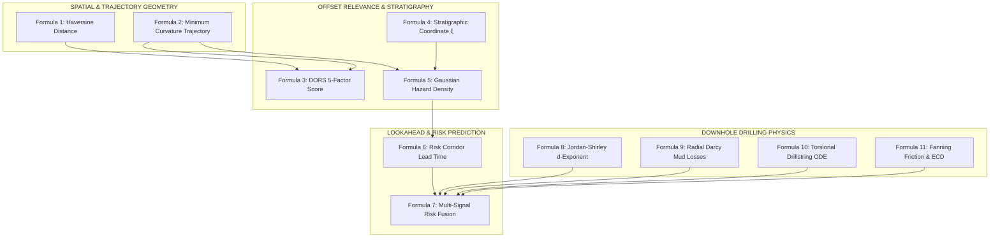

# Algorithms & Mathematical Formulations Reference
### Complete Derivations, Variable Definitions, Measurement Units, Boundary Conditions, and Worked Examples
**Engine Implementations:** `dors_engine.py`, `stratigraphic_correlator.py`, `risk_corridor_engine.py`, `physics_engine`

---

## 1. Catalog of Core Mathematical Formulations

This document provides the authoritative engineering reference for every formula implemented across the eRTMAC-NWIS platform.

---

## 2. Spatial & Directional Trajectory Mathematics

### Formula 1: Haversine Great-Circle Surface Distance
* **Purpose:** Computes the great-circle surface separation between the active well rig site and candidate offset wellheads across the spherical geoid.
* **Mathematical Expression:**
  $$a = \sin^2\left(\frac{\phi_2 - \phi_1}{2}\right) + \cos(\phi_1)\cos(\phi_2)\sin^2\left(\frac{\lambda_2 - \lambda_1}{2}\right)$$
  $$d = 2 R_{\text{earth}} \arcsin\left(\sqrt{\max(0.0, a)}\right)$$
* **Variables & Units:**
  * $\phi_1, \lambda_1$: Latitude and longitude of the active well (radians).
  * $\phi_2, \lambda_2$: Latitude and longitude of the offset well (radians).
  * $R_{\text{earth}}$: Mean radius of Earth ($6,371.009\text{ km}$).
  * $d$: Surface distance (kilometers).
* **Worked Example:**
  * Active Well `WELL-NHK-001`: $27.3150^\circ\text{ N}, 95.3200^\circ\text{ E} \rightarrow (0.476735, 1.663647)\text{ rad}$.
  * Offset Well `WELL-NHK-002`: $27.3320^\circ\text{ N}, 95.3410^\circ\text{ E} \rightarrow (0.477032, 1.664013)\text{ rad}$.
  * $\Delta\phi = 0.000297\text{ rad}, \quad \Delta\lambda = 0.000366\text{ rad}$.
  * $a = \sin^2(0.0001485) + \cos(0.476735)\cos(0.477032)\sin^2(0.000183) = 2.205 \times 10^{-8} + (0.8885 \times 0.8884 \times 3.349 \times 10^{-8}) = 4.848 \times 10^{-8}$.
  * $d = 2 \times 6371.009 \times \arcsin(0.0002202) = \mathbf{2.805 \text{ km}}$.

---

### Formula 2: Minimum Curvature Trajectory Integration
* **Purpose:** The SPE standard method to convert discrete directional survey stations $(MD, Inclination, Azimuth)$ into continuous 3D Cartesian coordinates $(TVD, North, East)$.
* **Mathematical Expression:**
  $$\cos\beta = \cos(I_2 - I_1) - \sin(I_1)\sin(I_2)\left[1 - \cos(A_2 - A_1)\right]$$
  $$\beta = \arccos\left(\text{clamp}(\cos\beta, -1.0, 1.0)\right)$$
  $$F = \begin{cases} 1.0 & \text{if } \beta < 10^{-6} \\ \frac{2}{\beta}\tan\left(\frac{\beta}{2}\right) & \text{otherwise} \end{cases}$$
  $$\Delta TVD = \frac{\Delta MD}{2}\left[\cos(I_1) + \cos(I_2)\right] \times F$$
  $$\Delta North = \frac{\Delta MD}{2}\left[\sin(I_1)\cos(A_1) + \sin(I_2)\cos(A_2)\right] \times F$$
  $$\Delta East = \frac{\Delta MD}{2}\left[\sin(I_1)\sin(A_1) + \sin(I_2)\sin(A_2)\right] \times F$$
* **Variables & Units:**
  * $MD_1, MD_2$: Measured depth of preceding and succeeding survey stations (meters).
  * $I_1, I_2$: Wellbore inclination angle from true vertical (radians).
  * $A_1, A_2$: Wellbore azimuth angle from true north (radians).
  * $\beta$: Total 3D dogleg angle over the course length (radians).
  * $F$: Curvature ratio correction factor (dimensionless).

---

## 3. Offset Relevance & Stratigraphic Alignment

### Formula 3: Dynamic Offset Relevance Score (DORS)
* **Purpose:** Evaluates the multidimensional relevance of an offset well $w$ relative to the active well $a$ at current drilling depth $d_t$.
* **Mathematical Expression:**
  $$\text{DORS}(w, d_t) = w_s S_{\text{spatial}} + w_f S_{\text{formation}} + w_d S_{\text{depth}} + w_t S_{\text{trajectory}} + w_h S_{\text{hazard}}$$
* **Default Component Weights:**
  $$\sum w_i = 1.0 \quad \Longrightarrow \quad w_s = 0.20, \; w_f = 0.30, \; w_d = 0.20, \; w_t = 0.15, \; w_h = 0.15$$
* **Component Formulations:**
  1. **Spatial Sub-Score:** $S_{\text{spatial}} = \max\left(0.0, \; 1.0 - \frac{d_{\text{km}}}{R_{\max}}\right)$.
  2. **Formation Match Sub-Score:**
     $$S_{\text{formation}} = \begin{cases} 
     1.0 & \text{same formation penetrated at corresponding depth interval} \\ 
     0.75 & \text{same formation penetrated elsewhere in wellbore} \\
     0.60 & \text{adjacent formation within same stratigraphic group (e.g. Barail Group)} \\
     0.10 & \text{different group or unmapped}
     \end{cases}$$
  3. **Depth Overlap Sub-Score:**
     $$S_{\text{depth}} = \frac{\text{Length}\left([TD_{\min}(w), TD_{\max}(w)] \cap [d_t - 50, d_t + 100]\right)}{150.0\text{ m}}$$
  4. **Trajectory Similarity Sub-Score:**
     $$S_{\text{trajectory}} = 1.0 - \frac{|\bar{\theta}_a - \bar{\theta}_w|}{90^\circ} \times 0.5 - 0.5 \cdot \mathbb{I}(\text{Type}_a \neq \text{Type}_w)$$
  5. **Hazard Density Sub-Score:**
     $$S_{\text{hazard}} = \min\left(1.0, \; \sum_{e \in \text{Events}(w)} \text{Sev}(e) \exp\left(-\frac{(d_e - d_t)^2}{2 \sigma_d^2}\right)\right)$$
     Where $\sigma_d = 25.0\text{ m}$, and $\text{Sev}(\text{CRITICAL})=1.0, \text{Sev}(\text{HIGH})=0.7, \text{Sev}(\text{MEDIUM})=0.4$.

---

### Formula 4: Dimensionless Stratigraphic Coordinate Index ($\xi$)
* **Purpose:** Normalizes penetration depth relative to geological formation tops, eliminating structural dipping and layer thickness variations.
* **Mathematical Expression:**
  $$\xi(w, d) = \frac{\text{TVD}(w, d) - \text{Top}_{\text{TVD}}(F_k, w)}{\text{Base}_{\text{TVD}}(F_k, w) - \text{Top}_{\text{TVD}}(F_k, w)}$$
* **Interpretation:**
  * $\xi = 0.0$: Bit is at the formation entry boundary (top).
  * $\xi = 0.5$: Bit is at the median formation depth.
  * $\xi = 1.0$: Bit is at the formation exit boundary (base).

---

## 4. Downhole Drilling Physics Formulations

### Formula 8: Jordan-Shirley Corrected $d$-Exponent ($d_{cs}$)
* **Purpose:** Detects undercompacted overpressured shale formations (abnormal pore pressure zones) by normalizing drilling rate against mechanical parameters.
* **Mathematical Expression:**
  $$d = \frac{\log_{10}\left(\frac{ROP}{60 \times N}\right)}{\log_{10}\left(\frac{12 \times WOB}{10^6 \times D_{\text{bit}}}\right)}$$
  $$d_{cs} = d \times \left(\frac{\rho_{\text{normal}}}{\rho_{\text{actual}}}\right)$$
* **Variables & Units:**
  * $ROP$: Rate of penetration ($\text{ft/hr}$).
  * $N$: Rotary speed ($\text{RPM}$).
  * $WOB$: Weight on bit ($\text{lbs}$).
  * $D_{\text{bit}}$: Bit diameter ($\text{inches}$).
  * $\rho_{\text{normal}}$: Normal hydrostatic mud density ($9.0\text{ ppg}$ or $0.465\text{ psi/ft}$).
  * $\rho_{\text{actual}}$: Actual equivalent circulating density ($\text{ppg}$).
* **Diagnostic Rule:** In normal compaction, $d_{cs}$ increases linearly with depth. A sharp **negative divergence** indicates entry into an abnormal overpressured zone (potential kick warning).

---

### Formula 9: Radial Darcy Lost Circulation Influx/Loss
* **Purpose:** Models the dynamic rate of drilling mud loss into a fractured formation.
* **Mathematical Expression:**
  $$Q_{\text{loss}} = \frac{2 \pi k h (P_{\text{wellbore}} - P_{\text{pore}})}{\mu \ln\left(\frac{r_e}{r_w}\right)}$$
* **Variables & Units:**
  * $Q_{\text{loss}}$: Volumetric rate of lost circulation ($\text{m}^3/\text{s}$).
  * $k$: Formation permeability / fracture conductivity ($\text{m}^2$).
  * $h$: Net fractured interval height ($\text{meters}$).
  * $P_{\text{wellbore}}$: Annular hydrostatic + circulating pressure at loss depth ($\text{Pa}$).
  * $P_{\text{pore}}$: In-situ formation pore pressure ($\text{Pa}$).
  * $\mu$: Drilling mud dynamic plastic viscosity ($\text{Pa}\cdot\text{s}$).
  * $r_e, r_w$: Drainage radius and wellbore radius ($\text{meters}$).

---

### Formula 10: Second-Order Torsional Drillstring Dynamics
* **Purpose:** Simulates drillstring stick-slip oscillations and predicts extreme torque spikes.
* **Mathematical Expression:**
  $$J \frac{d^2\theta}{dt^2} + C \frac{d\theta}{dt} + K (\theta - \Omega_{\text{surf}} t) = -T_{\text{bit}}\left(\frac{d\theta}{dt}, WOB\right)$$
* **Variables & Units:**
  * $J$: Polar mass moment of inertia of the drillstring/BHA ($\text{kg}\cdot\text{m}^2$).
  * $C$: Structural damping coefficient ($\text{N}\cdot\text{m}\cdot\text{s/rad}$).
  * $K$: Torsional stiffness of the drill pipe ($\text{N}\cdot\text{m/rad}$).
  * $\Omega_{\text{surf}}$: Surface rotary speed ($\text{rad/s}$).
  * $T_{\text{bit}}$: Nonlinear bit-rock interaction torque ($\text{N}\cdot\text{m}$).

---

### Formula 11: Fanning Friction & Equivalent Circulating Density (ECD)
* **Purpose:** Calculates bottom-hole circulating pressure and Equivalent Circulating Density to monitor fracture and pore-pressure margins.
* **Mathematical Expression:**
  $$\Delta P_{\text{friction}} = \frac{2 f \rho v^2 L}{D_{\text{hydraulic}}}$$
  $$\text{ECD} = \rho_{\text{static}} + \frac{\Delta P_{\text{annular\_friction}}}{g \times TVD}$$
* **Variables & Units:**
  * $f$: Fanning friction factor, solved iteratively via Colebrook-White equation for turbulent Herschel-Bulkley drilling fluids.
  * $\rho$: Fluid density ($\text{kg/m}^3$).
  * $v$: Annular fluid velocity ($\text{m/s}$).
  * $D_{\text{hydraulic}}$: Hydraulic diameter of the casing/wellbore-pipe annulus ($D_{\text{hole}} - D_{\text{pipe}}$).
  * $\text{ECD}$: Equivalent circulating density ($\text{ppg}$ or $\text{SG}$).
