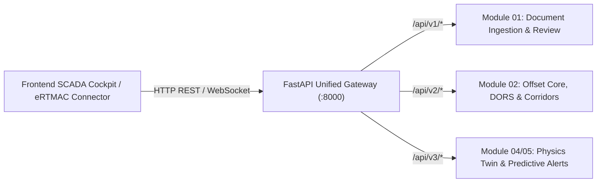

# REST & WebSocket API Reference
### Complete Endpoint Specifications, Request Payloads, JSON Responses, and Real-Time Streaming Contracts
**Base Origin:** `http://localhost:8000` (Dev Proxy: `5173`) | **Authentication:** `X-API-Key` Header

---

## 1. API Architecture Overview

eRTMAC-NWIS provides unified access across three operational service domains:



---

## 2. Module 01: Document Intelligence API (`/api/v1`)

### `POST /api/v1/ingest`
Submits a raw PDF document for automated parsing, vision OCR, and structured entity extraction.
* **Content-Type:** `multipart/form-data`
* **Form Parameters:**
  * `file`: Binary PDF file data.
  * `document_type`: Optional hint (`WELL_COMPLETION_REPORT`, `DAILY_DRILLING_REPORT`, `MUD_LOG`).
* **Response (202 Accepted):**
```json
{
  "job_id": "JOB-019842af-628d",
  "filename": "WELL-NHK-002_DRILLING_SUMMARY.pdf",
  "status": "QUEUED",
  "created_at": "2026-10-05T14:10:00Z"
}
```

### `GET /api/v1/jobs/{job_id}`
Polls the processing status of an active ingestion job.
* **Response (200 OK):**
```json
{
  "job_id": "JOB-019842af-628d",
  "status": "COMPLETED",
  "progress_percent": 100.0,
  "pages_processed": 42,
  "elapsed_seconds": 8.42,
  "result_id": "DOC-NHK002-WCR"
}
```

### `GET /api/v1/results/{doc_id}`
Retrieves the complete structured extraction result for an ingested document.
* **Response (200 OK):**
```json
{
  "doc_id": "DOC-NHK002-WCR",
  "well_name": "WELL-NHK-002",
  "field": "Nahorkatiya",
  "total_depth_md_m": 3850.0,
  "formations_extracted": [
    { "name": "Tipam Sandstone", "top_md_m": 1250.0, "base_md_m": 2100.0, "confidence": 0.98 },
    { "name": "Barail Sandstone", "top_md_m": 3150.0, "base_md_m": 3450.0, "confidence": 0.96 }
  ],
  "events_extracted": [
    {
      "hazard_type": "MUD_LOSS",
      "severity": "CRITICAL",
      "start_depth_md_m": 3215.4,
      "end_depth_md_m": 3230.0,
      "description": "Total mud losses in fractured sandstone.",
      "mitigation_summary": "Pumped 40 bbl LCM pill; returns restored.",
      "source_page": 18
    }
  ]
}
```

### `POST /api/v1/review/{doc_id}/decision`
Records a human drilling engineer's verification, correction, or rejection of extracted data.
* **Payload:**
```json
{
  "decision": "APPROVED",
  "reviewer_id": "SUPERVISOR_PRASAD",
  "comments": "Verified against physical mud log; depths accurate."
}
```

---

## 3. Module 02: Offset Well Intelligence API (`/api/v2`)

### `GET /api/v2/wells`
Lists all wells in the catalog with surface coordinates, total depth, and operational status.
* **Response (200 OK):**
```json
[
  {
    "well_id": "WELL-NHK-001",
    "well_name": "Nahorkatiya-001",
    "field": "Nahorkatiya",
    "surface_lat": 27.3150,
    "surface_lon": 95.3200,
    "total_depth_md_m": 3500.0,
    "is_active": true
  }
]
```

### `GET /api/v2/offset_rank/{well_id}?radius_km=25.0&active_depth_m=3200.0`
Computes the 5-factor DORS score for all candidate offset wells relative to the active well.
* **Response (200 OK):**
```json
{
  "active_well_id": "WELL-NHK-001",
  "active_depth_m": 3200.0,
  "ranked_offsets": [
    {
      "well_id": "WELL-NHK-002",
      "distance_km": 2.805,
      "composite_dors_score": 0.884,
      "component_scores": {
        "spatial": 0.888,
        "formation": 1.000,
        "depth": 0.920,
        "trajectory": 0.850,
        "hazard": 0.700
      },
      "structural_status": "SAME_FAULT_BLOCK"
    }
  ]
}
```

### `GET /api/v2/corridors/{well_id}?lookahead_m=100.0`
Generates ahead-of-bit historical risk corridors based on top-ranked offset well experience.
* **Response (200 OK):**
```json
{
  "well_id": "WELL-NHK-001",
  "current_md_m": 3200.0,
  "corridors": [
    {
      "corridor_id": "CORR-BARAIL-LOSS-01",
      "formation_name": "Barail Sandstone",
      "hazard_type": "MUD_LOSS",
      "severity": "CRITICAL",
      "start_depth_md_m": 3218.0,
      "end_depth_md_m": 3235.0,
      "lead_distance_m": 18.0,
      "contributing_wells": ["WELL-NHK-002", "WELL-NHK-003"]
    }
  ]
}
```

### `GET /api/v2/events/search?query=lost circulation Barail&hazard_type=MUD_LOSS`
Executes hybrid lexical-semantic retrieval across the institutional memory repository.
* **Response (200 OK):**
```json
{
  "query": "lost circulation Barail",
  "search_mode": "semantic",
  "results_count": 3,
  "results": [
    {
      "event_id": "EVT-NHK002-LOSS-03",
      "well_id": "WELL-NHK-002",
      "hazard_type": "MUD_LOSS",
      "severity": "CRITICAL",
      "depth_md_m": 3215.4,
      "formation": "Barail Sandstone",
      "relevance_score": 0.932,
      "source_document": "WELL-NHK-002_DRILLING_SUMMARY.pdf",
      "source_page": 18,
      "source_type": "REAL"
    }
  ]
}
```

---

## 4. Module 04/05: Physics Digital Twin & Alerts API (`/api/v3`)

### `WebSocket /api/v3/physics/stream`
Continuous 1 Hz bidirectional WebSocket streaming real-time downhole telemetry and alert advisories.
* **Client Message (Optional Scenario Control):**
```json
{ "action": "SET_SCENARIO", "scenario": "MUD_LOSS_FRACTURE" }
```
* **Server Broadcast Payload:**
```json
{
  "timestamp": "2026-10-05T14:35:10Z",
  "well_id": "WELL-NHK-001",
  "telemetry": {
    "md_m": 3218.5,
    "tvd_m": 2980.2,
    "rop_m_hr": 26.4,
    "wob_klbs": 22.0,
    "rpm": 115.0,
    "torque_kft_lb": 13.8,
    "flow_in_lpm": 2400.0,
    "flow_out_percent": 82.0,
    "pit_volume_m3": 121.2,
    "spp_psi": 2650.0
  },
  "active_alerts": [
    {
      "alert_id": "ALT-90812",
      "severity": "CRITICAL",
      "hazard_type": "MUD_LOSS",
      "lead_distance_m": 0.0,
      "lead_time_minutes": 0.0,
      "risk_score": 0.942,
      "recommended_action": "Stage 40 bbl LCM pill immediately; reduce flow to 2000 LPM."
    }
  ]
}
```

### `GET /api/v3/predictive/alerts/{well_id}/history`
Fetches the immutable historical alert audit log from PostgreSQL.
* **Response (200 OK):**
```json
{
  "status": "ok",
  "well_id": "WELL-NHK-001",
  "count": 14,
  "alerts": [
    {
      "alert_id": "ALT-89211",
      "hazard_type": "MUD_LOSS",
      "severity": "CRITICAL",
      "bit_depth_md_m": 3215.0,
      "risk_score": 0.885,
      "status": "ACKNOWLEDGED",
      "acknowledged_by": "SUPERVISOR_PRASAD",
      "triggered_at": "2026-10-05T12:19:40Z"
    }
  ]
}
```
