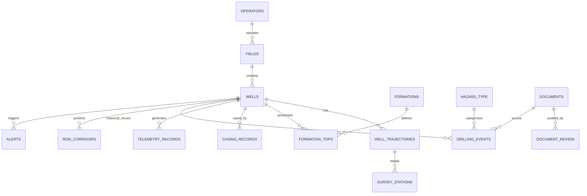

# Canonical Data Models & Database Schemas
### PPDM 3.9 Master Tables, WITSML Work Products, PostGIS Spatial Geometries, and pgvector Indexing
**Database:** PostgreSQL 16 + PostGIS 3.4 + pgvector 0.7.4 | **Schema Source:** `database/schema.sql`

---

## 1. Architectural Schema Tiers

The relational schema is organized into three distinct architectural tiers adhering to PPDM (Professional Petroleum Data Management) and OSDU (Open Subsurface Data Universe) standards:



---

## 2. Table Definitions & SQL DDL Specifications

### 2.1 Tier 1: Master & Reference Data (PPDM 3.9)

#### `wells` Table
The authoritative master registry for all physical surface well locations.
```sql
CREATE TABLE wells (
    well_id          TEXT PRIMARY KEY,              -- UWI e.g. "WELL-NHK-001" or "15/9-F-12"
    well_name        TEXT NOT NULL,
    field_id         INT REFERENCES fields(field_id),
    operator_id      INT REFERENCES operators(operator_id),
    surface_lat      NUMERIC(9,6) NOT NULL,
    surface_lon      NUMERIC(9,6) NOT NULL,
    -- PostGIS geography point for geodesic distance calculations
    surface_geom     geography(Point, 4326) GENERATED ALWAYS AS (
                         ST_SetSRID(ST_MakePoint(surface_lon, surface_lat), 4326)::geography
                     ) STORED,
    spud_date        DATE,
    completion_date  DATE,
    target_formation TEXT,
    kb_elevation_m   NUMERIC(7,2) NOT NULL DEFAULT 0.0,
    ground_elev_m    NUMERIC(7,2) NOT NULL DEFAULT 0.0,
    total_depth_md_m NUMERIC(8,2) NOT NULL,
    total_depth_tvd_m NUMERIC(8,2),
    well_type        TEXT DEFAULT 'VERTICAL',       -- VERTICAL, DIRECTIONAL, HORIZONTAL
    current_status   TEXT DEFAULT 'COMPLETED',      -- ACTIVE, DRILLING, COMPLETED, P&A
    is_active        BOOLEAN NOT NULL DEFAULT false,
    source_type      source_type NOT NULL DEFAULT 'REAL',
    created_at       TIMESTAMPTZ NOT NULL DEFAULT now()
);

CREATE INDEX idx_wells_surface_geom ON wells USING GIST(surface_geom);
```

---

### 2.2 Tier 2: Work-Product Operational Data (WITSML 1.4.1.1)

#### `formation_tops` Table
Records the discrete stratigraphic horizons penetrated by each well.
```sql
CREATE TABLE formation_tops (
    top_id             SERIAL PRIMARY KEY,
    well_id            TEXT NOT NULL REFERENCES wells(well_id) ON DELETE CASCADE,
    formation_name     TEXT NOT NULL,
    top_md_m           NUMERIC(8,2) NOT NULL,
    base_md_m          NUMERIC(8,2) NOT NULL,
    top_tvd_m          NUMERIC(8,2) NOT NULL,
    base_tvd_m         NUMERIC(8,2) NOT NULL,
    top_tvdss_m        NUMERIC(8,2),               -- Subsea normalized datum
    base_tvdss_m       NUMERIC(8,2),
    stratigraphic_order INT,                       -- Stratigraphic sequencing (1=shallowest)
    lithology_primary  TEXT,                       -- Sandstone, Shale, Limestone, Coal
    source_type        source_type NOT NULL DEFAULT 'REAL',
    UNIQUE (well_id, formation_name)
);

CREATE INDEX idx_formation_tops_well_depth ON formation_tops(well_id, top_md_m, base_md_m);
```

#### `casing_records` Table
Tracks tubular casing strings, shoe depths, and cement seals.
```sql
CREATE TABLE casing_records (
    casing_id           SERIAL PRIMARY KEY,
    well_id             TEXT NOT NULL REFERENCES wells(well_id) ON DELETE CASCADE,
    casing_type         TEXT NOT NULL,              -- CONDUCTOR, SURFACE, INTERMEDIATE, PRODUCTION
    outer_diameter_in   NUMERIC(6,3) NOT NULL,      -- e.g. 20.000, 13.375, 9.625, 7.000
    inner_diameter_in   NUMERIC(6,3),
    weight_ppf          NUMERIC(6,2),               -- Pounds per foot
    grade               TEXT,                       -- J-55, K-55, N-80, L-80, P-110
    shoe_depth_md_m     NUMERIC(8,2) NOT NULL,
    shoe_depth_tvd_m    NUMERIC(8,2) NOT NULL,
    top_of_cement_md_m  NUMERIC(8,2),               -- Top of cement annular seal
    leak_off_test_ppg   NUMERIC(5,2),               -- Formation fracture limit at shoe
    source_type         source_type NOT NULL DEFAULT 'REAL'
);
```

---

### 2.3 Tier 3: Derived Intelligence & Knowledge (OSDU Core)

#### `drilling_events` Table
The central institutional memory repository for historical downhole complications.
```sql
CREATE TABLE drilling_events (
    event_id            TEXT PRIMARY KEY,           -- e.g. "EVT-NHK002-LOSS-03"
    well_id             TEXT NOT NULL REFERENCES wells(well_id) ON DELETE CASCADE,
    hazard_type         TEXT NOT NULL REFERENCES hazard_type(code),
    severity            TEXT NOT NULL,              -- LOW, MEDIUM, HIGH, CRITICAL
    start_depth_md_m    NUMERIC(8,2) NOT NULL,
    end_depth_md_m      NUMERIC(8,2) NOT NULL,
    start_depth_tvd_m   NUMERIC(8,2),
    end_depth_tvd_m     NUMERIC(8,2),
    formation_name      TEXT NOT NULL,
    iadc_code           TEXT,                       -- IADC Non-Productive Time code
    npt_hours           NUMERIC(6,2) DEFAULT 0.0,
    cost_estimate_usd   NUMERIC(12,2),
    description         TEXT NOT NULL,              -- Narrative remark from Daily Drilling Report
    mitigation_summary  TEXT NOT NULL,              -- Actionable engineering response
    source_document     TEXT,                       -- Reference PDF filename
    source_page         INT,                        -- Page number in source PDF
    source_type         source_type NOT NULL DEFAULT 'REAL',
    -- 384-dimensional dense semantic vector for vector similarity search
    embedding           vector(384),
    created_at          TIMESTAMPTZ NOT NULL DEFAULT now(),
    updated_at          TIMESTAMPTZ NOT NULL DEFAULT now()
);

-- Fast Approximate Nearest Neighbor (ANN) index for real-time vector queries
CREATE INDEX idx_drilling_events_embedding_hnsw 
ON drilling_events 
USING hnsw (embedding vector_cosine_ops)
WITH (m = 16, ef_construction = 64);
```

#### `alerts` Table
Records all predictive real-time hazard alerts triggered during active operations.
```sql
CREATE TABLE alerts (
    alert_id            TEXT PRIMARY KEY,
    well_id             TEXT NOT NULL REFERENCES wells(well_id) ON DELETE CASCADE,
    hazard_type         TEXT NOT NULL REFERENCES hazard_type(code),
    severity            TEXT NOT NULL,              -- INFO, ADVISORY, WARNING, CRITICAL
    bit_depth_md_m      NUMERIC(8,2) NOT NULL,
    corridor_depth_md_m NUMERIC(8,2) NOT NULL,
    lead_distance_m     NUMERIC(8,2) NOT NULL,
    lead_time_minutes   NUMERIC(6,1) NOT NULL,
    risk_score          NUMERIC(4,3) NOT NULL,      -- Aggregated score in [0.0, 1.0]
    status              TEXT NOT NULL DEFAULT 'ACTIVE', -- ACTIVE, ACKNOWLEDGED, CLEARED
    acknowledged_by     TEXT,                       -- User ID of responding driller
    acknowledged_at     TIMESTAMPTZ,
    recommended_action  TEXT NOT NULL,              -- SPE/IADC standard mitigation playbook
    source_type         source_type NOT NULL DEFAULT 'SIMULATED',
    triggered_at        TIMESTAMPTZ NOT NULL DEFAULT now()
);

CREATE INDEX idx_alerts_well ON alerts(well_id, triggered_at DESC);
```
