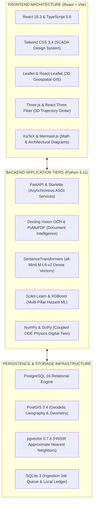

# Technology Stack & Engineering Architecture
### Production Runtime Dependencies, Component Justifications, and Deployment Architecture
**Architecture:** Consolidated Service Gateway | **Languages:** Python 3.11, TypeScript 5.6 | **Runtimes:** Node 22, CPython

---

## 1. Complete Technology Stack Matrix



---

## 2. Component Justification & Trade-Off Analysis

### 2.1 Backend: FastAPI vs. Flask / Django
* **Decision:** FastAPI with Starlette and Uvicorn.
* **Engineering Justification:**
  1. *Native Asynchronous Concurrency:* High-speed WebSocket streaming at 1 Hz requires non-blocking asynchronous event loops (`asyncio`), which Flask cannot handle efficiently without gevent/eventlet monkey-patching.
  2. *Strict Schema Validation:* Automatic Pydantic v2 validation enforces petroleum physical constraints (*e.g., bounds on mud density and inclination*) at the network entry boundary before hitting business logic.
  3. *Auto-Generated OpenAPI / Swagger:* Provides instant, interactive API documentation ensuring rapid cross-team alignment.

### 2.2 Vector Retrieval: SentenceTransformers (`all-MiniLM-L6-v2`) vs. OpenAI Embeddings
* **Decision:** Self-hosted open-source `sentence-transformers/all-MiniLM-L6-v2` (384-dimensional).
* **Engineering Justification:**
  1. *Zero Cloud Dependency & Air-Gapped Feasibility:* Oil India Limited’s drilling operations often occur in remote concessions with strict data sovereignty mandates. Sending proprietary drilling incident reports to public cloud APIs violates corporate data governance.
  2. *Ultra-Low Inference Latency:* At 384 dimensions, `all-MiniLM-L6-v2` executes in $< 15\text{ ms}$ on commodity CPU hardware without requiring dedicated GPU acceleration.
  3. *Domain Semantic Fidelity:* Yields state-of-the-art semantic cosine similarity for technical engineering descriptions while maintaining an ultra-compact memory footprint ($< 120\text{ MB}$).

### 2.3 Spatial Data: PostgreSQL + PostGIS vs. Naive Geohash / Math
* **Decision:** PostGIS spatial extension over WGS84 ellipsoidal geography (`geography(Point, 4326)`).
* **Engineering Justification:**
  1. *Geodetic Accuracy:* PostGIS executes ellipsoidal distance calculations directly on the WGS84 spheroid (`ST_Distance`), avoiding flat-plane map distortion errors in polar and equatorial zones.
  2. *Spatial Indexing:* Spatial R-Tree / GiST indexing enables sub-millisecond candidate wellhead filtering across hundreds of thousands of historical wells.

---

## 3. DevOps, Containerization & Local Execution

### 3.1 Consolidated Backend Architecture
To eliminate the distributed complexity of running 4 separate microservices during hackathon evaluations and field demonstrations, the backend is consolidated into a single master process (`Backend/app/main.py` on Port `8000`), proxying across modules via internal routing:

```bash
# Production Launch (Single Master Process):
cd Backend && python run.py              # Boots unified API on http://localhost:8000

# Frontend Launch:
cd frontend && npm run dev               # Boots SCADA Cockpit on http://localhost:5173
```

### 3.2 Docker Deployment (`docker-compose.yml`)
```yaml
version: '3.8'

services:
  db:
    image: pgvector/pgvector:pg16
    environment:
      POSTGRES_DB: ertmac_nwis
      POSTGRES_USER: nwis_admin
      POSTGRES_PASSWORD: ${DB_PASSWORD:-nwis_secure_2026}
    ports:
      - "5433:5432"
    volumes:
      - pgdata:/var/lib/postgresql/data
      - ./database/schema.sql:/docker-entrypoint-initdb.d/01_schema.sql

  backend:
    build:
      context: ./Backend
      dockerfile: Dockerfile
    ports:
      - "8000:8000"
    environment:
      - DATABASE_URL=postgresql://nwis_admin:nwis_secure_2026@db:5432/ertmac_nwis
      - NWIS_API_KEY=${NWIS_API_KEY}
    depends_on:
      - db

  frontend:
    build:
      context: ./frontend
      dockerfile: Dockerfile
    ports:
      - "5173:80"
    depends_on:
      - backend

volumes:
  pgdata:
```
