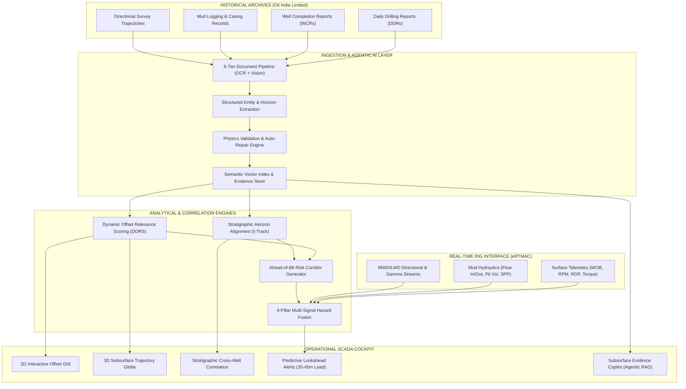

# eRTMAC-NWIS — Nearby Wells Intelligence System
### An AI-Powered Offset-Well Knowledge & Operational Decision Support Platform for Well Construction
**Problem Statement ID:** SIH26121 | **Organization:** Oil India Limited (OIL) | **Theme:** Smart Automation | **Category:** Software

---

## 1. Executive Overview

**eRTMAC-NWIS** (*internal engineering codename: eWIS / DrillWise*) is an enterprise-grade drilling decision support platform developed for **Oil India Limited (OIL)** under Smart India Hackathon 2026 Problem Statement **SIH26121**. The platform bridges the mission-critical gap between real-time surface/downhole rig monitoring and decades of institutional drilling experience locked inside unstructured historical well reports.

During active well construction, drilling through complex lithologies—such as the high-pressure, fractured, or depleted sand-shale sequences of the **Upper Assam Basin (Nahorkatiya, Baghjan, Moran, Hugrijan fields)**—exposes operators to severe downhole hazards:
* **Lost Circulation (Mud Losses)** into under-pressured or naturally fractured reservoirs.
* **Differential & Mechanical Stuck Pipe** across thick permeable sandstones and swelling shales.
* **Formation Fluid Influxes (Kicks)** and sudden overpressure transitions that threaten well control.
* **Severe Borehole Washouts & Wellbore Instability** in reactive Kopili shales.
* **Excessive Torque & Drag Spikes** compromising directional steerability.
* **Casing & Cementing Isolation Failures** resulting in costly remedial squeeze operations.

Across the oil and gas industry, Non-Productive Time (NPT) resulting from these drilling complications accounts for **15% to 35% of total well construction costs**, representing tens of millions of dollars in direct rig time, side-tracks, fishing operations, and lost equipment.

---

## 2. The Core Philosophy: "Nearby is NOT the Same as Relevant"

Conventional drilling dashboards rely on naive two-dimensional spatial radius searches (e.g., querying all historical wells within 10 km of the current surface rig coordinates). In structural subsurface petroleum engineering, **geographic proximity alone is fundamentally insufficient and often dangerously misleading**:

1. **Structural Fault Blocks & Tectonic Discontinuity:** Two wells drilled only 1,200 meters apart may be separated by a major sealing fault or high-angle reverse fault (prevalent in the Assam-Arakan thrust belt), placing them into completely decoupled hydrological compartments, stress regimes, and pore-pressure corridors.
2. **Stratigraphic Dip & Trajectory Divergence:** A historical offset well 15 kilometers away along the geological strike line may penetrate the exact target sand (*e.g., Tipam Sandstone or Barail Coal-Shale*) with identical reservoir dip, overburden stress, and fluid composition, making it **an order of magnitude more relevant** than a nearby well drilled through an uncorrelatable structural block.
3. **Interval-Specific Dynamic Relevance:** Offset relevance is not a static constant per well; it is a **dynamic function of the active bit's current stratigraphic depth**. An offset well may be completely irrelevant while drilling surface alluvium at 800 m, but becomes the **#1 high-fidelity analog** when the bit transitions into the reactive Kopili shale transition at 3,450 m.

eRTMAC-NWIS replaces naive proximity filtering with the **Dynamic Offset Relevance Scoring (DORS)** framework, mathematically unifying spatial coordinates, stratigraphic horizons, trajectory inclinations, historical hazard frequencies, and structural fault boundaries into a continuous, depth-indexed relevance vector.

---

## 3. SIH26121 Problem Statement Traceability

The system fulfills all 7 mandated outcomes of SIH26121:

| # | SIH26121 Mandated Requirement | NWIS Implementation & Capability | Key Technical Architecture |
|---|---|---|---|
| **i** | **AI/NLP/OCR Document Intelligence** | Automated extraction, structuring, and validation of legacy unstructured drilling reports (WCRs, DDRs, mud logs, casing records). | 6-Tier pipeline combining PyMuPDF, Vision Transformers / Docling OCR, schema regex/heuristics, Layer-4 template learning, and Layer-5 domain physics auto-repair. |
| **ii** | **Interactive Geospatial Map Visualization** | Real-time map displaying nearby wells within a user-configurable radius relative to the active well. | Dual-engine visualizer: 2D SCADA-grade Leaflet GIS with cluster filtering + 3D Three.js Subsurface Globe tracking true spatial 3D wellbore trajectories. |
| **iii** | **Searchable Knowledge Repository** | Subsurface memory bank indexing historical events, mitigations, IADC codes, and operational lessons. | Hybrid lexical-semantic retrieval using `all-MiniLM-L6-v2` dense vector embeddings (384-dim) + full provenance tracking with original PDF page citations. |
| **iv** | **Cross-Well Geological Correlation** | Correlation of drilling parameters, reservoir characteristics, and mud losses across wells by depth and formation. | Minimum Curvature trajectory reconstruction, TVD/TVDSS normalization, and dimensionless stratigraphic coordinate transformation ($\xi = d_{strat} / h_{formation}$). |
| **v** | **Predictive Risk Analytics** | Predictive models detecting mud losses, stuck pipe, overpressure kicks, torque spikes, and cementing issues. | 4-Pillar Risk Fusion Model uniting deterministic physics rules (35%), unsupervised anomaly detection (20%), supervised XGBoost/Logistic classification (30%), and offset priors (15%). |
| **vi** | **Real-Time Alerts & Recommendations** | Early proactive warnings and actionable mitigation protocols before the bit reaches documented hazard zones. | Ahead-of-Bit Risk Corridor Engine generating notifications with **35 to 45 minutes of operational lead time** (15–50 m depth lead at standard ROP). |
| **vii** | **Unified Operational Dashboard** | Single-pane-of-glass SCADA command cockpit designed for field drilling superintendents and central office analysts. | High-density SCADA-inspired responsive React cockpit featuring 14 unified operational interfaces, zero-latency state synchronization, and live telemetry streaming. |

---

## 4. Documentation Knowledge Base Structure

This documentation website serves as the complete technical architecture reference, mathematical manual, and operational user guide for the eRTMAC-NWIS platform:

### [Architecture & System Design](file:///docs/architecture/system-design.md)
* **[System Design & Service Boundaries](file:///docs/architecture/system-design.md):** Logical tiers, microservices vs. monolithic consolidation, data contracts, and fault tolerance.
* **[End-to-End Data Flow](file:///docs/architecture/end-to-end-data-flow.md):** The complete path from raw sensor telemetry and scanned PDFs to real-time risk advisories.
* **[eRTMAC Integration Design](file:///docs/architecture/ertmac-integration.md):** High-speed streaming protocols (WITS0, WITSML, OPC-UA), edge buffering, and safety perimeter isolation.

### [Document Intelligence & Agentic RAG](file:///docs/document-intelligence/ingestion-pipeline.md)
* **[6-Tier Ingestion Pipeline](file:///docs/document-intelligence/ingestion-pipeline.md):** Native parsing, Docling vision OCR, entity extraction, and physics-informed auto-repair.
* **[Canonical Data Normalization](file:///docs/document-intelligence/normalization-and-validation.md):** PPDM/OSDU-aligned relational schemas, depth reference harmonization, and coordinate conversions.
* **[Agentic RAG & Provenance](file:///docs/document-intelligence/agentic-rag-and-provenance.md):** Dense semantic search, hybrid retrieval, and grounded PDF page/paragraph citations.

### [Well Intelligence & Geospatial Analytics](file:///docs/well-intelligence/geospatial-offset-discovery.md)
* **[Geospatial Offset Discovery](file:///docs/well-intelligence/geospatial-offset-discovery.md):** 2D Leaflet GIS, 3D trajectory projection, and Haversine distance filtering.
* **[Depth & Formation Correlation](file:///docs/well-intelligence/depth-and-formation-correlation.md):** Minimum Curvature survey math, MD vs. TVD conversion, and True Stratigraphic Depth ($\xi$).
* **[Historical Event Repository](file:///docs/well-intelligence/historical-events-and-memory.md):** Categorized incident database covering mud losses, stuck pipe, kicks, and NPT records.

### [Predictive Risk Intelligence](file:///docs/risk-intelligence/risk-taxonomy.md)
* **[Drilling Hazard Physical Taxonomy](file:///docs/risk-intelligence/risk-taxonomy.md):** Physical mechanisms, precursor indicators, and SPE/IADC standard mitigations for 7 hazard classes.
* **[4-Pillar Risk Fusion Model](file:///docs/risk-intelligence/prediction-methodology.md):** Combining physics rules, Isolation Forest anomaly scoring, supervised XGBoost classification, and historical priors.
* **[Ahead-of-Bit Lookahead Alerts](file:///docs/risk-intelligence/ahead-of-bit-alerts.md):** Predictive corridor identification, early warning lead times, and interactive operator advisories.

### [Engineering Reference](file:///docs/engineering/algorithms-and-formulas.md)
* **[Mathematical Formulations & Algorithms](file:///docs/engineering/algorithms-and-formulas.md):** Rigorous derivations, variable definitions, and worked numerical examples for all 11 core formulas.
* **[Canonical Data Models](file:///docs/engineering/data-models.md):** Complete PostgreSQL/PostGIS/pgvector schema documentation.
* **[REST & WebSocket API Reference](file:///docs/engineering/api-reference.md):** Endpoint specifications for `/api/v1`, `/api/v2`, and `/api/v3`.
* **[Technology Stack & DevOps](file:///docs/engineering/technology-stack.md):** Detailed breakdown of frameworks, runtimes, models, and deployment configurations.

### [Product Guide & Validation](file:///docs/product-guide/cockpit-and-dashboard.md)
* **[Cockpit & Operational Dashboards](file:///docs/product-guide/cockpit-and-dashboard.md):** Comprehensive tour of all 14 operational pages and controls.
* **[Operational Field Scenarios](file:///docs/product-guide/operational-workflows.md):** Real-world walkthroughs of pre-spud planning, ahead-of-bit mud loss prevention, and kick shut-in.
* **[USP & Strategic Differentiation](file:///docs/product-guide/usp-and-differentiation.md):** What makes eRTMAC-NWIS superior to legacy GIS maps and generic AI chatbots.
* **[Requirements Traceability Matrix](file:///docs/reference/requirements-traceability.md):** Exhaustive verification matrix against official SIH26121 deliverables.
* **[Glossary & Petroleum References](file:///docs/reference/glossary.md):** Comprehensive petroleum engineering, drilling physics, and computational abbreviations.
