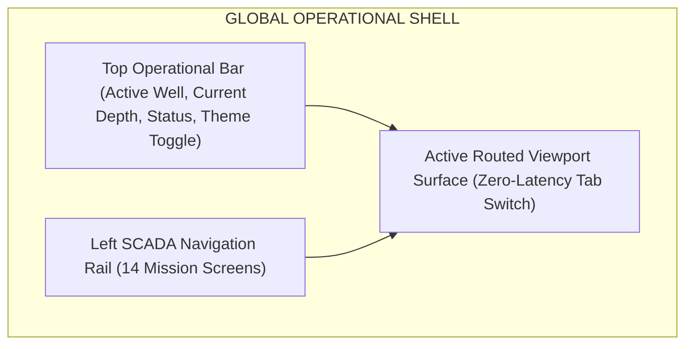

# Operational Cockpit & Dashboard Guide
### Comprehensive Interface Tour of all 14 SCADA Cockpit Screens, Controls, and Visual Indicators
**Interface:** Single-Page React Application (`/app/*`) | **Design System:** SCADA Industrial Dark/Light

---

## 1. Global Navigation & SCADA Layout Architecture

The eRTMAC-NWIS operational interface is engineered for high-density situational awareness, following the safety-critical layout standards of offshore drilling control cabins and central command monitoring rooms.

---

## 2. Walkthrough of the 14 Cockpit Interfaces

### 1. Executive Operations Dashboard (`/app`)
* **Purpose:** The high-level command summary providing real-time situational awareness across the entire active well catalog.
* **Key Widgets:**
  * Active rig status cards (Current MD, TVD, ROP, Active Formation).
  * 24-hour drilling timeline and active formation penetration gauge.
  * Real-time risk distribution radar across the 7 hazard families.
  * Recent critical alert ticker with direct jump-to-action buttons.

### 2. Operational Command Center (`/app/command-center`)
* **Purpose:** Unified split-screen cockpit bringing together real-time telemetry, 2D offset proximity, and ahead-of-bit risk projections on a single high-resolution canvas.
* **Key Controls:**
  * **LookAheadPanel:** Real-time indicator displaying the distance to the next predicted hazard corridor and remaining intervention minutes.
  * **Telemetry Strip:** Digital strip gauges for WOB, RPM, Torque, Standpipe Pressure, and Differential Flow Rate.

### 3. Live Drilling Telemetry (`/app/drilling`)
* **Purpose:** Continuous sensor visualization tracking real-time surface parameters and hydraulic trends.
* **Key Visuals:**
  * Multi-channel analog and digital gauge clusters.
  * High-frequency time-series graphs tracking Flow In vs. Flow Out balance.
  * Live bit depth indicator advancing with penetration rate.

### 4. Nearby Wells Explorer (`/app/wells`)
* **Purpose:** Complete well catalog directory and candidate offset inspection console.
* **Key Features:**
  * Multi-field selector covering all 14 catalog wells across 5 fields.
  * Radius filter slider dynamically updating offset candidate lists.
  * Complete well dossier displaying total depth, operator, spud date, casing shoe depths, and historical event summaries.
  * **"Set as Active Well"** button that synchronizes well selection across all 14 pages.

### 5. 2D Interactive Offset Map (`/app/offset-map`)
* **Purpose:** Geospatial mapping interface displaying real-world surface wellheads and spatial proximity buffers.
* **Key Controls:**
  * High-resolution satellite basemap overlay (Esri World Imagery).
  * Active well marker (High-visibility Brand Yellow) surrounded by a dynamic radius circle.
  * Offset well pins color-coded by DORS composite score (Green = High relevance, Grey = Low relevance).

### 6. 3D Subsurface Trajectory Globe (`/app/globe`)
* **Purpose:** Immersive 3D WebGL spatial view tracking wellbore trajectories penetrating geological strata.
* **Key Features:**
  * True Earth curvature globe with atmospheric raymarching.
  * Directional trajectory tubes colored by dogleg severity and inclination.
  * Stratigraphic formation bounding slices displaying subsurface layer dip.

### 7. Stratigraphic Cross-Well Correlation (`/app/correlation`)
* **Purpose:** Deep subsurface formation alignment comparing the active well directly with top-ranked offset analogues.
* **Key Panels:**
  * Side-by-side stratigraphic columns normalized by True Stratigraphic Depth ($\xi$).
  * Horizon alignment ribbons tracking formation dip across wells.
  * Historical risk markers displayed directly at their corresponding stratigraphic depth.

### 8. Predictive Risk Outlook (`/app/risk`)
* **Purpose:** Deep inspection console for the 4-Pillar Risk Fusion Model.
* **Key Features:**
  * Multi-hazard risk breakdown gauges (Mud Loss, Stuck Pipe, Kick, Instability, Torque Spike, Cementing).
  * Pillar contribution breakdown (Physics Rules 35%, Anomaly 20%, ML 30%, Offset 15%).
  * Honest model status indicators (`ACTIVE` vs. `UNFITTED_FALLBACK`).

### 9. Alerts & Advisory Console (`/app/alerts`)
* **Purpose:** Real-time alert dispatch console and historical audit log.
* **Key Tabs:**
  * **Active Advisories Tab:** Displays pending hazard corridors with grounded SPE/IADC mitigation protocols, lead distances, and acknowledgment buttons.
  * **Alert History Tab:** Persisted database audit log tracking all past alerts, timestamps, acknowledging drillers, and final resolutions.

### 10. Historical Knowledge Search (`/app/knowledge`)
* **Purpose:** Structured search interface over the institutional drilling memory repository.
* **Key Features:**
  * Filter dropdowns by Hazard Type, Formation, and Severity.
  * Real/Synthetic provenance badge per event.
  * **"View Source"** buttons opening authentic Daily Drilling Report PDFs.

### 11. Subsurface Agentic Copilot (`/app/copilot`)
* **Purpose:** Conversational domain AI assistant capable of answering natural-language engineering questions using grounded RAG.
* **Key Capabilities:**
  * Synthesizing complex multi-well operational questions.
  * Providing cited responses linking directly to source PDF pages.

### 12. Document Ingestion Studio (`/app/documents`)
* **Purpose:** Administrative console for uploading historical drilling PDFs and executing automated vision extraction.
* **Key Workflows:**
  * Drag-and-drop PDF upload with real-time job progress bar.
  * Side-by-side verification canvas comparing extracted tables with the original PDF.
  * Approve/Reject/Edit buttons triggering idempotent database sync.

### 13. Operational Scenario Simulator (`/app/simulator`)
* **Purpose:** High-fidelity simulation console for emergency training and evaluator demonstrations.
* **Key Scenarios:**
  * Injects controlled fault events (*e.g., severe fracture mud loss, high-pressure gas kick, pipe pack-off*).
  * Demonstrates real-time sensor response, ahead-of-bit warning trigger, and mitigation validation.

### 14. System Status & Diagnostics (`/app/status`)
* **Purpose:** Real-time health monitor inspecting all backend modules, databases, and model checkpoints.
* **Key Indicators:**
  * Module 01, 02, and 04/05 liveness indicators with round-trip latency.
  * Model fitting status matrix and vector index status.
  * PostgreSQL connection status and record counters.
