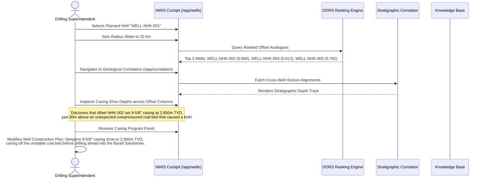

# Operational Field Workflows
### Step-by-Step Practical Engineering Scenarios for Rig-Site and Remote Center Teams
**Users:** Drilling Supervisors, Mud Engineers, eRTMAC Analysts | **Scenarios:** Pre-Spud, Live Drilling, Well Control, Ingestion

---

## 1. Scenario 1: Pre-Spud Planning & Casing Program Correlation

### Operational Context:
Before spudding an exploratory well (`WELL-NHK-001`) in the Nahorkatiya field, the drilling superintendent and casing design engineer must verify that the proposed casing shoe depths and mud weight program will safely isolate anticipated hazard zones.



---

## 2. Scenario 2: Real-Time Ahead-of-Bit Mud Loss Mitigation

### Operational Context:
Active well `WELL-NHK-001` is actively drilling ahead at $MD = 3,205\text{ m}$ in the Barail Sandstone at an average penetration rate of $ROP = 28\text{ m/hr}$.

```mermaid
sequenceDiagram
    actor Rig as Active Rig Telemetry
    participant Engine as Ahead-of-Bit Lookahead Engine
    participant Alert as Alert Advisory Console (/app/alerts)
    actor Driller as Rig Site Drilling Supervisor

    Rig->>Engine: 1 Hz Sensor Telemetry (MD: 3,205m, Flow In: 2,400 LPM, SPP: 2,800 psi)
    Engine->>Engine: Queries Offset Incidents in Lookahead Window (3,205m to 3,255m)
    Note over Engine: Found: 3 Severe Lost Circulation Events in Offset WELL-NHK-002<br/>occurring between 3,218m and 3,230m TVD
    Engine->>Engine: Calculates Lead Distance: 15.0 meters | Lead Time: 32.1 minutes
    Engine->>Alert: Broadcasts CRITICAL Ahead-of-Bit Alert
    Alert->>Driller: Flashing Red Banner + Audio Alert: "Hazard Corridor Ahead: Mud Loss at 3,220m"
    Driller->>Alert: Inspects Recommended SPE Mitigation Protocol
    Note over Driller: Protocol: (1) Stage 40 bbl LCM pill in slug pit;<br/>(2) Reduce pump rate from 2,400 to 2,000 LPM to lower dynamic ECD.
    Driller->>Driller: Directs mud crew to mix 30 ppb calcium carbonate LCM pill.
    Driller->>Alert: Clicks "Acknowledge & Stage Pill"
    Note over Driller,Rig: Bit enters loss zone at 3,220m: Minor seepage occurs (8 bbl),<br/>pre-mixed LCM pill is immediately spotted across the zone.<br/>Losses cured in 45 minutes without tripping pipe!
```

---

## 3. Scenario 3: Kick Detection & Well Control Advisory

### Operational Context:
Active well encounters an unexpected permeable fracture in an overpressured formation at $3,450\text{ m}$, resulting in formation gas influx.

```mermaid
sequenceDiagram
    actor Rig as Active Rig Sensor Feeds
    participant Fusion as 4-Pillar Risk Fusion Model
    participant Alert as Alerts & Advisory Console
    actor Toolpusher as Rig Toolpusher / Driller

    Rig->>Fusion: Telemetry: ROP jumps from 18 to 44 m/hr (Drilling Break)
    Rig->>Fusion: Active Pit Volume increases (+0.8 m³ in 2 minutes)
    Rig->>Fusion: Differential Flow: +140 LPM excess return flow
    Fusion->>Fusion: Pillar 1 Rules Trigger: Kick Influx Score = 1.000
    Fusion->>Fusion: Dynamic Fusion Score: R_H(t) = 0.985 (CRITICAL)
    Fusion->>Alert: Dispatches CRITICAL Well Control Alert
    Alert->>Toolpusher: "CRITICAL FORMATION INFLUX (KICK) DETECTED"
    Note over Toolpusher: Cockpit displays IADC WellSharp Space-Out Protocol:<br/>(1) Pick up drill pipe until tool joint is above rotary table;<br/>(2) Stop mud pumps and verify positive return flow;<br/>(3) Close annular preventer and record SIDPP / SICP.
    Toolpusher->>Toolpusher: Safely executes shut-in procedure within 90 seconds.
    Toolpusher->>Alert: Enters stabilized SIDPP = 350 psi, SICP = 420 psi
    Alert->>Toolpusher: Computes Kill Mud Weight (KMW = 11.8 ppg vs Current 11.2 ppg)
    Toolpusher->>Toolpusher: Successfully kills well using Driller's Method with zero surface gas release.
```

---

## 4. Scenario 4: Historical Document Ingestion & Institutional Handoff

### Operational Context:
An operational geologist uploads a scanned 1998 Daily Drilling Report for well `WELL-NHK-002` to expand the institutional memory database.

1. **Upload:** User navigates to `/app/documents` and drops `WELL-NHK-002_1998_DDR.pdf` onto the upload zone.
2. **Automated Processing:**
   * Tier 1 detects scanned raster pages and transfers execution to Tier 2 Docling Vision OCR.
   * Tier 3 extracts structured tables, identifying a previously unrecorded 35-barrel lost circulation event at $3,215.4\text{ m}$ in the Barail Sandstone.
   * Layer 5 validates mud density ($11.2\text{ ppg}$) and confirms depth consistency.
3. **Interactive Review:** The geologist inspects the side-by-side verification canvas. The extracted formation name *"Barail Sand"* and loss volume are verified.
4. **Approval & Knowledge Handoff:**
   * Geologist clicks **"Approve & Sync to Knowledge Base"**.
   * Backend executes an idempotent `UPSERT` into `drilling_events`.
   * SentenceTransformers generates a 384-dimensional vector embedding.
   * The new event immediately becomes searchable in Historical Search (`/app/knowledge`) and active in future ahead-of-bit lookahead corridors!
