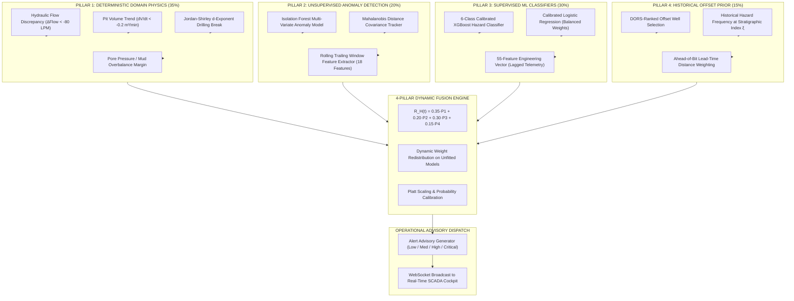

# Predictive Analytics & 4-Pillar Risk Fusion
### Multi-Signal Risk Architecture: Physics Rules, Unsupervised Anomaly Detection, Supervised XGBoost, and Offset Priors
**Modules:** `modules/02_nwis_backend/ml`, `modules/05_predictive_analytics` | **Fusion Engine:** `risk_fusion_engine.py`

---

## 1. The Multi-Signal Fusion Architecture

Predicting drilling hazards using pure black-box machine learning models is notoriously dangerous: real-world drilling datasets are characterized by extreme class imbalance ($< 0.1\%$ hazard positive events), sensor noise, and shifting baseline operations across different geological basins.

eRTMAC-NWIS overcomes these limitations with a **4-Pillar Multi-Signal Hybrid Risk Fusion Model**:

---

## 2. Mathematical Breakdown of the 4 Pillars

### Pillar 1: Deterministic Domain Physics & Operational Rules ($S_{\text{rules}}$)
Evaluates sharp boundary conditions governed by Navier-Stokes hydraulics, drillstring mechanics, and formation pore pressure curves:
* **Mud Loss Criterion:**
  $$S_{\text{loss}} = \max\left(0.0, \; \min\left(1.0, \; \frac{-(\Delta Flow_{\text{LPM}} + 30)}{150}\right)\right)$$
* **Overpressure Kick Criterion:**
  $$S_{\text{kick}} = \begin{cases}
  1.0 & \text{if } \Delta Flow > +50\text{ LPM and } \frac{dV_{pit}}{dt} > +0.15\text{ m}^3/\text{min} \\
  0.6 & \text{if } d_{\text{exp}} \text{ drops by } > 25\% \text{ (drilling break)} \\
  0.0 & \text{otherwise}
  \end{cases}$$

### Pillar 2: Unsupervised Anomaly Detection ($S_{\text{anomaly}}$)
Trained on nominal, incident-free drilling intervals. Over an 18-feature sliding window of 60 seconds (sampling rate 1 Hz), the **Isolation Forest** calculates the mean path length $h(x)$ across an ensemble of 100 isolation trees:

$$s(x, n) = 2^{-\frac{\mathbb{E}(h(x))}{c(n)}}$$

Where $c(n) = 2\left(\ln(n - 1) + 0.5772156649\right) - \frac{2(n - 1)}{n}$ is the average path length of unsuccessful searches in a binary search tree. A score $s(x, n) > 0.65$ indicates significant multivariate deviation from nominal drilling behavior.

### Pillar 3: Supervised Multi-Hazard Classification ($S_{\text{ML}}$)
* **Features ($X_t \in \mathbb{R}^{55}$):** Standpipe pressure rolling gradient ($\frac{dSPP}{dt}$), torque standard deviation, hookload overpull relative to free-hanging weight, mechanical specific energy ($MSE$), and d-exponent.
* **Algorithm:** Gradient boosted decision trees (**XGBoost**) trained with `multi:softprob` objective.
* **Class Imbalance Mitigation:** Synthetic Minority Over-sampling Technique (SMOTE) combined with inverse-class-frequency weighting:
  $$w_c = \frac{N_{\text{total}}}{K \times N_c}$$

### Pillar 4: Historical Stratigraphic Offset Prior ($S_{\text{offset}}$)
Measures the historical empirical probability of hazard $H$ occurring in the top-3 DORS-ranked offset wells at the current stratigraphic penetration coordinate $\xi$:

$$P_{\text{offset}}(H, \xi) = \frac{\sum_{w \in W_{\text{top}}} \text{DORS}(w) \cdot \mathbb{I}(H \in \text{Events}(w, \xi))}{\sum_{w \in W_{\text{top}}} \text{DORS}(w)}$$

---

## 3. Dynamic Weight Redistribution & Transparent Degradation

> [!IMPORTANT]
> **NO FABRICATED METRICS:**  
> When machine learning models have not been fitted on genuine field training data, NWIS never fabricates an artificial prediction score.

In `modules/05_predictive_analytics/predictive/risk_fusion_engine.py`, the system checks whether persistent model artifacts (`.joblib` or `.json`) exist on disk:
* If the Isolation Forest or XGBoost models are in `UNFITTED_FALLBACK` status:
  * The weights of the unfitted ML pillars are dynamically reassigned to **Pillar 1 (Deterministic Physics Rules)** and **Pillar 4 (Historical Offset Priors)**.
  * The API response explicitly flags `model_status: "UNFITTED_FALLBACK"`, and the cockpit displays an honest informational tooltip explaining that the risk evaluation is currently operating on audited physics rules and historical analog data.

---

## 4. Leakage Prevention & Rigorous Validation Methodology

To ensure technical validity before Smart India Hackathon evaluators, all predictive model training scripts enforce strict data leakage safeguards:
1. **GroupKFold by Well Identifier (Leave-One-Well-Out):** Training and validation sets are strictly split at the **well level**, never by random row-level shuffling. A model evaluated on `WELL-NHK-001` is trained exclusively on separate offset wells (`WELL-NHK-002`, `WELL-NHK-003`), proving that the algorithm learns true cross-well subsurface generalizability rather than memorizing local sensor traces.
2. **Causal Temporal Windows:** Feature extraction uses exclusively trailing time-series windows ($t - 60\text{ s}$ to $t$); future sensor data ($t + \Delta t$) is strictly masked to prevent temporal lookahead leakage.
