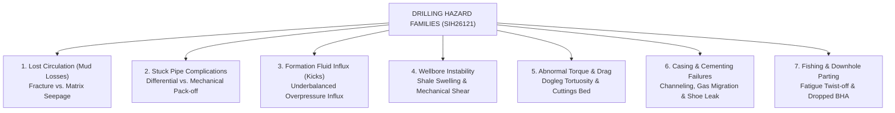

# Physical Drilling Risk Taxonomy
### Downhole Mechanics, Precursor Sensor Signatures, and Standardized SPE/IADC Mitigations
**Standard:** SPE (Society of Petroleum Engineers) Drilling Hazard Guidelines | **IADC** Non-Productive Time Standards

---

## 1. Overview: The 7 Downhole Hazard Families

Drilling complications arise from complex coupled interactions between drillstring mechanics, fluid hydraulics, rock mechanics, and in-situ formation pore pressures. eRTMAC-NWIS categorizes all drilling risks into 7 physical hazard families:

---

## 2. Granular Physical Breakdown

### 2.1 Lost Circulation (Mud Losses)
* **Physical Phenomenon:** Drilling fluid flows uncontrollably into the geological formation rather than circulating back up the annulus. Occurs when Equivalent Circulating Density (ECD) exceeds the formation fracture propagation pressure ($ECD > P_{frac}$) or when penetrating highly permeable vugular carbonates and depleted sandstone reservoirs.
* **Precursor Sensor Signatures:**
  * Sudden drop in return flow rate ($\Delta Flow = Flow_{out} - Flow_{in} < -50\text{ LPM}$).
  * Continuous loss in active mud pit volume ($\frac{dV_{pit}}{dt} < 0$).
  * Decrease in Standpipe Pressure ($SPP$) due to reduced hydrostatic column height in the annulus.
* **Historical Mitigation Playbook (SPE-Standard):**
  1. Halt drilling immediately; pull off bottom and rotate at low RPM to prevent differential sticking.
  2. Pump a 30 to 50 bbl Lost Circulation Material (LCM) pill containing graded calcium carbonate ($CaCO_3$), walnut shells, and mica flakes (25–40 ppb concentration).
  3. If losses continue, mix and spot a cross-linked polymer or thixotropic cement squeeze plug.

### 2.2 Stuck Pipe (Differential & Mechanical)
* **Physical Phenomenon:** Drillstring becomes immobilized downhole.
  * *Differential Sticking:* Drillstring rests against a thick, permeable filter cake across a depleted sand, where high overbalance pressure ($\Delta P = P_{hydrostatic} - P_{pore}$) pins the pipe against the wellbore wall.
  * *Mechanical Sticking:* Inadequate hole cleaning causes a cuttings bed to slide down around the BHA; or reactive swelling shale pinches the drillstring (pack-off).
* **Precursor Sensor Signatures:**
  * Increasing drag during pipe connections (hookload overpull $> 20\text{ klbs}$).
  * Erratic torque spikes while rotating off bottom.
  * Standpipe pressure escalation combined with reduced cuttings volume across the shale shakers.
* **Historical Mitigation Playbook:**
  1. Immediately work pipe: apply maximum allowable torque and fire downhole drilling jars up or down (opposite to the sticking direction).
  2. Spot a low-friction lubricating oil-based or ester-based pill around the BHA to break the filter cake seal.
  3. If pipe remains stuck after 12 hours of continuous jarring, run wireline free-point indicator and perform chemical string-shot backoff to recover drill collars.

### 2.3 Formation Fluid Influx (Well Kick)
* **Physical Phenomenon:** Formation pore pressure exceeds the hydrostatic pressure of the drilling mud column ($P_{pore} > P_{hydrostatic}$), resulting in an influx of formation water, gas, or crude oil into the wellbore. If unmitigated, a kick can escalate into a catastrophic surface blowout.
* **Precursor Sensor Signatures:**
  * Sudden drilling break: Rate of Penetration ($ROP$) jumps by $> 50\%$ without change in Weight-on-Bit ($WOB$).
  * Active pit volume gain ($\frac{dV_{pit}}{dt} > 0$).
  * Increase in flow out with mud pumps operating at constant speed.
  * Rapid escalation in background gas units detected by mud logging chromatograph.
* **Historical Mitigation Playbook (IADC WellSharp Protocol):**
  1. Execute space-out: pick up off bottom until the drill pipe tool joint is clear of the BOP rams; stop mud pumps; verify positive return flow.
  2. Shut in the well: close annular or pipe rams; open choke line to manifold; record stabilized Shut-In Drillpipe Pressure (SIDPP) and Shut-In Casing Pressure (SICP).
  3. Calculate Kill Mud Weight ($KMW$):
     $$KMW = MW_{\text{current}} + \frac{SIDPP}{0.052 \times TVD_{\text{ft}}}$$
  4. Circulate out influx using the **Driller's Method** (two-circulation cycle) or **Wait and Weight Method**.

### 2.4 Wellbore Instability (Washouts & Sloughing Shale)
* **Physical Phenomenon:** Borehole wall fractures, spalls, or caves into the wellbore due to high in-situ tectonic stresses, chemical reaction between water-based mud and smectite/illite shales, or mechanical erosion from high annular velocities.
* **Precursor Sensor Signatures:**
  * Massive splintery or blocky shale cavings observed on shale shaker screens.
  * Large discrepancies between bit diameter and 4-arm caliper log ($Caliper > Bit\text{ size} + 3\text{ inches}$).
  * Tight hole conditions requiring high overpull during tripping operations.
* **Historical Mitigation Playbook:**
  1. Increase drilling mud density to provide mechanical radial support against tectonic horizontal stress ($\sigma_H$).
  2. Add shale inhibitors: poly-potassium glycol (KCl-PHPA) to reduce osmotic hydration of swelling clays.
  3. Perform high-viscosity weighted sweeps every stand to maintain annular hole cleaning.

### 2.5 Abnormal Torque & Drag
* **Physical Phenomenon:** High frictional resistance between drillstring and wellbore wall caused by severe dogleg tortuosity, hole spiraling, or settling of cuttings beds on the low side of directional wellbores ($> 30^\circ$ inclination).
* **Precursor Sensor Signatures:**
  * Continuous exponential growth in rotary torque at constant RPM and WOB.
  * Inability to orient directional mud motor during slide drilling.
  * High friction factor ($f > 0.35$) in soft-string torque and drag models.
* **Historical Mitigation Playbook:**
  1. Circulate bottoms-up at maximum pump rate while rotating drillstring at 120 RPM to mobilize cuttings bed.
  2. Add 2% to 4% liquid drilling lubricant or glass beads to reduce friction coefficient.
  3. Ream tight sections with specialized roller reamers to smooth sharp dogleg transitions.

### 2.6 Casing & Cementing Complications
* **Physical Phenomenon:** Incomplete mud displacement leaving mud channels behind the casing, lost returns during high-density slurry pumping, or gas migration creating micro-annuli before cement sets, compromising zonal isolation.
* **Precursor Sensor Signatures:**
  * Losses observed during circulation prior to cementing.
  * Failure of casing shoe to pass Leak-Off Test (LOT) / Formation Integrity Test (FIT).
  * Low amplitude signals across Cement Bond Log (CBL) / Variable Density Log (VDL).
* **Historical Mitigation Playbook:**
  1. Optimize casing centralization (minimum standoff $> 80\%$) using rigid centralizers.
  2. Pump aggressive chemical wash and weighted spacer ahead of cement slurry.
  3. Perform high-pressure remedial squeeze cementing across unbonded intervals.

### 2.7 Fishing Operations (Parted Drillstring / Lost BHA)
* **Physical Phenomenon:** Catastrophic failure of drillstring components resulting from torsional fatigue, cyclic bending stress in high doglegs, twist-offs at pin/box connections, or dropped drill collars during pipe handling.
* **Precursor Sensor Signatures:**
  * Sudden instantaneous drop in Standpipe Pressure ($SPP$) with simultaneous loss of hook load.
  * Rotary torque drops to near-zero as top drive free-spins without BHA engagement.
* **Historical Mitigation Playbook:**
  1. Pull remaining drillstring to surface; inspect severed pin/box end to identify failure mode.
  2. Run impression block on wireline to determine top-of-fish orientation and dimensions.
  3. Make up overshot or spear assembly; engage fish; circulate mud and apply jarring tension to retrieve fish.
