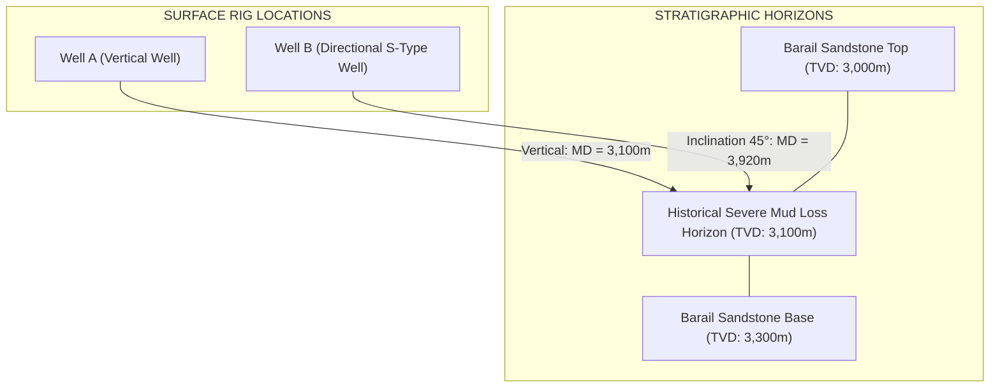

# Stratigraphic & Depth-Aware Cross-Well Correlation
### Minimum Curvature Survey Math, True Stratigraphic Depth, and Dimensionless Horizon Normalization ($\xi$)
**Engine:** `stratigraphic_correlator.py` | **Standard:** SPE Minimum Curvature Method | **API:** `/api/v2/corridors`, `/api/v2/stratigraphic_depth_track`

---

## 1. The "Trajectory Trap" in Subsurface Well Comparison

A fatal error in primitive drilling analysis systems is comparing wells directly using **Measured Depth (MD)**—the cumulative length of drill pipe run into the hole. 



In the diagram above:
* **Well A** is a strictly vertical well; it strikes the loss zone at **Measured Depth (MD) = 3,100 m**.
* **Well B** is an extended-reach directional well built at a $45^\circ$ inclination; it penetrates the identical loss zone at **Measured Depth (MD) = 3,920 m**.
* If a software system searches for historical events within a naive $\pm 50\text{ m MD}$ window around Well B's current depth of $3,100\text{ m}$, it will conclude that **zero events exist**, when in physical reality the bit is directly entering the exact same hazardous formation!

To eliminate this "trajectory trap", eRTMAC-NWIS implements a **three-stage coordinate normalization pipeline**:
1. Directional Survey Minimum Curvature 3D Integration ($MD \rightarrow TVD, N, E$).
2. Subsea Elevation Referencing ($TVD \rightarrow TVDSS$).
3. Dimensionless Stratigraphic Penetration Index ($\xi = d_{strat} / h_{formation}$).

---

## 2. Directional Survey Mathematics: The Minimum Curvature Method

The **Minimum Curvature Method** is the SPE-accepted industry standard for computing 3D wellbore coordinates between discrete directional survey stations $(MD_1, I_1, A_1)$ and $(MD_2, I_2, A_2)$, where $I$ represents inclination from vertical and $A$ represents azimuth from true north.

### 2.1 Dogleg Angle ($\beta$)
The total 3D angular change over the survey interval $\Delta MD = MD_2 - MD_1$ is:

$$\cos\beta = \cos(I_2 - I_1) - \sin(I_1)\sin(I_2)\left[1 - \cos(A_2 - A_1)\right]$$

$$\beta = \arccos\left(\text{clamp}(\cos\beta, -1.0, 1.0)\right)$$

### 2.2 Ratio Factor ($F$)
To account for the smooth circular arc connecting the two stations:

$$F = \begin{cases}
1.0 & \text{if } \beta < 10^{-6} \text{ radians (straight line)} \\
\frac{2}{\beta} \tan\left(\frac{\beta}{2}\right) & \text{otherwise}
\end{cases}$$

### 2.3 Incremental Coordinate Displacements
The incremental components of True Vertical Depth ($\Delta TVD$), Northing ($\Delta N$), and Easting ($\Delta E$) are calculated as:

$$\Delta TVD = \frac{\Delta MD}{2} \left[ \cos(I_1) + \cos(I_2) \right] \times F$$

$$\Delta N = \frac{\Delta MD}{2} \left[ \sin(I_1)\cos(A_1) + \sin(I_2)\cos(A_2) \right] \times F$$

$$\Delta E = \frac{\Delta MD}{2} \left[ \sin(I_1)\sin(A_1) + \sin(I_2)\sin(A_2) \right] \times F$$

Cumulative coordinates at any measured depth along the trajectory are calculated by continuous numerical integration across all survey stations:

$$TVD(s) = TVD_1 + \int_{s_1}^s \cos(I(u)) \, du$$

---

## 3. The Dimensionless Stratigraphic Penetration Index ($\xi$)

Geological formations vary in structural thickness across a basin due to depositional pinching, erosion, and tectonic faulting. A sand unit that is $200\text{ m}$ thick in the Baghjan field may thin to $120\text{ m}$ in the Moran field.

To correlate events regardless of structural thinning or thickening, NWIS defines the **Dimensionless Stratigraphic Index ($\xi$)**:

$$\xi(w, d) = \frac{\text{TVD}(w, d) - \text{Top}_{\text{TVD}}(F_k, w)}{\text{Base}_{\text{TVD}}(F_k, w) - \text{Top}_{\text{TVD}}(F_k, w)} \in [0.0, 1.0]$$

```text
ξ = 0.00  ===> Bit is exactly at the Formation Top (Entry Boundary)
ξ = 0.50  ===> Bit is exactly at the Middle of the Formation
ξ = 1.00  ===> Bit is exactly at the Formation Base (Exit Boundary)
ξ < 0.00  ===> Bit is in the overlying formation
ξ > 1.00  ===> Bit has penetrated into the underlying formation
```

### Horizon Alignment Algorithm:
When correlating the active well $a$ at depth $d_a$ with offset well $w$:
1. Determine active formation $F_k$ and compute $\xi_a = \xi(a, d_a)$.
2. Calculate the corresponding equivalent True Vertical Depth in offset well $w$:
   $$\text{TVD}_{\text{equivalent}}(w, \xi_a) = \text{Top}_{\text{TVD}}(F_k, w) + \xi_a \times \left[\text{Base}_{\text{TVD}}(F_k, w) - \text{Top}_{\text{TVD}}(F_k, w)\right]$$
3. Query all historical events $e \in \text{Events}(w)$ whose stratigraphic index satisfies:
   $$|\xi(w, d_e) - \xi_a| \le \Delta\xi_{\text{tolerance}} \quad (\text{default: } \Delta\xi = 0.08)$$

---

## 4. Worked Numerical Example: Cross-Well Alignment

### Scenario Setup:
* **Active Well:** `WELL-NHK-001` (Drilling active at $MD = 3,420\text{ m}$, Inclination $I = 28^\circ$, Barail Sandstone Top at $3,150\text{ m TVD}$, Base at $3,450\text{ m TVD}$, Thickness $H_a = 300\text{ m}$).
* **Offset Well:** `WELL-NHK-002` (Drilled at $MD = 3,850\text{ m}$, Inclination $I = 42^\circ$, Barail Sandstone Top at $3,280\text{ m TVD}$, Base at $3,500\text{ m TVD}$, Thickness $H_w = 220\text{ m}$).
* **Historical Event:** Severe differential sticking occurred in `WELL-NHK-002` at $MD = 3,680\text{ m}$ ($TVD = 3,346\text{ m}$).

### Step 1: Compute Stratigraphic Penetration of the Historical Event
$$\xi_{\text{event}} = \frac{3,346\text{ m} - 3,280\text{ m}}{3,500\text{ m} - 3,280\text{ m}} = \frac{66\text{ m}}{220\text{ m}} = 0.300 \quad (30\% \text{ into Barail})$$

### Step 2: Project Event into Active Well Coordinate Frame
To determine the exact True Vertical Depth where this hazard will manifest in `WELL-NHK-001`:

$$\text{TVD}_{\text{projected}} = \text{Top}_{\text{TVD}}(Barail, a) + \xi_{\text{event}} \times H_a$$

$$\text{TVD}_{\text{projected}} = 3,150\text{ m} + 0.300 \times 300\text{ m} = 3,240.0\text{ m TVD}$$

### Step 3: Compute Active Well Measured Depth (MD) Lookahead
Using `WELL-NHK-001`'s directional survey profile, solving for $TVD = 3,240\text{ m}$ yields:

$$MD_{\text{projected}} = 3,485.2\text{ m MD}$$

Current active bit depth is $3,420.0\text{ m MD}$. Therefore, the remaining distance to the hazard zone is:

$$\Delta D_{\text{lead}} = 3,485.2\text{ m} - 3,420.0\text{ m} = 65.2\text{ meters}$$

At the current drilling penetration rate of $ROP = 30\text{ m/hr}$, the drilling team has:

$$T_{\text{lead}} = \frac{65.2\text{ m}}{30\text{ m/hr}} \times 60 \approx \mathbf{130 \text{ minutes of operational lead time}}$$

This worked example demonstrates how NWIS eliminates the trajectory trap and provides the driller with more than two hours of advance warning to optimize mud conditioning before reaching the sticking zone.
