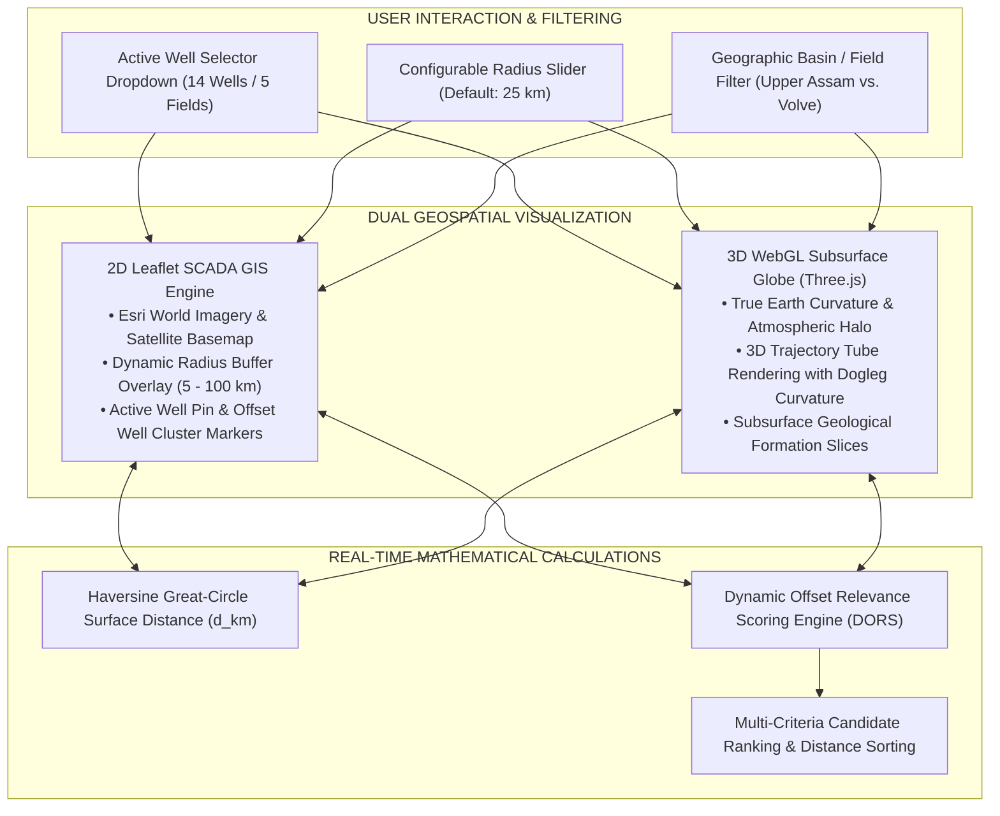
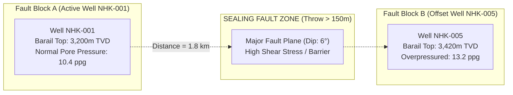

# Geospatial Offset-Well Discovery
### Interactive 2D Leaflet GIS, 3D Subsurface WebGL Globe, and Dynamic Candidate Filtering
**Module:** `frontend/src/pages/NearbyWellsPage.tsx`, `frontend/src/pages/GlobeMapPage.tsx` | **Engine:** `dors_engine.py`

---

## 1. Multi-Dimensional Geospatial Discovery

In modern directional well planning, finding offset wells requires visualizing both surface operational logistics (*e.g., rig pad locations, river crossings, infrastructure*) and deep subsurface trajectories (*e.g., kick-off points, building sections, horizontal pay-zone intervals*).

eRTMAC-NWIS delivers a **synchronized dual-perspective geospatial engine**:



---

## 2. Mathematical Distance Estimation: The Haversine Equation

To accurately calculate the great-circle surface separation between the active rig coordinates and historical offset wellheads across the spherical geoid:

Let $(\phi_1, \lambda_1)$ be the latitude and longitude of the active well, and $(\phi_2, \lambda_2)$ be the coordinates of candidate offset well $w$ in radians:

$$\Delta\phi = \phi_2 - \phi_1, \quad \Delta\lambda = \lambda_2 - \lambda_1$$

The central angle $\Delta\sigma$ is computed via:

$$a = \sin^2\left(\frac{\Delta\phi}{2}\right) + \cos(\phi_1)\cos(\phi_2)\sin^2\left(\frac{\Delta\lambda}{2}\right)$$

$$d(w, a) = 2 R_{\text{earth}} \arcsin\left(\sqrt{\max(0.0, a)}\right)$$

Where volumetric mean Earth radius $R_{\text{earth}} = 6,371.0\text{ km}$.

### The Spatial Proximity Sub-Score ($S_{\text{spatial}}$):
Within the DORS framework, physical distance is mapped to a normalized linear decay score bounded by the operator's configured search radius $R_{\max}$:

$$S_{\text{spatial}}(w) = \max\left(0.0, \; 1.0 - \frac{d(w, a)}{R_{\max}}\right)$$

```text
Distance d = 0 km   ===> S_spatial = 1.000  (Co-located pad well / slot)
Distance d = 12.5 km (at R_max=25km) ===> S_spatial = 0.500
Distance d >= 25 km ===> S_spatial = 0.000  (Outside configured radius)
```

---

## 3. Structural Fault Boundary Detection & Dip-Slip Penalisations

A core innovation in NWIS is the **Structural Fault-Boundary Heuristic**. In tectonic compressional basins like Upper Assam, crossing a major fault boundary often places the active well into an entirely different pressure and fluid block.



### Fault Penalty Formulation:
For an assumed regional structural formation dip angle $\theta_{\text{dip}} \approx 6.0^\circ$ and maximum allowable stratigraphic vertical throw margin $\Delta z_{\text{margin}} = 150.0\text{ m}$:

$$\Delta z_{\text{expected}} = d(w, a) \times 1000 \times \tan(\theta_{\text{dip}})$$

$$\Delta z_{\text{actual}} = \left| \text{Top}_{\text{TVD}}(F_k, w) - \text{Top}_{\text{TVD}}(F_k, a) \right|$$

If $\Delta z_{\text{actual}} > \Delta z_{\text{expected}} + \Delta z_{\text{margin}}$, the system detects a **Possible Structural Fault Discontinuity**. A multiplicative penalty factor $\lambda_{\text{fault}} = 0.20$ is automatically applied to the total DORS score, preventing an engineer from being misled by a geographically close well that resides on the opposite side of a sealing fault.
