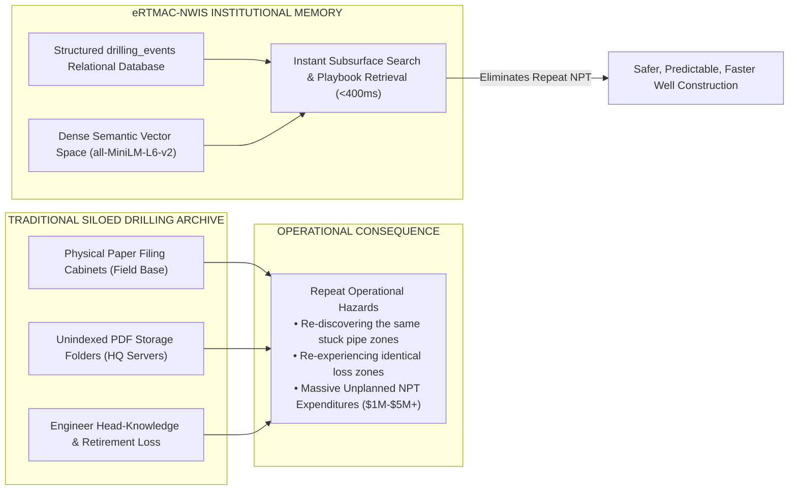
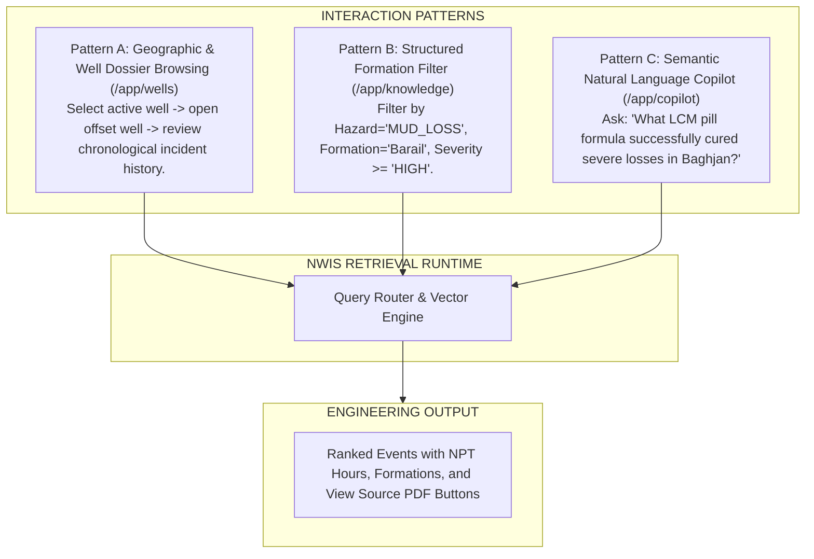

# Historical Drilling Events & Institutional Memory
### Structured Complication Taxonomies, Non-Productive Time (NPT) Mitigation Records, and Reusable Subsurface Experience
**Module:** `modules/02_nwis_backend` | **Table:** `drilling_events` | **Standard:** IADC Incident Classification Codes

---

## 1. The Institutional Memory Deficit in Upstream Drilling

A pervasive operational problem in the oil and gas industry is the loss of institutional memory. When experienced drilling supervisors, mud engineers, and superintendents retire or rotate to other operating concessions, their hard-won knowledge of regional downhole behaviors often leaves with them.



---

## 2. Structured Historical Event Taxonomy

In eRTMAC-NWIS, historical drilling complications are classified into 7 standardized industrial hazard families:

| Hazard Family | Code | Physical Operational Indicator | Standard IADC Code | Typical NPT Duration |
|---|---|---|---|---|
| **Lost Circulation (Mud Loss)** | `MUD_LOSS` | Sudden decrease in return flow, drop in active pit volume, standpipe pressure decrease. | Code 07 (Lost Circulation) | 8 to 48 Hours |
| **Stuck Pipe (Differential / Mech)** | `STUCK_PIPE` | Inability to pull or rotate drillstring, overpull exceeding safe tensile yield, erratic torque. | Code 08 (Stuck Pipe) | 12 to 120 Hours |
| **Formation Fluid Influx (Kick)** | `KICK` | Pit volume gain, positive flow with pumps stopped, drilling break, sudden background gas increase. | Code 09 (Well Control) | 18 to 96 Hours |
| **Wellbore Instability (Washout/Collapse)** | `WELLBORE_INSTABILITY` | Excessive cavings on shaker screens, hole pack-off, erratic torque, tight hole on connections. | Code 10 (Hole Cleaning / Instability) | 6 to 36 Hours |
| **Abnormal Torque & Drag** | `TORQUE_SPIKE` | Sudden exponential torque spikes, extreme rotational drag, inability to slide with steerable motor. | Code 11 (Torque & Drag / Friction) | 4 to 24 Hours |
| **Casing & Cementing Complications** | `CEMENTING_FAILURE` | Cement lost returns, poor cement bond log (CBL) isolation, casing shoe failure during leak-off test. | Code 12 (Casing & Cementing) | 24 to 160 Hours |
| **Fishing Operations** | `FISHING` | Parted drill pipe, twisted-off BHA, dropped cone/cutter in hole, magnetic retrieval runs. | Code 14 (Fishing Operations) | 48 to 300+ Hours |

---

## 3. The Anatomy of an NWIS Historical Event Record

To provide complete technical fidelity, every event in the repository is stored as a rich, multi-dimensional entity:

```typescript
interface DrillingEvent {
  event_id: string;               // e.g. "EVT-VOLVE-15-9-F-12-003"
  well_id: string;                // e.g. "15/9-F-12"
  hazard_type: HazardType;        // MUD_LOSS | STUCK_PIPE | KICK | ...
  severity: "LOW" | "MEDIUM" | "HIGH" | "CRITICAL";
  start_depth_md_m: number;       // e.g. 3215.4
  end_depth_md_m: number;         // e.g. 3230.0
  start_depth_tvd_m: number;      // e.g. 2894.2 (True Vertical Depth)
  formation_name: string;         // e.g. "Hugin Formation"
  iadc_code?: string;             // e.g. "07"
  npt_hours: number;              // e.g. 18.5
  cost_estimate_usd?: number;     // e.g. 145000.0
  precursor_indicators: {
    rop_break: boolean;           // Sudden ROP jump preceding event
    torque_fluctuation: boolean;  // Erratic torque oscillations
    flow_discrepancy_lpm: number; // e.g. -220.0 (losses) or +150.0 (kick)
    pit_volume_change_m3: number; // e.g. -4.2 m3
  };
  description: string;            // Detailed narrative from driller's log
  mitigation_summary: string;     // Exact remedial chemicals, volumes, pressures
  mitigation_success: boolean;    // Did the mitigation cure the problem?
  source_document: string;        // PDF document filename
  source_page: number;            // Page number in source PDF
  source_type: "REAL" | "SYNTHETIC" | "SIMULATED";
}
```

---

## 4. Querying & Retrieval Workflows

Drilling engineers can interrogate the institutional memory bank through three distinct interaction patterns:



### Direct Evidence Verification:
Every event displayed in the cockpit features a **"View Source"** button. Clicking this button immediately renders the underlying source document in the embedded PDF.js viewer, navigating directly to the exact page where the original driller recorded the remarks. If a source document is unavailable, the system displays an honest informational notice rather than fabricating a viewer.
