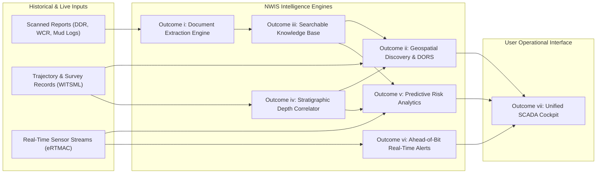
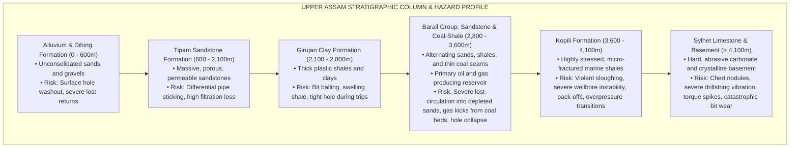

# Official Problem Statement: SIH26121
### eRTMAC-NWIS (Nearby Wells Intelligence System): AI-Powered Offset-Well Knowledge & Decision Support for Drilling Operations
**Organization:** Oil India Limited (OIL) | **Theme:** Smart Automation | **Category:** Software

---

## 1. Official Problem Statement Text

### 1.1 Verbatim Description
> **Problem Statement Title:** eRTMAC-NWIS (Nearby Wells Intelligence System): An AI-Powered Offset Well Knowledge and Decision Support Platform for Drilling Operations  
> **Problem Statement ID:** 26121  
> **Organization:** Oil India Limited (OIL)  
> **Category:** Software | **Theme:** Smart Automation  
>
> **Background & Context:**  
> During drilling operations, accessing historical knowledge and operational experiences from nearby or offset wells is critical for anticipating potential drilling hazards, optimizing drilling parameters, and preventing non-productive time (NPT). Currently, historical drilling data, well completion reports, daily drilling reports (DDR), mud logging records, and geological formation details are scattered across disparate reports, databases, and document archives.
>
> When drilling a new well, engineers and drilling supervisors often lack an automated, intelligent mechanism to quickly identify nearby wells, correlate operational events (such as mud losses, stuck pipe incidents, kicks, high torque/drag, or cementing complications), and extract actionable lessons learned that are relevant to the current depth, geological formation, and operational context.
>
> **Objective:**  
> To develop an AI-powered Nearby Wells Intelligence System (NWIS) that integrates seamlessly with Oil India Limited's real-time drilling monitoring environment (eRTMAC - Real Time Data Monitoring and Analysis Centre). The system must automatically extract, structure, and correlate historical drilling knowledge, provide geospatial visualization of offset wells, perform cross-well geological and operational correlation, and deliver proactive, predictive alerts and mitigation recommendations to drilling engineers in real time.

---

## 2. Expected Outcomes & Deliverables (Requirements i–vii)

The problem statement explicitly specifies seven core deliverables that any complete solution must demonstrate:

### Detailed Functional Breakdown:

#### Outcome i: AI, NLP, OCR, and Data Analytics for Historical Reports
* **The Challenge:** Historical records span decades of paper scans, heterogeneous digital PDFs, varying driller handwriting, non-standard tabular layouts, and inconsistent technical terminology.
* **Intended Capability:** Automated ingestion pipeline that converts raw PDFs into verified, structured JSON representations. The system must capture:
  * Well header data (Well Name, Operator, Field, Spud Date, Completion Date, Surface Coordinates, KB elevation).
  * Stratigraphic tops and lithology descriptions with top/bottom depths.
  * Operational timelines and Daily Drilling Report summaries.
  * Documented drilling hazards (Mud Loss, Stuck Pipe, Kick, Hole Instability, Torque Spike, Cement Failure, Fishing).
  * Recorded operational parameters prior to the event (Depth, WOB, RPM, Mud Weight, ECD, Flow Rate, Standpipe Pressure).
  * Remedial actions taken, mitigation materials applied, and final operational outcome.
  * Non-Productive Time (NPT) duration and financial/operational impact.

#### Outcome ii: Interactive Map-Based Geospatial Visualization of Nearby Wells
* **The Challenge:** Drilling engineers need to visualize spatial proximity immediately while maintaining awareness of subsurface structural trends.
* **Intended Capability:** High-performance 2D and 3D geospatial visualization:
  * Geospatial radius filtering with user-definable distance thresholds ($5\text{ km} \le R_{max} \le 100\text{ km}$).
  * Clear visual distinction between the active well and candidate offset wells.
  * Real-time calculation of true great-circle surface distances using the Haversine equation.
  * Direct well dossier inspection (trajectory profile, casing shoe depths, penetrated formations, documented incidents).
  * Multi-dimensional relevance ranking (DORS) alongside the geographic map.

#### Outcome iii: Searchable Knowledge Repository of Events, Lessons, and Mitigations
* **The Challenge:** Drilling expertise is lost when experienced engineers retire or transfer; crews repeatedly encounter the same downhole problems that were solved a decade earlier in a neighboring well.
* **Intended Capability:** Institutional memory bank enabling plain-language natural query answering:
  * Free-text semantic search capable of resolving drilling synonyms (*e.g., "lost returns" $\leftrightarrow$ "mud loss" $\leftrightarrow$ "fluid seepage"*).
  * Multi-attribute structured filtering (by hazard type, severity level, formation name, depth range, field name, IADC code).
  * Strict evidence provenance: Every retrieved event links directly to the exact source PDF document and page number.
  * Explicit provenance indicators distinguishing real field observations from synthetic test fixtures.

#### Outcome iv: Cross-Well Geological, Drilling, and Reservoir Correlation
* **The Challenge:** Comparing wells based on raw surface-measured depth (MD) creates severe errors because of wellbore trajectory inclination, dogleg severity, and regional geological layer dip.
* **Intended Capability:** Three-dimensional subsurface correlation:
  * Trajectory conversion: Measured Depth (MD) to True Vertical Depth (TVD) and Subsea TVD (TVDSS) using the Minimum Curvature Method.
  * True Stratigraphic Depth (TSD) normalization: Dimensionless formation-relative penetration index ($\xi = \frac{d - d_{top}}{d_{base} - d_{top}}$).
  * Horizon alignment displaying side-by-side stratigraphic columns of the active well and top-ranked offset analogs.
  * Identification of structural fault offsets, dipping formations, and stratigraphic thickness variations across the basin.

#### Outcome v: Predictive Analytics Models for Drilling Risks
* **The Challenge:** Threshold-only sensor alarms produce frequent false alarms, leading to alarm fatigue on the drill floor.
* **Intended Capability:** Multi-signal hybrid risk prediction:
  * Physics-based deterministic rule evaluation (pore pressure vs. mud hydrostatic overbalance, delta flow discrepancies, d-exponent drilling breaks).
  * Unsupervised anomaly detection identifying multi-variate parameter drift before human perception.
  * Supervised machine learning classification estimating hazard probabilities from historical feature correlations.
  * Offset prior integration: Weighting real-time risk by the historical occurrence frequency of hazards in offset wells at the corresponding stratigraphic interval.

#### Outcome vi: Real-Time Alerts and Actionable Mitigation Recommendations
* **The Challenge:** Warnings must be provided with sufficient operational lead time to allow the drilling crew to adjust mud properties, circulate hole, or alter drilling parameters before the bit strikes the hazard zone.
* **Intended Capability:** Proactive decision support:
  * Ahead-of-Bit Risk Corridor Engine forward-projecting 15 to 50 meters ahead of the active drill bit.
  * Dynamic operational lead time $T_{\text{lead}} = \frac{\Delta \text{Depth}}{\text{ROP}} \times 60$ (typically **15 to 45 minutes** at typical drilling penetration rates of 20–35 m/hr).
  * Standardized mitigation playbooks aligned with SPE (Society of Petroleum Engineers) and IADC (International Association of Drilling Contractors) best practices.
  * Operator acknowledgment, mitigation execution logging, and audit trail generation.

#### Outcome vii: Unified Dashboard for Field and Office Personnel
* **The Challenge:** Disconnected standalone tools create friction between field personnel on the rig floor and central subsurface monitoring engineers in the town office.
* **Intended Capability:** A single unified SCADA cockpit serving:
  * **Rig-Site Drilling Supervisors:** Clear, zero-clutter situational awareness, large digital gauges, immediate ahead-of-bit danger warnings, and step-by-step mitigation checklists.
  * **eRTMAC Monitoring Analysts & Geologists:** Deep cross-well correlation tracks, multi-well parameter comparison charts, raw telemetry inspectors, and document review consoles.

---

## 3. Operational Context: The Upper Assam Basin

Oil India Limited's operational heartland lies within the **Assam-Arakan Basin (Upper Assam Shelf)**. The geological column in this province presents well-documented drilling challenges:

### The Strategic Value of Offset Correlation in Upper Assam:
In fields like **Baghjan, Nahorkatiya, and Moran**, the Barail and Kopili intervals are notoriously complex:
* Depleted Barail reservoir sands frequently have pore pressure gradients as low as **0.42 psi/ft (8.1 ppg equivalent)**, while overlying or interbedded shales require **0.55 psi/ft (10.6 ppg)** mud weight to prevent mechanical collapse.
* This narrow mud-weight drilling window means that an engineer drilling an active well without instant awareness of offset loss and kick events is navigating blind through a high-stakes operational minefield.
* **eRTMAC-NWIS provides the exact illumination required to drill these complex wells safely, on time, and on budget.**
