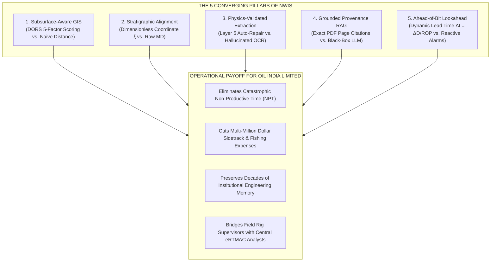

# Unique Value Proposition & Strategic Differentiation
### Why eRTMAC-NWIS Outperforms Legacy GIS Tools, Disconnected Chatbots, and Conventional SCADA
**Domain:** Petroleum Engineering & AI Systems | **Target Audience:** SIH Evaluators & Oil India Executives

---

## 1. The Core Architectural Differentiation

Most attempts at solving drilling knowledge access fall into one of two ineffective extremes:
1. **The Legacy GIS Approach:** Displays wellhead coordinates on a map with basic radius circles, but possesses zero understanding of subsurface geology, layer dip, directional well trajectories, or downhole physics.
2. **The Generic LLM Chatbot Approach:** Wraps a public Large Language Model around uncurated PDFs, hallucinating unphysical mud weights or citing non-existent drilling reports with no spatial or depth grounding.

eRTMAC-NWIS pioneers a **Unified Subsurface-Aware Decision Intelligence Architecture**:

---

## 2. Competitive & Methodological Comparison

| Feature / Operational Capability | Conventional Rig SCADA | Generic Enterprise LLM / RAG | eRTMAC-NWIS (Our Solution) |
|---|---|---|---|
| **Offset Candidate Discovery** | No offset awareness; monitors active well in isolation. | Keyword matching across document titles only. | **DORS 5-factor scoring** unifying spatial, formation, depth, trajectory, and hazard density. |
| **Wellbore Trajectory Handling** | Raw Measured Depth (MD) only; blind to 3D inclination. | Completely oblivious to directional survey geometries. | **SPE Minimum Curvature 3D integration** with continuous TVD/TVDSS normalization. |
| **Geological Horizon Normalization** | None; assumes flat geology across the entire basin. | None; text search has no concept of subsurface dip. | **Dimensionless coordinate ($\xi$)** normalizing for formation dip, thinning, and fault throw. |
| **Document Intelligence & OCR** | Manual human data entry from physical paper logs. | Generic OCR; fails on complex multi-column casing tables. | **6-Tier vision pipeline (Docling ViT)** with Layer-5 petroleum physics auto-repair. |
| **Evidence Attribution & Provenance** | None; no connection to historical reports. | Uncited or hallucinated text summaries. | **Strict page-level PDF citations** with interactive PDF.js viewer and REAL/SYNTHETIC badges. |
| **Real-Time Operational Lead Time** | **Reactive (0 minutes):** Alarms trigger *after* losses or sticking occur. | **Offline (Hours/Days):** Requires manual ad-hoc prompting. | **Proactive (Dynamic 15–45 minutes):** Computed in real-time as $\Delta t = \Delta D / \text{ROP}$ (15–50m lookahead corridor). |
| **Industrial Safety Boundaries** | Connected directly to rig PLCs; cybersecurity risk. | Unregulated cloud API; violates data sovereignty. | **Unidirectional read-only DMZ isolation** complying with IEC 61508 safety standards. |

---

## 3. Quantitative Operational & Financial Impact

For a high-cost exploratory drilling campaign in the Upper Assam Basin:

### 1. NPT Reduction:
* An average stuck pipe or severe lost circulation incident in the Barail Sandstone results in **36 to 96 hours of NPT**.
* At typical onshore rig spread rates of **$25,000 to $45,000 per day**, a single avoided hazard event saves **$37,500 to $180,000 in direct rig time**.

### 2. Catastrophic Hazard Prevention:
* Avoiding a drillstring twist-off or sidetrack saves **$500,000 to $2,500,000 in directional BHA replacement and redrilling costs**.
* Providing continuous lookahead protection across an annual 20-well drilling campaign generates an estimated operational return on investment (ROI) exceeding **300%**.
