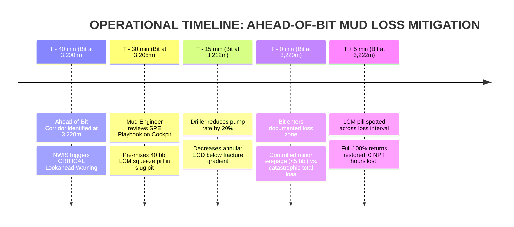
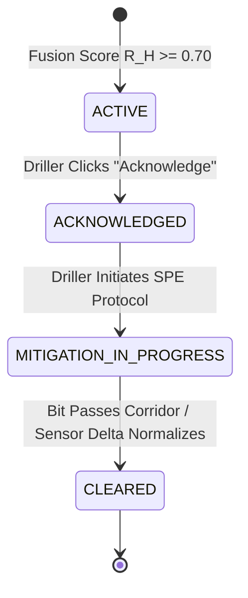

# Ahead-of-Bit Lookahead Alerts & Actionable Advisories
### Predictive Risk Corridors, Lead-Time Dynamics, and SPE/IADC Standard Mitigation Protocols
**Module:** `modules/02_nwis_backend/engines/risk_corridor_engine.py` | **UI:** `frontend/src/pages/AlertsAdvisoryPage.tsx`

---

## 1. The Operational Imperative: Proactive vs. Reactive Drilling

Traditional drilling instrumentation is almost entirely **reactive**:
* A pit alarm sounds *after* 20 barrels of drilling mud have already drained into a fracture zone.
* A torque alarm sounds *after* the drill collars have already become mechanically locked in swelling shale.

At modern rotary table speeds, reacting *after* an incident manifests leaves the drilling crew with seconds to avoid catastrophic equipment loss. **eRTMAC-NWIS transforms drilling operations from reactive fire-fighting into proactive navigation.**



---

## 2. Mathematical Definition of a Risk Corridor ($\mathcal{C}_k$)

A **Historical Risk Corridor** $\mathcal{C}_k = [D_{\text{start}}, D_{\text{end}}]$ represents a discrete subsurface depth interval where offset wells demonstrated a statistically significant concentration of drilling complications.

Let $\mathcal{E}_{\text{offset}}$ be the set of historical events recorded across the top-ranked DORS offset wells $W_{\text{top}}$ within the same stratigraphic formation $F_k$:

$$D_{\text{start}}(\mathcal{C}_k) = \min_{e \in \mathcal{E}} d_{\text{start}}(e) - \delta_{\text{buffer}}$$

$$D_{\text{end}}(\mathcal{C}_k) = \max_{e \in \mathcal{E}} d_{\text{end}}(e) + \delta_{\text{buffer}}$$

Where depth safety buffer $\delta_{\text{buffer}} = 10.0\text{ meters}$.

### Ahead-of-Bit Lead-Time Distance ($\Delta D_{\text{lead}}$):
Given the active bit's current measured depth $d_{\text{current}}$:

$$\Delta D_{\text{lead}} = D_{\text{start}}(\mathcal{C}_k) - d_{\text{current}}$$

### Operational Warning States:
```text
State 1: SAFE (GREEN)
  ΔD_lead > 50 meters
  Nominal drilling parameters; background monitoring active.

State 2: ADVISORY (YELLOW)
  25 meters < ΔD_lead <= 50 meters
  Pre-hazard alert; crew reviews offset historical mitigation summaries.

State 3: CRITICAL LOOKAHEAD (FLASHING RED)
  0 meters < ΔD_lead <= 25 meters
  Immediate ahead-of-bit warning; prepare mitigation materials (LCM / Lubricant / Kill Mud).

State 4: INSIDE ACTIVE HAZARD ZONE (DEEP RED)
  d_current >= D_start and d_current <= D_end
  Active complication interval; monitor real-time delta flow and torque for instant response.
```

---

## 3. Operational Lead-Time Formulation

The remaining operational intervention window $T_{\text{lead}}$ in minutes is a direct function of current Rate of Penetration ($ROP$):

$$T_{\text{lead}} = \frac{D_{\text{start}}(\mathcal{C}_k) - d_{\text{current}}}{\max(5.0, \; ROP_{\text{current}})} \times 60 \text{ minutes}$$

```text
At typical ROP = 25 m/hr:
  ΔD_lead = 20 m ===> Lead Time = (20 / 25) * 60 = 48.0 minutes
  ΔD_lead = 15 m ===> Lead Time = (15 / 25) * 60 = 36.0 minutes

At fast ROP = 45 m/hr:
  ΔD_lead = 25 m ===> Lead Time = (25 / 45) * 60 = 33.3 minutes
```

This dynamic operational window (typically **15 to 45 minutes**, computed in real time from live eRTMAC WITSML telemetry) provides the drilling superintendent, toolpusher, and mud engineer the indispensable operational lead time required to condition drilling fluids or stage downhole tools.

---

## 4. Alert Lifecycle, Acknowledgment & Audit Logging

Every alert emitted by the predictive engine transitions through a formal, auditable lifecycle:



### Actionable Mitigation Playbooks:
Unlike generic monitoring alarms that display a raw warning text without guidance, every NWIS alert is paired with a standardized, authoritative **SPE/IADC Mitigation Protocol**:

```text
┌─────────────────────────────────────────────────────────────────────────────────┐
│ ALERT: CRITICAL AHEAD-OF-BIT HAZARD CORRIDOR (LEAD: 18.2 METERS / 38 MINUTES)   │
│ HAZARD: SEVERE MUD LOSS (FRACTURED BARAIL SANDSTONE) | WELL: WELL-NHK-001      │
├─────────────────────────────────────────────────────────────────────────────────┤
│ Historical Evidence:                                                            │
│ 3 offset wells (NHK-002, NHK-003, NHK-005) experienced severe lost circulation  │
│ between 3,218m and 3,235m TVD (Average NPT: 16.5 hours).                        │
│                                                                                 │
│ Recommended SPE/IADC Operational Playbook:                                      │
│ 1. Reduce rotary speed from 120 RPM to 60 RPM to minimize dynamic ECD peaks.    │
│ 2. Stage 45 bbl LCM pill containing 30 ppb calcium carbonate blend in slug pit. │
│ 3. Throttle mud pump flow rate from 2,600 LPM to 2,100 LPM.                     │
│ 4. Set flow paddle alarm threshold to ±30 LPM.                                  │
│                                                                                 │
│ [ ACKNOWLEDGE ALERT ]    [ VIEW SOURCE PDF EVIDENCE ]    [ EXECUTE MITIGATION ] │
└─────────────────────────────────────────────────────────────────────────────────┘
```

### Immutable Audit Trail:
When an operator acknowledges an alert or initiates mitigation, the action is written to the canonical PostgreSQL `alerts` table with an authenticated timestamp, operator user ID, and active well depth, establishing an unalterable operational record for regulatory compliance and post-well reviews.
